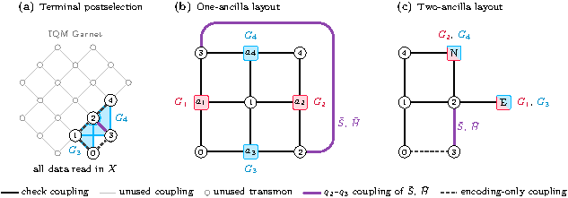

# Logical randomized benchmarking with error detection (LRB-D)

[](https://github.com/Sohan100/LRB-Simulations-sdim/actions/workflows/tests.yml)

We benchmark the logical Clifford gates of a small error-detecting code, the folded `[[5,1,2]]`
surface code, for qutrits and for qubits. Every logical Clifford is followed by a stabilizer
check, shots that fail a check are discarded, and the decay of the rest gives the logical error per
Clifford. Comparing it with physical randomized benchmarking under the same noise gives the
pseudo-threshold `p*`: below it, the encoded qudit beats the bare one. All circuits are simulated
with [sdim](https://arxiv.org/abs/2511.12777) 1.4.0 under the SI1000 and SD6 circuit-level noise
models.



## Results

Pseudo-thresholds with a check after every logical Clifford (`k = 1`), one standard error in
brackets:

| layout | qutrits | qutrit SI1000 | qutrit SD6 | qubit SI1000 | qubit SD6 |
|---|---|---|---|---|---|
| one-ancilla, five-moment round | 9 | 0.0313(6) | 0.0501(26) | 0.0123(4) | 0.0290(10) |
| two-ancilla | 7 | 0.0191(4) | 0.0206(4) | 0.00511(15) | 0.00854(18) |

On the one-ancilla layout the qutrit code's `p*` is 2.6 times the qubit code's under SI1000 and
1.7 times under SD6. Each layout page in [`layouts/`](layouts/) has `k = 1` to `4` and the earlier
layouts. The canonical tables are `LRB-experiment-data-slurm/comparisons/pseudo-thresholds-*-current.md`.

The code is the distance-2 member of the folded surface code. In
[`layouts/folded-surface-code/`](layouts/folded-surface-code/) we lay that family out with
nearest-neighbour couplers for every distance and simulate it as a memory: it matches the rotated
surface code's threshold, needs 10 to 30% more qubits for the same memory, and does a logical H for
free and a logical S for about half a round.

## What is where

| folder | what |
|---|---|
| [`src/lrb/`](src/lrb/) | the package: codes and layouts, circuit generation, simulation, fits and plots |
| [`scripts/`](scripts/) | command-line tools for making, running, validating and comparing campaigns |
| [`slurm/`](slurm/) | cluster launchers |
| [`tests/`](tests/) | the test suite |
| [`notebooks/`](notebooks/) | one notebook per campaign, numbered in the order we ran them |
| [`layouts/`](layouts/) | one page per hardware layout, and the folded surface code at any distance |
| [`studies/`](studies/) | side studies, each with its own report |
| [`manuscript/`](manuscript/) | the paper: the current simulation and hardware versions and the Overleaf history |
| [`LRB-experiment-data-slurm/`](LRB-experiment-data-slurm/) | run results and the cross-run comparisons |
| [`docs/`](docs/) | the simulation model and how to run a campaign |

## Getting started

```bash
git clone https://github.com/Sohan100/LRB-Simulations-sdim.git
cd LRB-Simulations-sdim
python -m venv .venv && source .venv/bin/activate
pip install -e ".[dev]"
pytest
```

A small run, from the repository root:

```bash
python scripts/generate_circuits_folded.py --ancilla-mode single-prod5b --noise-model si1000 \
  --custom-name quickstart --n-cliff 2 --depths 0,2 --n-shots 2000 \
  --probabilities 0.0,0.005 --stab-checks-const 0 --stab-checks-unif 1
python scripts/run_lrb_experiment.py <Run-folder printed above> 1
```

[`docs/running-simulations.md`](docs/running-simulations.md) walks through a production campaign
on SLURM, and [`docs/simulation-model.md`](docs/simulation-model.md) states exactly what is
simulated.

## The package

| module | what |
|---|---|
| `code_definitions.py` | the codes and their circuits: Clifford gates, encoders, check rounds for every layout, logical readout |
| `code_simulation_profiles.py` | the registry from a `code_name` to its code, unpackers and dimensions |
| `circuit_generator.py` | RB and LRB-D circuits with SI1000/SD6 noise and moment scheduling |
| `experiment_setup.py` | run folders and circuit export |
| `lrb_simulation.py`, `dem_simulation.py`, `detector_events.py` | simulation, postselection and checkpointing |
| `lrb_plotting.py`, `lrb_gif_plotting.py`, `pooled_lrb_fits.py` | fits, pseudo-thresholds, plots |
| `clifford_recovery.py` | the compiled recovery Clifford |

## Citing

If you use this code or its results, please cite the repository (`CITATION.cff`) and the sdim
paper: A. Kabir et al., "Sdim: A Qudit Stabilizer Simulator", arXiv:2511.12777 (2025).

## License

GPL-3.0; see [`LICENSE`](LICENSE).
