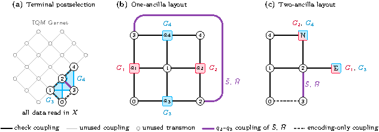

# Layouts

The folded `[[5,1,2]]` code needs its logical S and H to act on the pair `q2-q3`, and its checks
need ancillas wired to the data. How the qutrits sit on a chip decides which couplers exist, how deep
a check round is, and what the pseudo-thresholds come out as. This folder has one page per layout we
simulated, plus the folded surface code at any distance.

| layout | qutrits | couplers | check round | p*(k = 1), qutrit, SI1000 / SD6 | status |
|---|---|---|---|---|---|
| [terminal check on IQM Garnet](garnet-terminal-check/) | 5 | 5 of Garnet's 30 | final X readout only | (terminal LRB-D) | in the paper, panel (a) |
| [one-ancilla](one-ancilla/) | 9 | 13 (one long-range) | 5 gate moments | 0.0313(6) / 0.0501(26) | in the paper, panel (b) |
| [two-ancilla](two-ancilla/) | 7 | 8, square lattice | 19 gate moments | 0.0191(4) / 0.0206(4) | in the paper, panel (c) |
| [conventional-site two-ancilla](conventional-site-two-ancilla/) | 9 | 12, nearest neighbour | 11 gate moments | 0.0266(4) / 0.0283(7) | replaced by the two-ancilla layout |
| [relay two-ancilla](relay-two-ancilla/) | 11 | local | | 0.0288(6) / 0.0360(13) | superseded |
| [candidates](candidates/) (A1, 2a, square, SQ14) | 7 to 9 | 7 to 10 | | | not run in production |
| [folded surface code, any d](folded-surface-code/) | `(2d-1)^2` | `(d-1)(9d-5)` | 8 (SD6) or 11 (SI1000) moments | memory study instead of LRB-D | scaling study |

`p*(k)` is the pseudo-threshold for a check every `k` logical gates, with one standard error from
the sequence bootstrap. Each layout page lists all of `k = 1` to `4`, for qutrits and qubits. The
one-ancilla row is the five-moment round; the layout's earlier seven-moment round gives
0.0292(6) / 0.0399(15).

## Shared figures

| file | what |
|---|---|
| `figures/three-layouts.pdf` | the paper's figure of the three layouts |
| `figures/encoders.pdf` | the encoding circuits of the three layouts |
| `figures/check-rounds.pdf` | the check rounds of the one-ancilla (a to d) and two-ancilla (e to h) layouts |
| `figures/layouts-and-circuits-overview.pdf` | five pages: each layout with its encoder, check round and moment table |
| `figures/layouts-and-circuits.pdf` | the same drawings without text |

`figures/source/` holds the TikZ and quantikz sources of the first three, and of
`two-ancilla/two-ancilla-layout.pdf` and `two-ancilla-check-round.pdf`; each compiles on its own
(`latexmk -pdf <file>.tex`) and reproduces the figure the paper includes. The code for every layout is
in `src/lrb/code_definitions.py` (classes) and `src/lrb/code_simulation_profiles.py` (the
`code_name` profiles that the generator and the runs use).
