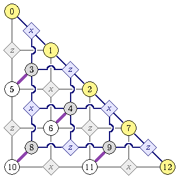

# Folded surface code: a nearest-neighbour layout for every distance

This folder scales the paper's five-qudit code up. The `[[5,1,2]]` code is the distance-2 member of
the folded surface code: the unrotated surface code `[[d^2 + (d-1)^2, 1, d]]` folded along its
diagonal, whose logical H and S are fold-transversal (Moussa 2016). Folding brings `(d-1)^2` pairs
of data qubits together, and each pair needs a two-qubit gate for the logical S. In the unfolded
patch the partners of a pair sit up to `2 sqrt(2) (d-1) a` apart. Here they sit `a/sqrt(2)` apart.



`layout-note.pdf` is the full write-up (8 pages). In short:

- **Layout.** The lower half of the patch stays on a square lattice of pitch `a` (the bottom
  layer). The mirror image of the upper half sits on the cell centres (the top layer). The fold
  qubits belong to both layers. Couplers have length `a` within a layer and `a/sqrt(2)` between a
  site and the layer above it. The two layers cross at `2(d-1)(2d-3)` points, always two couplers at
  right angles at their midpoints, which an air bridge or a flip-chip stack can carry.
- **Size.** `(2d-1)^2` qubits in a right triangle with legs `(2d-2) a`. Growing d by one adds two
  rows and moves nothing, so a chip built for distance d also runs every smaller distance on a corner
  of itself. `dorito-chip.pdf` (the "Dorito chip") outlines the distance-2 and distance-3 codes on
  the distance-5 chip; its numbers are the distance-5 labels.
- **Against Moussa's planar layout.** There every site holds one qudit of each half, and with
  nearest-neighbour gates every round needs a pairwise swap of all top and bottom qudits. Here each
  half keeps its own ancillas, so a round is the ordinary one with no swaps; the price is the
  crossovers.
- **Hardware needs.** Two coupler lengths, five couplers on most data qubits, one kind of
  crossover, three frequency groups. The SWAPs of logical H are a relabelling of the two layers.
- **Labels.** At d = 2 the numbering is the paper's (fold qubits 0, 1, 4; pair 2-3). At d = 3 it is
  the 13-qubit sketch this work started from. For d >= 4 it is a convention.
- **Memory.** Under SD6 and SI1000 the thresholds match the rotated surface code's, and a teraquop
  memory needs 10 to 30% more qubits. In exchange a logical H between rounds is free and a logical S
  costs about half a round. See [`memory/README.md`](memory/README.md).

## Files

| file | what |
|---|---|
| `layout-note.tex`, `layout-note.pdf` | the write-up |
| `gen_layout.py` | builds and checks the layout for any d; writes `data/` and `figures/` |
| `layout-d2.pdf` ... `layout-d6.pdf` | the layout alone, one page per distance (`layout-d<d>.tex`) |
| `dorito-chip.pdf`, `dorito_chip.py` | the distance-5 chip with the distance-2 and distance-3 codes outlined |
| `data/layout-d<d>.json` | every qubit (coordinates, role, partner), ancilla (check, data qubits, qudit exponents), coupler and crossover |
| `data/summary.json` | counts and check results for every d |
| `figures/` | TikZ sources; `layout-style.tex` holds the styles |
| `memory/` | the memory study |

`gen_layout.py` checks, for d = 2 to 6: all counts against their formulas; that the checks commute
and encode one qudit for qubits and qutrits; that the fold maps X checks onto Z checks; that the
fold-transversal H and S preserve the stabilizer group and act as logical H and S; the coupler
lengths and crossovers; planarity (only at d = 2); that each distance contains the previous one;
the frequency groups; and the layer-exchange symmetry. For d <= 5 it confirms the distance by
exhaustive search.

```bash
python layouts/folded-surface-code/gen_layout.py 8        # data up to d = 8, figures up to d = 6
cd layouts/folded-surface-code && latexmk -pdf layout-note.tex
```
