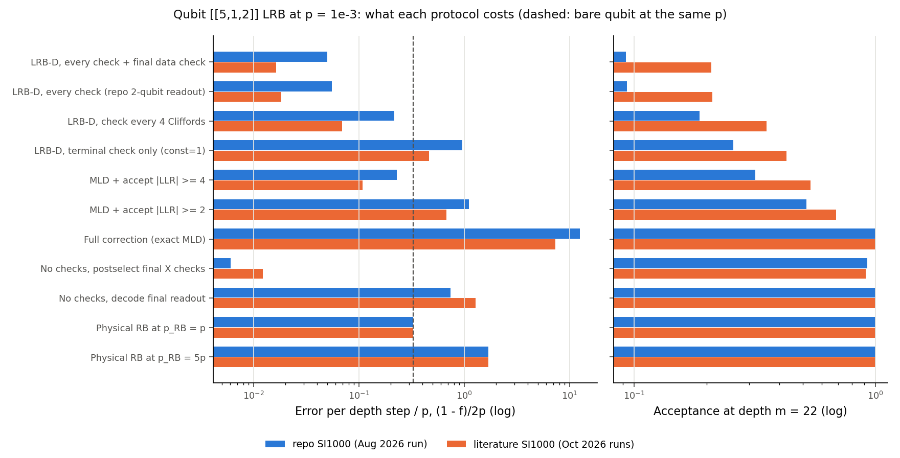

# Correction instead of detection in logical RB on the qubit [[5,1,2]] code

Status: DRAFT, round 2. It integrates work packages A–E, H and J and the lead
analyses. F (non-Markovianity, dense depths), G (distance-3 surface code),
I (erasure, leakage, flags) and K (Steane) are pending, and the adversarial
verifications are still running.

**What "the qubit code" means here.** It is the qubit counterpart of the
`[[5,1,2]]_3` folded surface code this repository simulates with `sdim`: the
distance-2 unrotated (planar) surface code on five data qubits.

- Checks: `Z0Z1Z3`, `Z1Z2Z4`, `X0X1X2`, `X1X3X4`, one ancilla each.
- Logical operators: `X_L = X0X3`, `Z_L = Z0Z2`.
- Logical H (fold-transversal) is `SWAP(2,3)` followed by transversal H.
- Logical S is S on {0,4}, S† on 1, and `CZ(2,3)`.

The protocol, the noise, the `const`/`unif` policies and the grid mirror the
August 2026 qutrit production run
`Run-2026-08-04-23-58-49-folded_qutrit-single-ancilla-si1000`. Nothing found
suggests that another qubit code was meant.

On 2026-10-28 you moved the qutrit production runs to literature-exact SI1000
with ASAP scheduling, resets before checks, and physical RB compared at the
same p. Every headline below is therefore checked under both noise models
(§7).

**Claim labels**:

- **[VA]** verified analytically.
- **[VN]** verified numerically: reproducible from this worktree, and checked
  by an independent verifier agent where marked ✔.
- **[LIT]** from literature, with fetched and verified citations in §12.
- **[C]** conjecture.

---

## 1. Executive summary



*At p = 1e-3: error per depth step and acceptance at depth 22 for every
protocol, under the repo's SI1000 (blue) and literature SI1000 (orange). The
dashed line is a bare qubit at the same p.*

### Q1. Which decoders work, and how well against LRB-D?

1. **Full correction does not pay off at distance 2** [VN, VA]. Exact
   maximum-likelihood decoding (MLD) over every check round leaves a logical
   error of about 12–15p per depth step under the repo's SI1000, and about
   7–8p under literature SI1000. That is first order in p.
   - Physical RB has about 0.34p per step at p_RB = p and 1.7p at the repo's
     p_RB = 5p.
   - So correction is 20–40× worse than a bare qubit at the same p, and 4–9×
     worse at the repo's 5p convention.
   - No decoder or noise model changes the verdict, and no p has a
     pseudo-threshold.
2. **What correction can buy at d=2 is exactly computable, and it is mostly
   time-like** [VA, VN; §4]. Measurement, reset and ancilla faults are
   corrected perfectly at first order. They cause 29% of LRB-D's first-order
   rejections, and 67% of the rejected weight lies in syndrome classes that
   are uniquely decodable at first order. The residual error is dominated by
   data qubits idling while ancillas are read out, and it is symmetric within
   the coset pairs that distance 2 cannot resolve.
3. **The right decoder is exact MLD with soft-output acceptance** [VA, LIT,
   VN ✔(E)]:
   - accept a shot when |LLR| ≥ t, which is Chow's optimal reject rule;
   - LRB-D with every check (`unif=1`) is exactly the most conservative point
     of this family, keeping the same shots in 1,414 of 1,414 circuits;
   - every sparser LRB-D policy is dominated: by 1.0–6.9× at the same
     information, and by 3–15× once the full terminal readout is used.

   The MLD runs on a 32-state transfer matrix over time slots; it is exact
   and costs about 1–9 µs per shot in vectorized batches.
4. **Decoder ranking** (§5).
   1. Exact MLD with a gap threshold.
   2. A decoder-free time-like rule, within 1.26× of the frontier.
   3. A sliding-window lookup table: w = 3 is within about 0.8 percentage
      points of MLD, and every w ≥ 2 is exact at first order. Its table
      lookups suit an FPGA [C].
   4. BP+OSD and BP+LSD, within about 0.7–1.4 points, but only with
      non-default settings.
   5. Matching and union-find. On average over sequences, matching is worse
      than no decoding at d=2: 24.5p against 21.2p per step at first order,
      reproduced on 20 new sequences. At depth 2, matching beats no decoding
      on about half of individual sequences.
5. **Removing checks beats correcting with them** [VN ✔(H, J)].
   - Under the repo's SI1000, a protocol with no mid-circuit checks that
     decodes only the final five-qubit readout reaches 0.74p per step. That
     beats physical RB at 5p, but not at p, and loses to it under literature
     SI1000 (1.28p).
   - At first order, checks would need to be about 500–1700× quieter than
     SI1000 (±25% from sequence sampling) before they helped decoded LRB
     [VN ✔(H)].

6. **Distance 3 is necessary but not sufficient** [VN, work packages G and
   K, verification pending]. Correction becomes second order and beats a
   bare qubit at the same p only with all of the following:
   - fault-tolerant extraction (flags for the Steane code's weight-4 checks);
   - parallel ancilla readout;
   - a decoder that handles the fold-transversal S gate's hyperedges (exact
     MLD or BP-OSD, not PyMatching);
   - p below about 2–3e-4.

   Pseudo-thresholds at the same p are 3.3e-4 (Steane with flags) and
   1.9e-4 (the [[13,1,3]] surface code). The repo's sequential readout pushes
   them about 5× lower, or off the grid. Detection keeps the lower accepted
   error at both distances. With d ≥ 3, the soft-output rule gives the best of
   both: on the Steane code at p = 1e-3, |LLR| ≥ 4 has half the bare qubit's
   error per step and keeps 99.25% of shots per step.

### Q2. Does correction mitigate non-Markovianity?

**Yes, operationally, but because it removes postselection, not because it
decodes** [VN, VA; §6].

- **Corrected LRB is Markovian.** Exact-MLD-corrected LRB decays as a single
  exponential at every p tested (drift ρ = 0.01–0.05, goodness-of-fit p ≥
  0.5).
- **LRB-D is not.** Its sparse or depth-dependent policies (`const=k`,
  `const=0`) are strongly non-Markovian (ρ = 1.1–4.0). For `const=1` at
  p = 1e-3, f drifts from 0.9977 to 0.9834 with depth.
- **Even dense LRB-D (`unif=1`) is slightly curved** (ρ ≈ 0.08). The exact
  cause is fault pairs in the repo's unchecked mirror-inverse half; checking
  that half removes the curvature.
- **The decoder is not what produces the Markovian shape.** An undecoded,
  unpostselected null control is just as Markovian. MLD keeps that shape and
  lowers the rate, which stays first order in p.
- **Correction can reintroduce non-Markovianity.** A fixed soft-output
  threshold t forces F(m) ≥ tanh(t/2), and a decoder that sees only a
  policy's sparse rounds has ρ = 0.13–0.25.

### Q3. A sustainable hardware protocol

Detailed in §8.

1. Read all five data qubits in X at the end, not two. This removes a 4.53p
   undetectable logical floor [VN ✔(A)].
2. Record every syndrome and decode offline in the Pauli frame. Clifford-only
   LRB needs no feedback; this is exact [VA, VN ✔(D)].
3. Report the (acceptance, fidelity) frontier from exact MLD's soft output,
   not only a single postselected f.
4. On IQM-class square lattices, run the benchmark check-free on a native
   (2,3) layout. Use check-round circuits only for DEM calibration, since
   checks make d=2 correction worse. If checks run, skip resets and read the
   ancillas out in parallel [VN ✔(H, J)].
5. A distance-2 lookup-table decoder fits easily in FPGA memory. Real-time
   decoding is only needed for feed-forward, for non-Clifford gates, or to
   abort rejected shots early (35–88% QPU-time saving on platforms that
   support it).
6. Genuine correction needs d ≥ 3 with fault-tolerant extraction, or erasure
   heralds that also cover idle errors.
   - On the Steane code with flags and parallel readout, correction beats a
     bare qubit below p ≈ 3.3e-4 (same-p comparison), and |LLR| ≥ 4 halves
     the bare qubit's error at p = 1e-3 while keeping 99% of shots per step.
   - On d=2, heralding gate and idle errors cuts the decoded error by
     75–83%.
   - On the [[13,1,3]] surface code with parallel readout and BP-OSD,
     correction beats a bare qubit below p ≈ 1.9e-4 (same p). With the
     repo's sequential readout there is no pseudo-threshold on the grid, and
     PyMatching fails across the fold-transversal S gate.

---

## 2. The qubit model and its validation

Code: `src/lrb_qubit/`.

| module | contents |
|---|---|
| `code.py` | code, logical gates, 24-Clifford catalog |
| `circuits.py` | repo-SI1000 builder |
| `circuits_lit.py` | literature-SI1000 builder |
| `baseline.py` | LRB-D policies |
| `mld.py` | exact MLD |
| `exact.py` | exact LRB-D and null curves |
| `experiment.py` | grid runner |
| `fits.py` | repo fits plus bootstrap |

Tests: `tests/test_lrb_qubit_model.py` (64 pass) and nine `tests/test_qubit512_*.py`
files from the work packages.

- **Circuits** [VN] mirror `LRBCircuitGenerator.generate_lrb_clifford_sequence`
  gate for gate:
  1. ideal encoding of |+>_L;
  2. for each forward Clifford: the Clifford, a full noisy check round, then
     an ancilla reset;
  3. mirror-style individual inverses with no checks;
  4. a final check round with no reset after it;
  5. an ideal X readout.
- **Repo SI1000 on qubits:**
  - one-qubit gates: DEPOLARIZE1(0.1p) after;
  - two-qubit gates: DEPOLARIZE2(p) after;
  - each measurement is its own layer, with DEPOLARIZE1(2p) on every other
    wire and, on the measured wire, DEPOLARIZE1(p) then X_ERROR(5p);
  - reset layer: DEPOLARIZE1(2p) on the other wires, X_ERROR(2p) after.
- **Validation** [VN]:
  - the catalog is the full Clifford group, and every inverse inverts;
  - the encoder prepares |+>_L;
  - the logical gates preserve the stabilizers with + signs and act correctly
    on X_L and Z_L;
  - noiseless circuits are deterministic;
  - raw syndromes reconstructed from difference detectors equal the sampled
    ancilla records bit for bit;
  - `used_rounds` equals the repo's `postselect_*` functions;
  - the circuit-level distance is 2 with the five-qubit readout.
- **Independent cross-check through the repo's own pipeline** [VN ✔(A)].
  1. A qubit `LRBCodeDefinition` was built for the repo's
     `LRBCircuitGenerator(noise_model='si1000')` at sdim dimension 2.
  2. 108 generated circuits were translated gate for gate to Stim.
  3. Their detector error models (DEMs) are identical to the lead's to the
     last bit.
  4. 1,130 two-sample sampling tests against sdim's frame simulator show
     nothing significant after Holm/BH correction.
  5. The independent verifier rebuilt 84 more circuits (new sequences, new p,
     all 24 descriptors) and found them gate- and noise-identical. It also
     tested the production run's own DEM sampler (`lrb.dem_simulation`):
     χ² 174.8 on 152 degrees of freedom, p = 0.10.
- **Exact MLD** [VA, VN]. Every DEM mechanism touches at most two consecutive
  time slots, so P(syndrome, L) is a transfer-matrix sweep over 32 states. It
  matches brute force to 4e-15 in the LLR, and its soft output is calibrated
  (χ² 17/20, and 2 of 4,979 bins beyond 3σ). Two independent implementations
  (work packages C and E) reproduce it.

## 3. LRB-D baseline and side findings

**Main grid** [VN]: `results/grid_main/`, `results/summary/`, figures 1–3.

- 30 sequences, depths 0,2,4,6,10,14,18,20,22, the 15 qutrit probabilities.
- 1e6 shots per circuit for LRB-D, and 3e5 decoded shots on the same samples.

| method, error per depth step (1−f)/2 ÷ p | p = 1e-4 | 1e-3 | 2e-3 | 5e-3 | 1e-2 | A(22) at 1e-3 |
|---|---|---|---|---|---|---|
| LRB-D unif=1 (repo two-qubit readout) | 0.0045 | 0.056 | 0.13 | 0.40 | 1.16 | 0.094 |
| LRB-D unif=1 + final data check | 0.0045 | 0.050 | 0.11 | 0.32 | 0.85 | 0.093 |
| LRB-D unif=4 | 0.019 | 0.22 | 0.49 | 1.66 | 4.75 | 0.187 |
| LRB-D const=1 | 0.13 | 0.96 | 2.2 | 9.6 | 11 | 0.258 |
| full exact MLD | 11.9 | 12.5 | 13.1 | 14.2 | 14.9 | 1 |
| MLD, accept \|LLR\| ≥ 4 | 0.092 | 0.23 | 0.27 | 0.37 | – | 0.318 |
| no checks, postselect ideal final X checks (`const=0`) | 0.00075 | 0.0061 | 0.011 | 0.029 | 0.058 | 0.925 |
| no checks, decode final readout | 0.74 | 0.74 | 0.74 | 0.74 | 0.74 | 1 |
| physical RB, p_RB = p (first order: 61/180 = 0.339) | 0.339 | 0.339 | 0.339 | 0.339 | 0.339 | 1 |
| physical RB, p_RB = 5p (offset 0) | 1.70 | 1.70 | 1.69 | 1.69 | 1.67 | 1 |

Side findings that also matter for the qutrit pipeline:

1. **The repo's two-qubit terminal readout leaks an undetectable logical**
   [VN ✔(A), VA].
   - The ordinary readout measures only data 0 and 3. Z faults reaching data
     0 or 3 after their last X-check coupling in the terminal round flip the
     logical with no detection event. That covers idle noise during the
     sequential X-ancilla measurements, plus two CNOT locations.
   - The leaked mass is exactly [1 − (1 − 8p/3)³(1 − 16p/15)]/2, which is
     68p/15 = 4.53p at small p and the same at every depth. The repo's own
     sdim circuits show it too. It is 48p/15 with one parallel
     measurement layer, and 3.7p under literature SI1000.
   - It caps every acceptance rule's accepted fidelity near 1 − 9p. Reading
     all five data qubits removes it at no physical cost.
   - The qutrit pipeline has the same structure [C].
2. **The repo's free-offset physical-RB fit is biased at low p** [VN]. F(m)
   is nearly flat there, and the offset trades off against f: at p = 1e-4 it
   reports 20p instead of 1.7p. For |<Z>|, which decays to 0, fit with the
   offset fixed at 0.
3. **Latent repo hazards** [VN ✔(A); none affects the production runs].
   - `generate_lrb_clifford_sequence` builds wrong inverses if handed a
     pre-sampled Clifford list longer than max(depths).
   - The unpack specs default to `dimension=3`.
   - An unsorted `depths` list would mislabel circuits: the generator sorts,
     but the runtime reads file k as `depths[k]`.
   - The sdim gate aliases `S`, `MZ` and `MR` silently receive no SI1000
     noise, and sdim's `R` is Hadamard, not reset.
   - sdim's detector parser evaluates `rec[1]+rec[0]` as the constant 0.
   - After `read_circuit`, two-qubit noise carries a 15/16 depolarizing
     default unless `ensure_noise_params` runs.

   The verifier's notes (`notes/A-sdim-crosscheck.verify.md`) list suggested
   fixes R1–R6.
4. **The repo protocol executes every check round, whatever the policy.**
   Physically executing only the rounds a policy uses is much better
   [VN ✔(H), exact]. For example, `const=1` at p = 5e-3, m = 22 goes from
   F = 0.024 at acceptance 0.063 to F = 0.931 at acceptance 0.461.
   Fitted f values here depend on the fit, because these curves are not
   exponential.

## 4. What correction can buy at distance 2: the exact fault census

`studies/correction-decoders/qubit/scripts/first_order.py` and `studies/correction-decoders/qubit/scripts/lit_variant.py census`;
notes L0 §4 and L1. Group single DEM mechanisms by symptom s, with P0 (P1)
the weight that leaves (flips) the logical. Then:

- LRB-D's first-order rejection is R1 = Σ(P0+P1).
- Exact MLD's first-order error is E1 = Σ min(P0, P1).
- LRB-D's accepted error is A2 = Σ P0·P1, at second order.

All three are exact coefficients [VA].

| per depth step (30 sequences) | repo SI1000 | literature SI1000 |
|---|---|---|
| R1, LRB-D rejection | 105p | 68.5p |
| E1, exact-MLD error | 11.8p | 7.0p |
| A2, LRB-D accepted error | 48p² | 16.4p² |
| data2 undetectable floor (depth-independent) | 4.53p | 3.73p |

| repo SI1000 term, depth 22 | R1/p | E1/p |
|---|---|---|
| data idle during the 4 sequential ancilla measurements (2p) | 1093 | 168 |
| ancilla measurement flip (5p) | 460 | **0** |
| two-qubit gate depolarizing (p) | 329 | 47 |
| data idle during reset (2p) | 220 | 40 |
| reset flip (2p) | 176 | **0** |
| measured-ancilla depolarizing (p) | 61 | **0** |
| one-qubit gate depolarizing (0.1p) | 42 | 5 |

- **Free to correct.** Every time-like fault is corrected exactly at first
  order. 66.6% of R1 is in classes with min(P0, P1) = 0, and 24.5% is in
  genuinely ambiguous classes, where the cosets are within a factor of 10.
- **Rejecting only the ambiguous classes** leaves E1 = 7.7p at m = 22, against
  270p for full correction, and keeps 75% of what LRB-D throws away [VN].
- **Why d=2 can't do better.** The ambiguous classes are X0/X3, X2/X4,
  Z0/Z2 and Z3/Z4. On top of these come circuit-level aliases of qubit-1
  faults: noise on the fold gates produces X2X3, Z2Z3 and Y2Y3, which share
  qubit-1 syndromes but differ by a logical [VA, VN ✔(E)]. Correction can
  only bet on the likelier member of each pair.
- **Matching decoders are worse than no decoding.** MLD's whole gain over no
  decoding comes from nonlinear inference across the X and Z syndromes (Y
  faults). That is why matching decoders, which split the two, do worse than
  no decoding (§5) [VN ✔(B)].

## 5. Decoders: ranked recommendations

| rank | decoder / acceptance rule | performance vs exact MLD (same shots) | cost | use |
|---|---|---|---|---|
| 1 | **Exact MLD, transfer matrix** (`mld.py`) | reference; calibrated soft output ✔(C, E) | 1–9 µs/shot in numpy batches on one core | offline decoding of every LRB dataset |
| 1 | **MLD + accept \|LLR\| ≥ t** | optimal at every acceptance [VA, LIT Chow1970, Seip2026]; LRB-D unif=1 is its t → ∞ point | as above | report the (A, F) frontier; pick t by sampling budget |
| 2 | **Time-like hybrid `tl_d5`**: accept shots whose only events are isolated ancilla flips or lone final-round Z events; no correction | accepts no logical-flipping single fault; 5.1× the shots of unif=1+final at p=2e-3, m=22, within 1.26× of the frontier at equal error [VN ✔(E) pending] | trivial | decoder-free real-time acceptance |
| 3 | **Sliding-window lookup table** (`decoders_lut.py`) | first-order exact for every window w ≥ 2 as p → 0; sampled excess ≈ +0.84 pp (w=3), ≈ +0.56 pp (w=4) ✔(C) | numpy batch 0.03–0.5 µs/shot; Python single-shot 136–469 µs; 53 KiB of tables at w=3, m=22 | real-time decoding (FPGA [C]) |
| 4 | **BP+OSD (serial schedule) / BP+LSD (`always_run_lsd`)** | ≈ +0.7–0.8 pp / ≈ +1.4 pp ✔(C) | 0.2–16 ms per call | general codes; never use defaults here |
| 5 | **MWPM (PyMatching), correlated matching** | first-order 24.5p / 25.1p per step vs MLD 11.8p and no decoding 21.1p (averages; reproduced on new sequences ✔(B)); sampled MWPM/MLD 1.1–1.8 on the grid, rising toward about 2 as p → 0 | µs | not at d=2 |
| 5 | **Union-find** (textbook and ldpc) | +1.2 to +9.5 pp | µs | not at d=2 |
| – | **Causal (committed) MLD, lookahead w** | (1−f) ratio to offline at p = 5e-3: w=0 1.17–1.22 (depends on the tie rule), w=1 ≈ 1.09, w=4 ≈ 1.04; at p = 5e-4 all ≤ 1.12; w=4 equals unlimited lookahead ✔(D) | – | only if feed-forward forces mid-circuit commitments |

Details and pitfalls, all [VN] and pending ✔:

- **Matching** (work package B, ✔). The loss comes from projecting the
  hypergraph DEM onto a matching graph. For m ≥ 2, roughly 2/3–3/4 comes from
  splitting multi-detector mechanisms and roughly 1/4–1/3 from PyMatching's
  parallel-edge merge keeping the first observable. Both shares vary across
  sequences. A minimum-weight decoder on the full
  hypergraph equals MLD (MWE/MLD = 1.000–1.022). Two further problems:
  - Stim's `decompose_errors` emits observable-only components (2.9–22.8p
    per circuit). Plain PyMatching drops them silently, and correlated
    PyMatching raises on them.
  - MWPM's complementary gap is overconfident. Shots with a 6–8 nat gap fail
    29% of the time at p = 5e-4, m = 6, and 0.6–32% across the grid, against
    under 0.1% predicted. MLD's |LLR| is calibrated.
- **ldpc 2.4.1** (work package C, ✔).
  - Its `SinterBpOsdDecoder` DEM conversion keeps the last-listed observable
    of merged columns (`hyperedge_obs_map[hid] = hyperedge_obs`). 20–34% of
    detector sets per circuit carry both classes. The labels alone cost
    about 8.0 of the 8.8 pp worst-case excess.
  - The default flooding product-sum BP converges to a wrong-class solution
    on about 5–6% of unambiguous single-fault syndromes and then skips OSD,
    costing about 4.8 pp at p = 5e-4, m = 22. The docstring says min-sum, but
    product-sum is the actual default.
  - A serial schedule, or always running OSD or LSD, fixes it.
  - `UnionFindDecoder(H)` raises `TypeError`, and peeling UF hung once.
  - Runtimes compare batch throughput (LUT, MLD) with per-call latency
    (BP+OSD). Shot by shot, on random syndromes, the Python LUT is only
    about 2.4–11× faster than BP+OSD. An FPGA LUT would be far faster, but it
    is not built [C].
- **Causal decoding** (work package D, ✔). The exact MLD used here is
  itself a forward filter: it sweeps the time slots once and makes a single
  decision at readout. "Offline" decoding is therefore already causal for the
  only decision Clifford-only LRB needs.
  - Future syndromes matter only if corrections must be committed
    mid-circuit, for example before a non-Clifford gate.
  - Committing every round with lookahead w costs the ratios in the table.
    Lookahead beyond 4 rounds adds nothing, and the remaining cost depends on
    how exact posterior ties are broken.
  - Future syndromes mainly separate measurement errors from data errors;
    they do not resolve the d=2 pair ambiguity.

**Full correction against physical RB** [VN ✔(B, E)]. Error per depth step at
p = 1e-3:

| protocol | repo SI1000 | literature SI1000 |
|---|---|---|
| exact MLD | 12.5p | 7.3p |
| no-check MLD | 0.74p | 1.28p |
| physical RB, p_RB = p | 0.339p | 0.339p |
| physical RB, p_RB = 5p | 1.70p | 1.70p |

Correction never reaches break-even at the same p.

**Metric dependence** [VA, VN ✔(E) pending]. If a rejected shot counts as a
coin flip (score A·F), plain MLD with no rejection beats every LRB-D policy and
every gap threshold, at all 126 (p, m) points tested. Accepted-shot F favours
detection. Report both.

**Erasure heralding** [VN, work package I, verification pending].

- **What a herald fixes.** A single heralded erasure is always correctable at
  circuit level (0 of 14,052 locations miscorrected), because X, Y and Z on a
  known qubit have distinct syndromes.
- **Gate errors alone are not enough.** Heralding all two-qubit-gate errors
  lowers the exact-MLD first-order error per step by only 21%, because d=2's
  failures are dominated by data idling.
- **Idle errors matter most.** Heralding measurement-idle errors as well
  lowers it by 75% (r = 0.9) to 83% (r = 1). At p = 2e-3, f goes from 0.948
  to 0.987.
- **Better than LRB-D at equal acceptance.** A herald-aware gap rule reaches
  F = 0.9998 against LRB-D's 0.9951 at the same acceptance. "Correct
  heralded, reject unexplained" keeps 1.4–4.2× more shots than LRB-D, at
  slightly lower F.
- **Conclusion.** At d=2, correction becomes worthwhile only when the idle
  errors are heralded too, as on dual-rail or metastable-atom erasure
  qubits, not only gate errors.

**Flags** [VN, I, pending].

- At least 77% of MLD's first-order failures are data errors on ambiguous
  pairs, which no flag can resolve.
- The textbook flag layout misses the main hook. The best ("wrap") layout
  removes all hook miscorrections, but cuts first-order error by only 5–7%.
- With realistic flag noise, flags are neutral at p = 2e-3 and harmful at
  5e-3. Flags are not worth adding at d=2.

**Distance 3: is it needed before correction beats detection?**

Yes, and flags are needed too.

Steane [[7,1,3]] results [VN, work package K, verification pending]:

- **Gates.** The same 24-Clifford LRB, with fully transversal H and S, is
  tested with naive weight-4 extraction and with Chao–Reichardt flags.
- **Naive extraction** has circuit distance 2, because hook errors give a
  first-order floor of 0.75p per step. It never beats a bare qubit at the
  same p.
- **Flags** restore circuit distance 3. Full exact-MLD correction then
  becomes second order: about 1030p² per step with parallel ancilla readout,
  and about 5400p² with the repo's sequential readout.
- **Pseudo-thresholds** against physical RB, with no shots rejected:

  | readout | vs physical RB at the same p | vs physical RB at 5p |
  |---|---|---|
  | parallel | 3.3e-4 | 1.6e-3 |
  | sequential (the repo's) | 6.1e-5 | 3.1e-4 |

- **Detection with flags** is third order, but keeps only 1 − 158p of shots
  per step (2.8% survive to m = 22 at p = 1e-3).
- **The practical optimum is soft output.** With |LLR| ≥ 4, the error at
  p = 1e-3 is 0.18p per step, half the bare qubit's, while keeping 99.25% of
  shots per step.
- **Check rounds are the bottleneck.** The transversal gates alone cost
  about 0.01p per step; the noisy check rounds account for the rest.

d = 3 unrotated planar surface code [[13,1,3]], the d=3 member of the same
fold-transversal family [VN, work package G, verification pending]:

- **The code.** Logical H is the mirror SWAPs then transversal H. Logical S is
  S/S† on the fold diagonal plus CZ on mirror pairs (Moussa2016, BB2024). The
  repo's CNOT order keeps the circuit-level distance at 3, but 32 of 576
  uniform CNOT orders drop it to 2.
- **PyMatching does not preserve distance 3** across the fold-transversal S
  gate. Splitting its hyperedges into graph edges forces conflicting
  observable labels, so single faults are misdecoded and the error stays
  first order (2.7–30× physical). This agrees with SerraPeralta2026. With
  OSD forced on, BP-OSD preserves the distance and is the d=3 decoder used.
- **With parallel ancilla readout**, full correction is second order: about
  1520p² per round. It beats physical RB below p* = 1.9e-4 (at the same p)
  and 1.2e-3 (at 5p).
- **With the repo's sequential readout**, each round puts about 26p of idle
  noise on every data qubit, the coefficient is 10× larger, and there is no
  pseudo-threshold on the grid (extrapolated about 1e-4 against 5p) [C for
  the extrapolation].
- **No checks at all** gives 232p² with exact decoding of the final readout.
  It beats physical RB at 5p everywhere, and at the same p below 1.6e-3.
- **Detection still has the lower accepted error.** At p = 1e-3, m = 22:

  | protocol | F | rejected |
  |---|---|---|
  | corrected d=3 | 0.932 | none |
  | LRB-D unif=1, d=2 | 0.993 | 78% |
  | LRB-D unif=1, d=3 | 0.990 | 98.8% |

## 6. Non-Markovianity

**Definition** [VA, work package F]. The Clifford twirl makes any fixed
logical channel depolarizing. For the repo's figure of merit the asymptote is
then B = 0, so the protocol is Markovian at the logical level if and only if
log F(m) is affine in m. That holds when one fixed, normalized logical channel
per depth step reproduces every depth. More generally,
F(m) = E[c₀ (−1/3)^K], where K is the number of twirl blocks that carry a
logical fault. Short-memory error processes then stay asymptotically
single-exponential with a renormalized rate. Curvature appears when the
accepted ensemble, the check positions, or the per-shot rate depend on depth.

Two tests are used, both with sequence-bootstrap intervals, on exact
(shot-noise-free) curves (200 sequences, depths 0–40, lead note L2) and on
sampled curves (30 sequences, depths 0–30, 3e5 shots, work package F):

- the curvature c₂ of log F, and the relative rate drift ρ between the last
  and first thirds of the depth range;
- single-exponential goodness of fit against alternative models.

| protocol | evidence | Markovian? |
|---|---|---|
| physical RB; null decoder (no correction, no postselection) | ρ CIs include 0; early and late f agree to 1e-5 | yes [VN] |
| **exact-MLD correction** | ρ = 0.021, 0.014, 0.050 at p = 5e-4, 2e-3, 5e-3 (only the last marginally excludes 0); p_GOF ≥ 0.5; the first-order failure weight is exactly affine in m | **yes** [VN] |
| committed causal decoders | local rates flat within noise; the curvature difference from offline is small but not yet bounded | probably [VN, needs more evidence ✔(D)] |
| LRB-D every check (`unif=1`) | ρ = 0.07–0.09, single exponential rejected at p ≥ 2e-3; acceptance per step exactly constant; c₂ ≈ −0.1 to −0.2 p² | **slightly not** [VN] |
| the same, with the inverse half checked and used | c₂ = +2e-8 [−9e-8, +1.4e-7] at p = 1e-3; p_GOF = 0.13–0.32 | yes, at about 2× the decay rate [VN] |
| LRB-D `unif=k`, k ≥ 2 | per-block rate ≈ k × unif=1's (2.0–2.2× for k = 2, 4.0–5.5× for k = 4), because faults in different blocks cancel each other's syndromes; unif=8 curved | k = 2–4 nearly, 8 no [VN] |
| LRB-D `const=k` and `const=0` | ρ = 1.1–4.0; const=1 at p = 1e-3 has f drifting from 0.9977 to 0.9834; undetected weight grows like m² | **no, strongly** [VN] |
| inverse checks run but not used by the policy | ρ = 1.5–4.0 | no [VN] |
| MLD that sees only the `const=k` rounds | ρ = 0.13–0.25 | no [VN] |
| MLD plus a fixed \|LLR\| ≥ t threshold | F(m) ≥ tanh(t/2) at every m, so F cannot decay exponentially to 0; acceptance per step drifts | no, by construction [VA, VN ✔(E) pending] |
| leakage (persistent, with return) | adds an exponential rate to decoded F; LRUs remove about 20% of it | yes, in this model [VN, I] |

**Verdict.**

- **Yes, operationally.** Replacing LRB-D's postselection by exact-MLD
  correction removes the non-Markovianity seen in LRB-D. The decoded decay is
  a single exponential at every p tested.
- **But the mechanism is the removal of conditioning, not the decoding.**
  The undecoded, unpostselected null control is just as Markovian. MLD keeps
  that shape and lowers the rate by 28–43%, to a rate that is still first
  order in p: 50–500× the dense LRB-D rate.
- **Correction can reintroduce non-Markovianity** when its information or its
  acceptance is depth dependent: a fixed |LLR| threshold, or a decoder that
  sees only a policy's sparse rounds.
- **LRB-D's non-Markovianity is avoidable without correction.** Use every
  check round (or a spacing that does not scale with depth), check the
  inverse half or use a single compiled recovery Clifford [C for the latter],
  and report A(m) alongside F(m).
- **Out of scope.** Physical memory such as drift, slow non-Pauli
  correlations or long-lived leakage is not in SI1000. It needs hardware data
  or explicit models.

## 7. Robustness: literature-exact SI1000 (your newer convention)

`src/lrb_qubit/circuits_lit.py` mirrors `CircuitLevelNoiseRates` and
`apply_circuit_level_noise` in the main checkout:

- ASAP moments;
- a single shared ancilla measurement moment;
- reset before every check round;
- gate-moment idle at 0.1p and collapse idle at 2p;
- measurement noise of X_ERROR(5p) before and DEPOLARIZE1(p) after.

It is validated like the main builder [VN]. Results are in notes L1 and
`results/lit_grid/`. Error per step ÷ p at p = 1e-3:

| method | error per step ÷ p | A(22) |
|---|---|---|
| LRB-D unif=1 + final | 0.016 | 0.21 |
| LRB-D unif=4 | 0.070 | 0.36 |
| LRB-D const=1 | 0.46 | 0.43 |
| full MLD | 7.30 | 1 |
| MLD \|LLR\| ≥ 4 | 0.109 | 0.54 |
| no checks, decoded | 1.28 | 1 |
| no checks, postselected | 0.012 | 0.91 |
| physical RB, p_RB = p | 0.33 | 1 |

Every qualitative conclusion holds. The coefficients are smaller, because
there is one measurement moment per round instead of four. The no-check
decoded protocol loses its edge, because gate-moment idling now hits data
during the logical Cliffords.

## 8. Hardware protocol

Work packages J, D, C and H, and the lead's notes L0 §8.

**Pauli frame versus real-time feedback** [VA, VN ✔(D)]. For this
Clifford-only protocol, a correction applied physically mid-circuit and the
same decision applied as a final-readout frame flip give identical outcome
distributions: exact over 900 circuits, with the verifier adding 360 more,
and 0 mismatches in 4.5M + 11.25M shots. Corrections on qubit 1, or in
{X3, X4, Z2, Z4}, never reach the X0X3 readout. The
two differ only in three cases:

- noisy correction gates: +6e-5 to +8e-4 at 0.1p gate noise;
- non-Clifford gates, where an S† fix-up needs a committed decision at the
  gate;
- leakage.

So LRB with correction needs no feed-forward. Record everything and decode
offline.

**Recommended protocol for IQM-class square-lattice transmons**
[VN ✔(J) pending; LIT IQM sources in §12]:

1. **Layout.**
   - The four checks force a 3×3 patch. There, the fold pair (2,3) is at
     lattice distance 4, so a routed CZ(2,3) costs 8 CZ, and each check round
     costs 12 CZ and about 1.8 µs.
   - The check-free benchmark needs no ancillas. Put the data on a 2×2
     plaquette plus one site, with (2,3) on a native coupler.
   - Make SWAP(2,3) a relabelling, make S, S† and Z virtual, and track the
     logical Paulis in the Pauli frame.
2. **Benchmark circuits.** Check-free mirror LRB: encode, apply m Cliffords
   and their inverses, then read all five data qubits in X. No mid-circuit
   measurement, reset or feed-forward.
3. **Decoding.** Offline, on the same shots:
   - postselect on the two final X checks (detection);
   - exact MLD of the final syndrome (correction);
   - gap thresholds as an acceptance knob.

   Compare against physical RB at p_RB = p and 5p, and against compiled
   physical RB.
4. **Expected numbers.** With IQM Garnet published parameters:
   - check-free detection on the native layout: f = 0.99904 per depth step,
     at 31% rejection by m = 22;
   - compiled physical RB: 0.99701;
   - MLD with checks every step: 0.7705, so checks are worse than useless for
     d=2 correction;
   - the data idle during readout maps to 4.7p in SI1000 terms.
5. **Calibration.**
   - Interleave short check-round circuits (m ≤ 2, parallel readout, no
     reset, ≥ 1e5 shots).
   - Learn the DEM with the hyperedge p_ij estimator. MLD on it loses
     ≤ 0.32%; a pairs-only p_ij DEM loses 24–104%.
   - Take the tie-break inside each ambiguous pair from per-qubit calibration
     (T1, T2, readout). Syndromes cannot see it: a homogeneous prior costs
     2–74% on heterogeneous devices.
   - A decoder prior off by 2× costs ≤ 1.5%; off by 10×, up to 31%.
6. **If checks are run at all**, as in a detection-versus-correction
   comparison dataset:
   - read the ancillas out in parallel. That removes about 50% of the
     every-round check penalty in decoded error, leaving 5.5p of 11.0p
     (3.7p if the reset is also dropped);
   - skip resets: no-reset bookkeeping beats even a zero-latency conditional
     reset, and each µs of reset latency costs about 0.07 in f;
   - for LRB-D, spread the checks over both halves and require the final
     data check. At p = 5e-3, m = 22 [VN ✔(H), exact]:

     | check placement | accepted infidelity | acceptance |
     |---|---|---|
     | every 8 forward plus every 8 inverse Cliffords | 0.46% | 20% |
     | forward-only, every 4 | 0.62% | 16% |
     | every round | 0.90% | 0.37% |

     At equal round count, moving checks into the inverse half lowers
     accepted infidelity by 15–28%, and also removes LRB-D's residual
     curvature (§6).
7. **Latency.**
   - None is needed offline.
   - For real-time use, the w=3 lookup table needs 53 KiB per depth-22
     sequence and one 12-bit-address lookup per round (4w bits for w = 3).
     That is well within FPGA block RAM, but it has not been built or timed
     [C].
   - Early abort of rejected shots saves 35–88% of check-round time (L0 §8).
     Quantinuum Helios documents early termination; IBM and IQM document none
     [LIT Ransford2025, vendor docs].

**Other platforms** [VN ✔(J) pending]. f per depth step:

| platform | MLD, checks every step | check-free MLD | check-free detection | compiled physical RB |
|---|---|---|---|---|
| trapped ions (Helios-class) | 0.99061 | 0.99770 | 0.999973 (5.6% rejection) | 0.99992 |
| neutral atoms | 0.96282 | 0.99089 | 0.99940 (26% rejection) | 0.99708 |

- Ions make checks every round affordable, with 48% acceptance for unif=1 at
  m = 22 on all-to-all connectivity. They are the natural platform for a
  detection-versus-correction comparison dataset.
- Atoms have slow but data-friendly readout.
- Erasure-heralding platforms (dual-rail transmons, metastable atoms or ions): d=2 correction becomes worthwhile when idle errors are heralded too. f rises from 0.948 to 0.987 at p = 2e-3 when gate and idle errors are heralded [VN, I, pending].

## 9. Refuted ideas, and why

1. **"Correct everything instead of rejecting"** at d=2. The error is first
   order, at 12–15p per step, against 48p² for LRB-D's accepted error. It is
   worse than a bare qubit at the same p under both noise models (§4–5).
2. **"Matching or union-find is good enough for a tiny code."** At d=2 they
   are worse than no decoding on average: the graph projection discards the
   X/Z (Y) correlations that carry MLD's gain (§5).
3. **"Library defaults are safe."** Stim's decomposition plus PyMatching
   silently drops logical-only components. ldpc's DEM conversion keeps the
   wrong observable class, and default BP skips OSD (§5).
4. **"Sparser postselection (const=k) trades acceptance for fidelity
   efficiently."** It is dominated by the gap rule at equal acceptance and
   is strongly non-Markovian (§5–6).
5. **"Offline decoding uses future syndromes, so it changes what the decay
   rate means."** The exact MLD is a forward filter with one decision at
   readout, so it uses nothing beyond what a real-time decoder could see at
   that point. Committing earlier decisions costs 4–22% in rate. Shape
   changes are small and not yet bounded (§5, §6).
6. **"Correction mitigates non-Markovianity."** Only through dropping
   postselection; the null control is equally Markovian (§6).
7. **"Qubit-1 errors are always correctable."** False at circuit level,
   because fold-gate noise aliases them (§4).
8. **"More checks help decoded LRB."** They do not: decoded error rises
   monotonically with every added check round (§3, §8).
9. **"A postselected decay rate measures gate quality."** With a fixed
   threshold, F(m) ≥ tanh(t/2); the information moves into A(m).
10. **"Checks in the inverse half are useless."** True for decoded LRB
    (under 1%), but refuted for LRB-D: at equal round count they lower
    accepted infidelity by 15–28%, and they remove the m² curvature
    [VN ✔(H), L2].
11. **"PyMatching is fine at d=3."** Across the fold-transversal S gate it
    misdecodes single faults, so the d=3 code decays at first order. BP-OSD
    with OSD forced on, or MLD, is needed [VN, G; LIT SerraPeralta2026].
12. **"The fold pair can be made adjacent on any lattice."** On a square
    lattice with the four check ancillas, (2,3) sits at lattice distance 4,
    so CZ(2,3) costs 8 CZ. Only the check-free layout makes it native
    [VN, J, pending ✔].

## 10. Open questions

1. **d ≥ 3 under literature SI1000.** Work packages G and K used the repo's
   SI1000 with sequential or parallel readout. ASAP scheduling with
   gate-moment idle noise, which you now use, should sit near the parallel
   numbers, but this has not been simulated [C].
2. **A correct, fast matching-family decoder for fold-transversal S.** An
   observable-frame matching decoder in the style of SerraPeralta2026 would
   give a µs-scale alternative to BP-OSD at d ≥ 3. The simplified version in
   work package G still misdecodes some single faults.
3. **A single compiled recovery Clifford instead of the mirror inverse.**
   Does it remove LRB-D's m² term without the extra check rounds that
   checking the inverse half costs? [C]
4. **Depth-stationary soft-output acceptance.** A per-round (windowed)
   confidence rule might keep the accepted channel stationary, unlike a
   global |LLR| threshold [C].
5. **Leakage beyond the simple model.** Slow return dynamics, leakage on
   ancillas feeding correlated data errors, and measured leakage rates on
   IQM devices.
6. **Ambiguous-pair priors on hardware.** Can per-qubit calibration data (T1,
   T2, readout, gate errors) predict the within-pair split well enough? A
   homogeneous prior costs 2–74% on heterogeneous devices (work package J),
   and syndromes cannot reveal it.
7. **FPGA lookup decoder.** Build the w = 3 table set, measure its latency,
   and test whether one table set can serve every Clifford sequence (work
   package C).
8. **Non-Pauli noise.** Coherent over-rotations and readout-induced
   dephasing are only Pauli-twirled here. Randomized compiling would justify
   that on hardware, but its interaction with decoding is untested.
9. **The marginal +5% MLD drift at p = 5e-3** (work package F) is
   unexplained.
10. **Qutrit counterpart.** The transfer-matrix MLD, the exact LRB-D
    evaluator and the fault census generalize directly to Z₃: convolutions
    over Z₃^k, with 3^(4+1) = 243 states per slot. The sibling qutrit study
    could use them [C].
11. **Experiments.**
    - Check-free mirror LRB on an IQM native (2,3) layout, against physical
      RB.
    - A check-every-round detection-versus-correction dataset on a
      trapped-ion processor, where checks are cheap.

## 11. How this was done: agents, rounds, compute

**Round 1: literature and brainstorm.** One workflow ran 23 agents:

- 8 literature agents, each followed by an independent citation verifier
  that re-fetched every source. Across 206 citations they found no
  hallucinated paper and no wrong arXiv ID. They corrected author counts,
  venues and titles, and flagged overstated claims.
- 6 brainstorm lenses: decoder theorist, RB theorist, superconducting
  experimentalist, other platforms, skeptic, numerics and statistics.
- 1 synthesis agent, which wrote `brainstorm/SYNTHESIS.md`: 30 hypotheses, a
  pitfalls list, and the consolidated verified bibliography.

**Round 2: implementation and verification.**

- 11 work packages, A–K, each with tests and notes.
- 11 independent adversarial verifiers. Each re-derived its package's key
  claims with its own code and wrote a `.verify.md`.
- Fix rounds, in which the original implementer applied the required fixes
  and added a revision log.
- The lead built the model, the exact MLD and exact evaluators, the main and
  literature grids, the census, and the stationarity tests (notes L0–L2).

**Round 3: referee critique of this report.** PENDING (§14).

**Compute.**

- Login node: light runs only, niced, with BLAS threads pinned.
- Perlmutter CPU: a sequence of single-node interactive allocations, each 1
  hour, about 5 node-hours in total. One debug-QOS job was queued and then
  cancelled unused. Nothing was submitted with sbatch.
- Operational lessons are recorded in `results/ALLOCATION.md`:
  - a site hook imports numpy at startup, so OpenBLAS starts 64 threads
    unless OPENBLAS_NUM_THREADS is set before Python starts;
  - `threadpoolctl` aborts in forked workers;
  - overlapping `srun --overlap` steps pin to the same CPUs unless run with
    `--cpu-bind=none`.

## 12. Verified bibliography

Every entry below was fetched by a literature agent, and its metadata was
confirmed or corrected by an independent verifier. The synthesis lead then
re-checked every arXiv ID through the arXiv API on 2026-10-28; the bracket
names the verifier report or reports (v01–v08 in `lit/`). Keys match those
used in the notes.

- `Combes2017`. J. Combes, C. Granade, C. Ferrie, S. T. Flammia. "Logical Randomized Benchmarking." arXiv:1702.03688 (2017), preprint. [v01, v02, v04]
- `Ceasura2022`. A. Ceasura, P. Iyer, J. J. Wallman, H. Pashayan. "Non-Exponential Behaviour in Logical Randomized Benchmarking." arXiv:2212.05488 (2022), preprint. [v01, v02, v05, v08]
- `Ziyad2025`. J. A. Ziyad, R. Blume-Kohout, K. Rudinger. "Emergent Non-Markovianity in Logical Qubit Dynamics." arXiv:2512.08893 (2025; v3 2026), preprint. [v01, v02]
- `Kabir2025`. A. Kabir, S. Nguyen, S. Ghosh, J. Keppens, T. Kiran, I. H. Kim, Y. Huang, B. Sorée. "Sdim: A Qudit Stabilizer Simulator." arXiv:2511.12777 (2025; v2 2026), preprint. In-group source. LRB-D is defined in Sec. VII-A and the non-Markovian warning is in Sec. VIII. [v01, v02, v06, v08]
- `Wallman2018`. J. J. Wallman. "Randomized benchmarking with gate-dependent noise." Quantum 2, 47 (2018). arXiv:1703.09835; DOI 10.22331/q-2018-01-29-47. [v02]
- `Proctor2017`. T. Proctor, K. Rudinger, K. Young, M. Sarovar, R. Blume-Kohout. "What randomized benchmarking actually measures." Phys. Rev. Lett. 119, 130502 (2017). arXiv:1702.01853; DOI 10.1103/PhysRevLett.119.130502. [v02]
- `FigueroaRomero2021`. P. Figueroa-Romero, K. Modi, R. J. Harris, T. M. Stace, M.-H. Hsieh. "Randomized benchmarking for non-Markovian noise." PRX Quantum 2, 040351 (2021). arXiv:2107.05403; DOI 10.1103/PRXQuantum.2.040351. Five authors in the published version; the arXiv listing shows four. [v02, corrected; note 02's removal of Harris was wrong]
- `FigueroaRomero2022`. P. Figueroa-Romero, K. Modi, M.-H. Hsieh. "Towards a general framework of Randomized Benchmarking incorporating non-Markovian Noise." Quantum 6, 868 (2022). arXiv:2202.11338; DOI 10.22331/q-2022-12-01-868. [v02]
- `Ball2016`. H. Ball, T. M. Stace, S. T. Flammia, M. J. Biercuk. arXiv title "The effect of noise correlations on randomized benchmarking"; Phys. Rev. A title "Effect of noise correlations on randomized benchmarking." Phys. Rev. A 93, 022303 (2016). arXiv:1504.05307; DOI 10.1103/PhysRevA.93.022303. [v02, title note]
- `WoodGambetta2018`. C. J. Wood, J. M. Gambetta. "Quantification and Characterization of Leakage Errors." Phys. Rev. A 97, 032306 (2018). arXiv:1704.03081; DOI 10.1103/PhysRevA.97.032306. [v02, v05]
- `Wallman2016`. J. J. Wallman, M. Barnhill, J. Emerson. arXiv title "Characterization of Leakage Errors via Randomized Benchmarking"; New J. Phys. title "Robust characterization of leakage errors." New J. Phys. 18, 043021 (2016). arXiv:1412.4126; DOI 10.1088/1367-2630/18/4/043021. [v02, v05]
- `ChenBaldwin2025`. Y.-H. Chen, C. H. Baldwin. "Randomized Benchmarking with Leakage Errors." Phys. Rev. Research 7, 043065 (2025). arXiv:2502.00154; DOI 10.1103/j8sz-6ws9. [v01, v02]
- `Gottesman2016`. D. Gottesman. "Quantum fault tolerance in small experiments." arXiv:1610.03507 (2016), preprint. [v01, v08]
- `HarperFlammia2019` (aliases HF2019, Harper2018). R. Harper, S. T. Flammia. "Fault-Tolerant Logical Gates in the IBM Quantum Experience." Phys. Rev. Lett. 122, 080504 (2019). arXiv:1806.02359; DOI 10.1103/PhysRevLett.122.080504. [v01, v02, v06, v08]
- `Postler2022`. L. Postler et al. (13 authors). "Demonstration of fault-tolerant universal quantum gate operations." Nature 605, 675-680 (2022). arXiv:2111.12654; DOI 10.1038/s41586-022-04721-1. [v01]
- `RyanAnderson2021` (alias RA2021). C. Ryan-Anderson et al. (17 authors). "Realization of real-time fault-tolerant quantum error correction." Phys. Rev. X 11, 041058 (2021). arXiv:2107.07505; DOI 10.1103/PhysRevX.11.041058. [v01, venue added; v03, v06, v07]
- `Paetznick2024`. A. Paetznick et al. (32 authors). "Demonstration of logical qubits and repeated error correction with better-than-physical error rates." arXiv:2404.02280 (2024), preprint. Notes 01 and 06 said 33 authors; v06, v07 and v08 and the arXiv API give 32. Not the same paper as `Paetznick2026Nature`. [v01, v06, v07, v08]
- `Bluvstein2023` (alias Bluvstein2024 in note 07). D. Bluvstein et al. (21 authors). "Logical quantum processor based on reconfigurable atom arrays." Nature 626, 58-65 (2024; online 2023). arXiv:2312.03982; DOI 10.1038/s41586-023-06927-3. [v01, v04, v07]
- `Mayer2024`. K. Mayer et al. (23 authors). "Benchmarking logical three-qubit quantum Fourier transform encoded in the Steane code on a trapped-ion quantum computer." arXiv:2404.08616 (2024), preprint. [v01]
- `Gidney2021stim` (alias Gidney2021 in note 03). C. Gidney. "Stim: a fast stabilizer circuit simulator." Quantum 5, 497 (2021). arXiv:2103.02202; DOI 10.22331/q-2021-07-06-497. [v03]
- `Higgott2022`. O. Higgott. "PyMatching: A Python package for decoding quantum codes with minimum-weight perfect matching." ACM Trans. Quantum Comput. 3(3), 1-16 (2022). arXiv:2105.13082; DOI 10.1145/3505637. [v03]
- `HiggottGidney2025`. O. Higgott, C. Gidney. "Sparse Blossom: correcting a million errors per core second with minimum-weight matching." Quantum 9, 1600 (2025). arXiv:2303.15933; DOI 10.22331/q-2025-01-20-1600. [v03]
- `Fowler2013`. A. G. Fowler. "Optimal complexity correction of correlated errors in the surface code." arXiv:1310.0863 (2013), preprint. [v03]
- `DelfosseNickerson2021`. N. Delfosse, N. H. Nickerson. "Almost-linear time decoding algorithm for topological codes." Quantum 5, 595 (2021). arXiv:1709.06218; DOI 10.22331/q-2021-12-02-595. [v03]
- `PanteleevKalachev2021`. P. Panteleev, G. Kalachev. "Degenerate Quantum LDPC Codes With Good Finite Length Performance." Quantum 5, 585 (2021). arXiv:1904.02703; DOI 10.22331/q-2021-11-22-585. [v03]
- `Roffe2020`. J. Roffe, D. R. White, S. Burton, E. T. Campbell. "Decoding across the quantum low-density parity-check code landscape" (arXiv: "Decoding Across the Quantum LDPC Code Landscape"). Phys. Rev. Research 2, 043423 (2020). arXiv:2005.07016; DOI 10.1103/PhysRevResearch.2.043423. [v03]
- `Hillmann2025`. T. Hillmann, L. Berent, A. O. Quintavalle, J. Eisert, R. Wille, J. Roffe. "Localized statistics decoding for quantum low-density parity-check codes." Nat. Commun. 16, 8214 (2025). arXiv:2406.18655; DOI 10.1038/s41467-025-63214-7. [v03]
- `BravyiSucharaVargo2014`. S. Bravyi, M. Suchara, A. Vargo. "Efficient algorithms for maximum likelihood decoding in the surface code." Phys. Rev. A 90, 032326 (2014). arXiv:1405.4883; DOI 10.1103/PhysRevA.90.032326. [v03]
- `IyerPoulin2015` (alias IyerPoulin2013). P. Iyer, D. Poulin. "Hardness of decoding quantum stabilizer codes." IEEE Trans. Inf. Theory 61(9), 5209-5223 (2015). arXiv:1310.3235; DOI 10.1109/TIT.2015.2422294. [v03, venue added]
- `Das2022` (alias Das2021). P. Das, A. Locharla, C. Jones. arXiv title "LILLIPUT: A Lightweight Low-Latency Lookup-Table Based Decoder for Near-term Quantum Error Correction," arXiv:2108.06569 (2021). Published in Proc. ASPLOS '22, pp. 541-553 (2022), DOI 10.1145/3503222.3507707; the proceedings title drops "Based". [v03, venue added]
- `Skoric2023`. L. Skoric, D. E. Browne, K. M. Barnes, N. I. Gillespie, E. T. Campbell. "Parallel window decoding enables scalable fault tolerant quantum computation." Nat. Commun. 14, 7040 (2023). arXiv:2209.08552; DOI 10.1038/s41467-023-42482-1. [v03]
- `Spitz2018`. S. T. Spitz, B. Tarasinski, C. W. J. Beenakker, T. E. O'Brien. arXiv title "Adaptive weight estimator for quantum error correction," arXiv:1712.02360 (2017). Journal title "Adaptive Weight Estimator for Quantum Error Correction in a Time-Dependent Environment," Adv. Quantum Technol. 1(1), 1800012 (2018), DOI 10.1002/qute.201800012. [v03, title corrected]
- `TomitaSvore2014`. Y. Tomita, K. M. Svore. "Low-distance surface codes under realistic quantum noise." Phys. Rev. A 90, 062320 (2014). arXiv:1404.3747; DOI 10.1103/PhysRevA.90.062320. [v03]
- `Meister2024`. N. Meister, C. A. Pattison, J. Preskill. "Efficient soft-output decoders for the surface code." arXiv:2405.07433 (2024), preprint. [v03, v04]
- `Chow1970`. C. K. Chow (Crossref lists "C. Chow"). "On optimum recognition error and reject tradeoff." IEEE Trans. Inf. Theory 16(1), 41-46 (1970). DOI 10.1109/TIT.1970.1054406. [v04]
- `Seip2026`. D. Seip, L. Colmenarez, M. Schmitt, M. Müller. "Machine Learning Optimal Quantum Error Correction Thresholds." arXiv:2606.22194 (2026), preprint. [v04]
- `CombesFerrie2015`. J. Combes, C. Ferrie. "Cost of postselection in decision theory." Phys. Rev. A 92, 022117 (2015). arXiv:1504.03740; DOI 10.1103/PhysRevA.92.022117. [v04]
- `Gidney2023yoked`. C. Gidney, M. Newman, P. Brooks, C. Jones. "Yoked surface codes." Nat. Commun. 16, 4498 (2025). arXiv:2312.04522; DOI 10.1038/s41467-025-59714-1. [v04, venue added]
- `Bombin2022`. H. Bombín, M. Pant, S. Roberts, K. I. Seetharam. "Fault-tolerant Post-Selection for Low Overhead Magic State Preparation" (journal: "Fault-Tolerant Postselection for Low-Overhead Magic State Preparation"). PRX Quantum 5, 010302 (2024). arXiv:2212.00813; DOI 10.1103/PRXQuantum.5.010302. [v04]
- `Smith2024`. S. C. Smith, B. J. Brown, S. D. Bartlett. "Mitigating errors in logical qubits." Commun. Phys. 7, 386 (2024). arXiv:2405.03766; DOI 10.1038/s42005-024-01883-4. [v01, v03, v04, v08]
- `English2024`. L. H. English, D. J. Williamson, S. D. Bartlett. "Thresholds for post-selected quantum error correction from statistical mechanics." Phys. Rev. Lett. 135, 120603 (2025). arXiv:2410.07598; DOI 10.1103/nh49-52y2. Its Theorem 1 (equal-cardinality version) is wrong as stated per Seip2026 Remark G.2. [v04, v08]
- `Prabhu2021` (alias PR2024). P. Prabhu, B. W. Reichardt. "Distance-four quantum codes with combined postselection and error correction." Phys. Rev. A 110, 012419 (2024). arXiv:2112.03785; DOI 10.1103/PhysRevA.110.012419. [v04, v06, v08]
- `Pattison2021`. C. A. Pattison, M. E. Beverland, M. P. da Silva, N. Delfosse. "Improved quantum error correction using soft information." arXiv:2107.13589 (2021), preprint. [v04]
- `AGP2007`. P. Aliferis, D. Gottesman, J. Preskill. "Accuracy threshold for postselected quantum computation." Quantum Inf. Comput. 8, 181-244 (2008). arXiv:quant-ph/0703264. [v04, v08]
- `Wu2022`. Y. Wu, S. Kolkowitz, S. Puri, J. D. Thompson. "Erasure conversion for fault-tolerant quantum computing in alkaline earth Rydberg atom arrays." Nat. Commun. 13, 4657 (2022). arXiv:2201.03540; DOI 10.1038/s41467-022-32094-6. [v05]
- `Kubica2023`. A. Kubica, A. Haim, Y. Vaknin, H. Levine, F. Brandão, A. Retzker. "Erasure qubits: Overcoming the T1 limit in superconducting circuits." Phys. Rev. X 13, 041022 (2023). arXiv:2208.05461; DOI 10.1103/PhysRevX.13.041022. Six authors in PRX; the arXiv v1 listing has five. [v05, corrected]
- `Chou2024`. K. S. Chou et al. (34 authors). arXiv title "Demonstrating a superconducting dual-rail cavity qubit with erasure-detected logical measurements"; the journal title drops "Demonstrating". Nat. Phys. 20, 1454-1460 (2024). arXiv:2307.03169; DOI 10.1038/s41567-024-02539-4. [v05, author count corrected from 35]
- `Levine2024` (alias Levine2023 in note 04). H. Levine et al. (113 authors). "Demonstrating a long-coherence dual-rail erasure qubit using tunable transmons." Phys. Rev. X 14, 011051 (2024). arXiv:2307.08737; DOI 10.1103/PhysRevX.14.011051. [v01, v04, v05]
- `McEwen2021`. M. McEwen et al. (51 authors). "Removing leakage-induced correlated errors in superconducting quantum error correction." Nat. Commun. 12, 1761 (2021). arXiv:2102.06131; DOI 10.1038/s41467-021-21982-y. [v05, author count corrected from 50]
- `Miao2023`. K. C. Miao et al. (117 authors on arXiv, 118 in the journal). arXiv title "Overcoming leakage in scalable quantum error correction"; journal title "Overcoming leakage in quantum error correction." Nat. Phys. 19, 1780-1786 (2023). arXiv:2211.04728; DOI 10.1038/s41567-023-02226-w. [v05]
- `Battistel2021`. F. Battistel, B. M. Varbanov, B. M. Terhal. "A hardware-efficient leakage-reduction scheme for quantum error correction with superconducting transmon qubits" (the journal title drops the leading "A"). PRX Quantum 2, 030314 (2021). arXiv:2102.08336; DOI 10.1103/PRXQuantum.2.030314. [v05]
- `Varbanov2020`. B. M. Varbanov, F. Battistel, B. M. Tarasinski, V. P. Ostroukh, T. E. O'Brien, L. DiCarlo, B. M. Terhal. "Leakage detection for a transmon-based surface code." npj Quantum Inf. 6, 102 (2020). arXiv:2002.07119; DOI 10.1038/s41534-020-00330-w. [v04, v05]
- `Marques2023`. J. F. Marques et al. (12 authors). "All-microwave leakage reduction units for quantum error correction with superconducting transmon qubits." Phys. Rev. Lett. 130, 250602 (2023). arXiv:2302.09876; DOI 10.1103/PhysRevLett.130.250602. [v05]
- `ChaoReichardt2018`. R. Chao, B. W. Reichardt. "Quantum error correction with only two extra qubits." Phys. Rev. Lett. 121, 050502 (2018). arXiv:1705.02329; DOI 10.1103/PhysRevLett.121.050502. [v05]
- `ChamberlandBeverland2018`. C. Chamberland, M. E. Beverland. "Flag fault-tolerant error correction with arbitrary distance codes." Quantum 2, 53 (2018). arXiv:1708.02246; DOI 10.22331/q-2018-02-08-53. [v05]
- `Moussa2016`. J. E. Moussa. "Transversal Clifford gates on folded surface codes." Phys. Rev. A 94, 042316 (2016). arXiv:1603.02286; DOI 10.1103/PhysRevA.94.042316. [v06]
- `BB2024`. N. P. Breuckmann, S. Burton. "Fold-Transversal Clifford Gates for Quantum Codes." Quantum 8, 1372 (2024). arXiv:2202.06647; DOI 10.22331/q-2024-06-13-1372. [v06]
- `Andersen2020`. C. K. Andersen, A. Remm, S. Lazar, S. Krinner, N. Lacroix, G. J. Norris, M. Gabureac, C. Eichler, A. Wallraff. "Repeated quantum error detection in a surface code." Nat. Phys. 16, 875-880 (2020). arXiv:1912.09410; DOI 10.1038/s41567-020-0920-y. [v06]
- `Marques2022`. J. F. Marques et al. (13 authors). "Logical-qubit operations in an error-detecting surface code." Nat. Phys. 18, 80-86 (2022). arXiv:2102.13071; DOI 10.1038/s41567-021-01423-9. [v06]
- `Knill2005`. E. Knill. arXiv title "Quantum Computing with Very Noisy Devices" (2004); Nature title "Quantum computing with realistically noisy devices." Nature 434, 39-44 (2005). arXiv:quant-ph/0410199; DOI 10.1038/nature03350. [v07, v08]
- `Chamberland2018`. C. Chamberland, P. Iyer, D. Poulin. "Fault-Tolerant Quantum Computing in the Pauli or Clifford Frame with Slow Error Diagnostics." Quantum 2, 43 (2018). arXiv:1704.06662; DOI 10.22331/q-2018-01-04-43. [v07]
- `Terhal2015`. B. M. Terhal. "Quantum Error Correction for Quantum Memories." Rev. Mod. Phys. 87, 307-346 (2015). arXiv:1302.3428; DOI 10.1103/RevModPhys.87.307. [v07]
- `Google2025` (alias Google2024 in note 08). R. Acharya et al., Google Quantum AI and Collaborators (249 authors on arXiv). "Quantum error correction below the surface code threshold." Nature 638, 920-926 (2025). arXiv:2408.13687; DOI 10.1038/s41586-024-08449-y. [v07, v08]
- `Caune2026`. L. Caune et al. (25 authors). "Demonstrating real-time and low-latency quantum error correction with superconducting qubits." Nat. Commun. 17, 7383 (2026). arXiv:2410.05202; DOI 10.1038/s41467-026-73331-6. [v07]
- `Barber2025`. B. Barber et al. (13 authors). arXiv title "A real-time, scalable, fast and highly resource efficient decoder for a quantum computer"; journal title "A real-time, scalable, fast and resource-efficient decoder for a quantum computer." Nat. Electron. 8, 84-91 (2025). arXiv:2309.05558; DOI 10.1038/s41928-024-01319-5. Its results use simulated syndromes, and the ASIC is a pre-tape-out design. [v07]
- `Geher2025`. G. P. Gehér, M. Jastrzebski, E. T. Campbell, O. Crawford. "To reset, or not to reset -- that is the question." npj Quantum Inf. 11, 39 (2025). arXiv:2408.00758; DOI 10.1038/s41534-025-00998-y. [v07]
- `Gidney2021honeycomb` (alias Gidney2021 in note 07). C. Gidney, M. Newman, A. Fowler, M. Broughton. "A Fault-Tolerant Honeycomb Memory." Quantum 5, 605 (2021). arXiv:2108.10457; DOI 10.22331/q-2021-12-20-605. Defines SI1000 in Tables 1 and 2. [v07]
- `Corcoles2021`. A. D. Córcoles, M. Takita, K. Inoue, S. Lekuch, Z. K. Minev, J. M. Chow, J. M. Gambetta. "Exploiting dynamic quantum circuits in a quantum algorithm with superconducting qubits." Phys. Rev. Lett. 127, 100501 (2021). arXiv:2102.01682; DOI 10.1103/PhysRevLett.127.100501. [v07]
- `Moses2023`. S. A. Moses et al. (96 authors). "A Race Track Trapped-Ion Quantum Processor" (PRX title "A Race-Track Trapped-Ion Quantum Processor"). Phys. Rev. X 13, 041052 (2023). arXiv:2305.03828; DOI 10.1103/PhysRevX.13.041052. [v07]
- `Ransford2025`. A. Ransford et al. (186 authors). "Helios: A 98-qubit trapped-ion quantum computer." arXiv:2511.05465 (2025), preprint. [v05]
- `Abdurakhimov2024`. L. Abdurakhimov et al. (114 authors). "Technology and Performance Benchmarks of IQM's 20-Qubit Quantum Computer." arXiv:2408.12433 (2024), preprint. [v07, author count corrected from 113]
- `IQMdocs`. IQM client 36.0.0 documentation (models API page, "Qiskit on IQM" user guide) and iqm.pulse 15.0.0 `Reset_Conditional`, docs.iqm.tech, last updated 2026-10-06. [v07]
- `Vigneau2025`. F. Vigneau et al. (16 authors; the arXiv page lists one name twice). "Quantum error detection in qubit-resonator star architecture." PRX Quantum 6, 040369 (2025). arXiv:2503.12869; DOI 10.1103/8m33-wn4g. [v01, corrected author count and venue]
- `Self2022`. C. N. Self, M. Benedetti, D. Amaro. "Protecting expressive circuits with a quantum error detection code." Nat. Phys. 20, 219-224 (2024). arXiv:2211.06703; DOI 10.1038/s41567-023-02282-2. [v08]
- `Chen2021`. Z. Chen et al. (91 authors on arXiv). arXiv title "Exponential suppression of bit or phase flip errors with repetitive error correction," arXiv:2102.06132 (2021). Published with a Google Quantum AI byline as "Exponential suppression of bit or phase errors with cyclic error correction," Nature 595, 383-387 (2021), DOI 10.1038/s41586-021-03588-y. Cite each title with its own venue. [v01, corrected]

- `SerraPeralta2026` (alias SST2025 in note 06). M. Serra-Peralta, M. H. Shaw, B. M. Terhal. "Decoding across transversal Clifford gates in the surface code." PRX Quantum 7, 010335 (2026). arXiv:2505.13599; DOI 10.1103/sk5y-25b1. [v03, v06]

Hardware sources fetched by work package J. The J verifier is re-checking the
key ones; status in `notes/J-hardware-protocol.verify.md`.

- M. Renger et al. (IQM), "A Superconducting Qubit-Resonator Quantum Processor with Effective All-to-All Connectivity," arXiv:2503.10903 (2025).
- IQM, qiskit-on-iqm fake Garnet backend (coupler list, native `prx`/`cz`/`measure`, sample durations), github.com/iqm-finland/qiskit-on-iqm, fetched 2026-10-28.
- T. Wagner, H. Kampermann, D. Bruss, M. Kliesch, "Pauli channels can be estimated from syndrome measurements in quantum error correction," Quantum 6, 809 (2022), arXiv:2107.14252.
- E. Takou, K. R. Brown, "Estimating decoding graphs and hypergraphs of memory QEC experiments," arXiv:2504.20212 (2025).
- K. E. Arms et al., "Estimating Detector Error Models on Google's Willow," arXiv:2512.10814 (2025).
- M. A. Nielsen, "A simple formula for the average gate fidelity of a quantum dynamical operation," Phys. Lett. A 303, 249 (2002), arXiv:quant-ph/0205035.
- D. C. McKay, C. J. Wood, S. Sheldon, J. M. Chow, J. M. Gambetta, "Efficient Z-Gates for Quantum Computing," Phys. Rev. A 96, 022330 (2017), arXiv:1612.00858.
- S. J. Evered et al., "High-fidelity parallel entangling gates on a neutral atom quantum computer," Nature 622, 268 (2023), arXiv:2304.05420.
- Quantinuum, Guppy documentation, "Postselection: exit and panic," docs.quantinuum.com/guppy, fetched 2026-10-28.
- OpenQASM Live Specification, "Classical instructions" (`end;`), openqasm.com/language/classical.html, fetched 2026-10-28.
- IBM Quantum documentation, "Execute dynamic circuits," quantum.cloud.ibm.com/docs/guides/execute-dynamic-circuits, fetched 2026-10-28.

Citations that the literature verifiers rejected or could not verify are
listed in `brainstorm/SYNTHESIS.md` §4.10 and are not used here.

## 13. Reproducibility

Before running anything, `module load python/3.11` and
`export OPENBLAS_NUM_THREADS=1 OMP_NUM_THREADS=1 MKL_NUM_THREADS=1`. Every
script re-execs itself with these variables if they are missing.

```
python -m pytest -q tests/test_lrb_qubit_model.py tests/test_qubit512_*.py
python studies/correction-decoders/qubit/scripts/run_grid.py --out studies/correction-decoders/qubit/results/grid_main \
    --shots 1000000 --decode-shots 300000 --workers 120 --rb-shots 1000000      # about 10 min on one CPU node
python studies/correction-decoders/qubit/scripts/summarize_grid.py --grid studies/correction-decoders/qubit/results/grid_main \
    --out studies/correction-decoders/qubit/results/summary
python studies/correction-decoders/qubit/scripts/first_order.py --num-seq 30 --out studies/correction-decoders/qubit/results/first_order
python studies/correction-decoders/qubit/scripts/terminal_noise.py --out studies/correction-decoders/qubit/results/terminal_noise --workers 64
python studies/correction-decoders/qubit/scripts/lit_variant.py census --out studies/correction-decoders/qubit/results/lit_first_order
python studies/correction-decoders/qubit/scripts/lit_variant.py grid --out studies/correction-decoders/qubit/results/lit_grid --workers 32
python studies/correction-decoders/qubit/scripts/exact_lrbd_curves.py --out studies/correction-decoders/qubit/results/exact_lrbd --workers 32
python studies/correction-decoders/qubit/scripts/exact_lrbd_analysis.py --exact studies/correction-decoders/qubit/results/exact_lrbd
python studies/correction-decoders/qubit/scripts/exact_null_curves.py --out studies/correction-decoders/qubit/results/exact_null --workers 16
python studies/correction-decoders/qubit/scripts/exact_inverse_checks.py --out studies/correction-decoders/qubit/results/exact_inverse_checks --workers 40
python studies/correction-decoders/qubit/scripts/plot_main.py && python studies/correction-decoders/qubit/scripts/plot_summary.py
```

The work packages' commands are in the "Reproduce" section of each
`notes/<X>-*.md`.

| package | topic | notes | code |
|---|---|---|---|
| A | sdim cross-check | `A-sdim-crosscheck.md` (+ `.verify.md`) | `studies/correction-decoders/qubit/scripts/crosscheck_sdim.py` |
| B | matching | `B-matching.md` | `src/lrb_qubit/decoders_matching.py`, `studies/correction-decoders/qubit/scripts/matching_vs_mld.py` |
| C | BP-OSD, UF, LUT | `C-bposd-uf-lut.md` | `src/lrb_qubit/decoders_ldpc.py`, `decoders_lut.py`, `studies/correction-decoders/qubit/scripts/ldpc_lut_vs_mld.py` |
| D | causal vs offline, Pauli frame | `D-causal-offline.md` | `src/lrb_qubit/decoders_causal.py`, `studies/correction-decoders/qubit/scripts/causal_vs_offline.py` |
| E | soft output, Pareto, hybrids | `E-soft-output-pareto.md` | `src/lrb_qubit/acceptance_rules.py`, `studies/correction-decoders/qubit/scripts/pareto.py`, `hybrid_rules.py` |
| F | non-Markovianity | `F-non-markovianity.md` | `studies/correction-decoders/qubit/scripts/nonmarkov_runs.py`, `nonmarkov_analysis.py` |
| G | distance-3 surface code | `G-distance3.md` | `src/lrb_qubit/d3_code.py`, `d3_circuits.py`, `studies/correction-decoders/qubit/scripts/d3_compare.py` |
| H | schedules, ablations | `H-schedules-ablation.md` | `src/lrb_qubit/variants.py`, `studies/correction-decoders/qubit/scripts/schedule_variants.py` |
| I | erasure, leakage, flags | `I-leakage-erasure-flags.md` | `src/lrb_qubit/erasure.py`, `leakage.py`, `studies/correction-decoders/qubit/scripts/erasure_leakage.py` |
| J | hardware, DEM learning | `J-hardware-protocol.md` | `studies/correction-decoders/qubit/scripts/hardware_model.py`, `dem_learning.py` |
| K | Steane [[7,1,3]] | `K-steane.md` | `src/lrb_qubit/steane_code.py`, `steane_circuits.py`, `studies/correction-decoders/qubit/scripts/steane_compare.py` |
| L0–L2 | lead: model, grid, census, literature variant, exact stationarity | `L0-*.md`, `L1-*.md`, `L2-*.md` | `src/lrb_qubit/*`, the scripts above |

## 14. Referee critique log

PENDING round 3.
