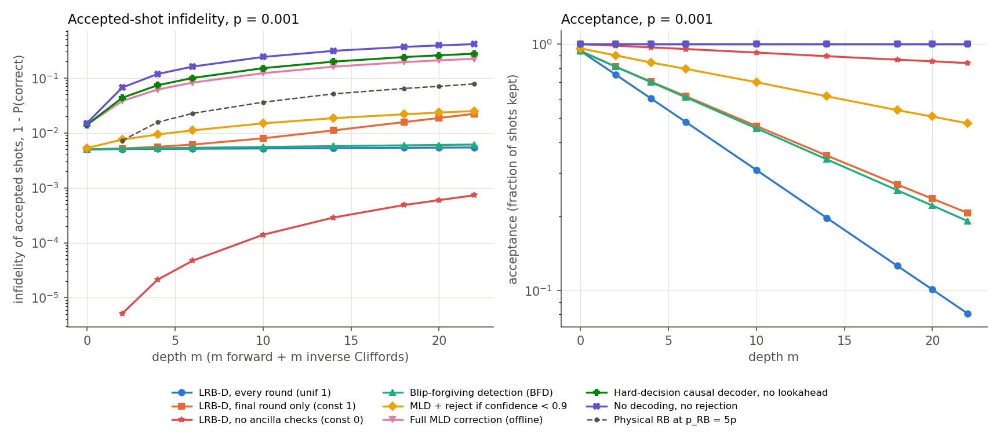
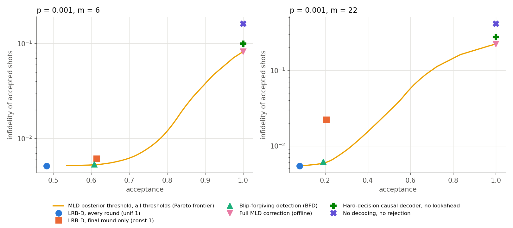
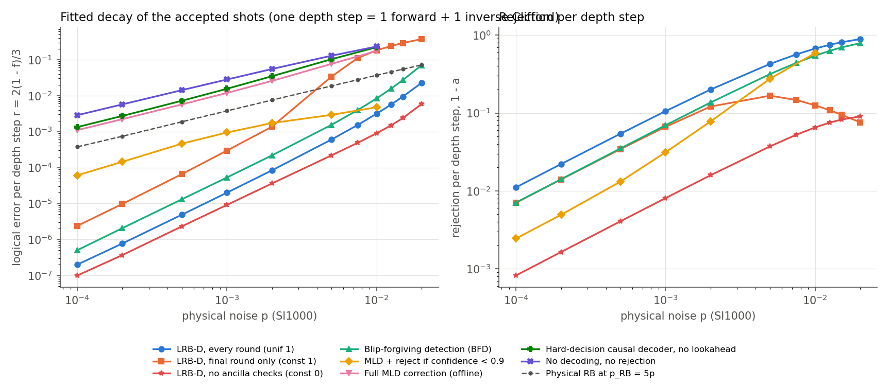
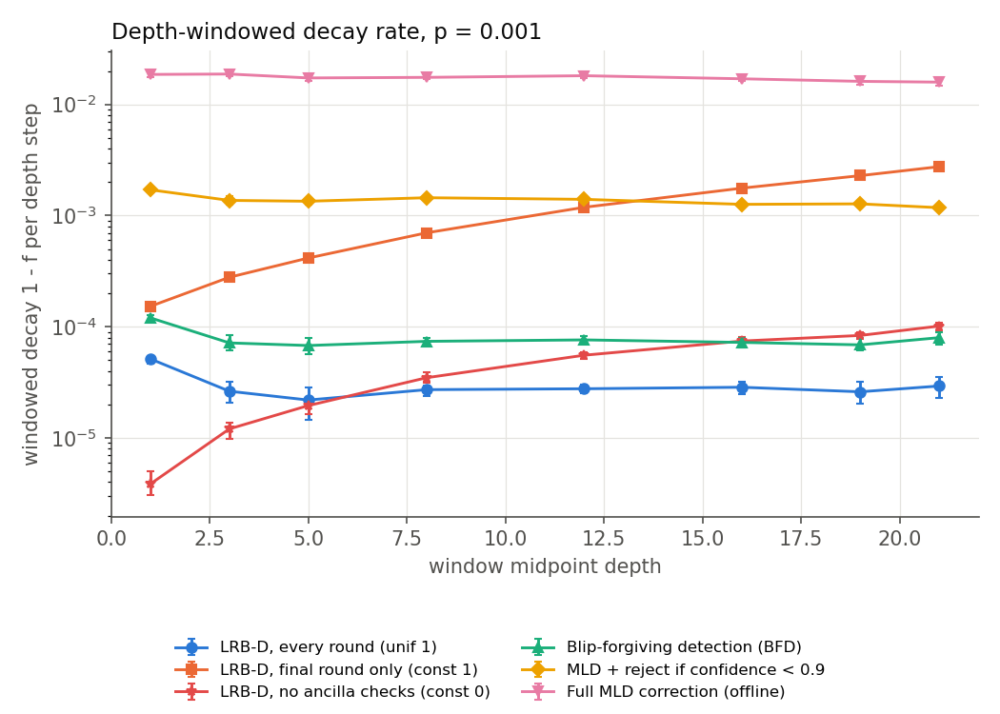
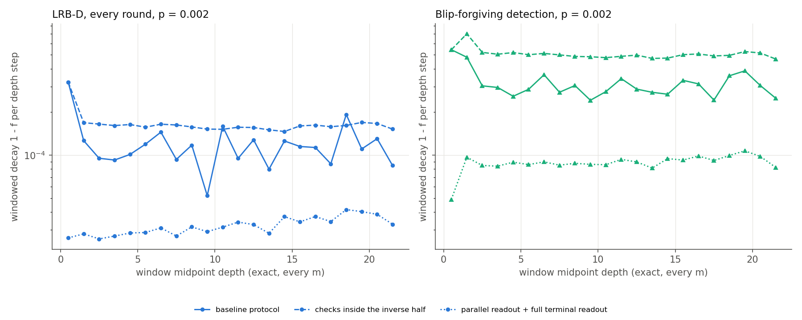
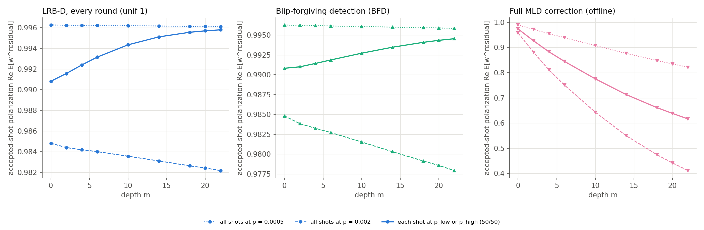

# Correction instead of detection in qutrit LRB on the `[[5,1,2]]_3` folded surface code

Study date: 2026-10-28. Scope: the repository's LRB-D experiment (single-ancilla
profile, generalized SI1000 noise, compact q-ary DEM backend), its production
run `Run-2026-08-04-23-58-49-folded_qutrit-single-ancilla-si1000` as the
baseline, and three questions:

1. Which decoders let this experiment correct instead of reject, and how well do
   they do against the LRB-D baseline?
2. Does correction mitigate non-Markovianity in LRB, and why?
3. What is a sustainable way to do this on hardware?

A sibling study covers the qubit `[[5,1,2]]` code separately.

**How to read the labels.** Every claim carries one tag:

| Tag | Meaning |
|---|---|
| **[VA]** | verified analytically (derivation in this report or in the cited notes file) |
| **[VN]** | verified numerically (script and result file named) |
| **[LIT]** | from a paper that an agent fetched and a second agent re-fetched and confirmed (Section 14) |
| **[CONJ]** | conjecture or estimate that was not verified |

"Per depth step" means one forward Clifford plus one inverse Clifford, because a
depth-m circuit has 2m noisy Cliffords. The decay rate is reported as
`r = 2(1 - f)/3` per depth step, from the fit `y = b f^m` of the accepted-shot
polarization `Re E[omega^residual]`. That is the pipeline's fit with the pipeline's
offset (0), applied to an unbiased metric (Section 2.5). Physical RB at the
repository's matched noise `p_RB = 5p` has `r = 3.76 p` per depth step.

---

## Executive summary

**Q1: decoders.** For this code, exact maximum-likelihood decoding (MLD) of the whole
circuit-level DEM is cheap. It is a forward filter over 243 states per check round,
validated to machine precision. Approximate decoders (matching, union-find, BP,
tensor networks) are therefore unnecessary. The decision rule matters, not the
decoder.

- **Full correction does not work at distance 2.** Accepting every shot and applying
  the MLD Pauli-frame correction gives `r = 1.18e-2` per depth step at `p = 1e-3`. That
  is 3.1 times worse than physical RB (`3.76e-3`) and 600 times worse than LRB-D's
  postselected `2.0e-5`, and it is worse than physical RB at every p simulated
  (1e-4 to 2e-2) **[VN]**. The cause is structural: 16 of the 40 single-qutrit errors
  (pure X or pure Z on a corner qutrit) are ambiguous, so first-order logical errors
  cannot be avoided. At code capacity, `P_fail = q + (63/16) q^2`, no better than an
  unencoded qutrit **[VA, VN]**.
- **What correction can buy is selective.**
  - *Blip-forgiving detection (BFD)* forgives a syndrome seen in one round only, which
    at first order is always a measurement or reset fault. It never accepts a
    first-order logical error **[VN]**. It cuts rejection per depth step from 0.106 to
    0.070 at `p = 1e-3` and raises acceptance at `m = 22` from 8.1% to 19.1%. Its
    accepted error grows from `2.0e-5` to `5.3e-5`, still 70 times below physical RB
    **[VN]**. It needs no DEM and is a 2-round lookup.
  - *Soft-output MLD* rejects when the posterior confidence is below a threshold. It
    traces the Bayes-optimal acceptance-fidelity frontier **[VA, LIT]**. For example, a
    0.9 threshold gives 3.1% rejection per step and `r = 9.4e-4` (4 times below
    physical RB, 47.7% acceptance at `m = 22`). A 0.97 threshold gives 4.8% and
    `2.4e-4` **[VN]**.
  - LRB-D with every round (`unif 1`) already sits on that frontier (exactly at the
    enumerated depths m = 0 and 2). Sparse-check LRB-D (`const c`, `unif k >= 2`) is
    strictly dominated **[VN, VA]**.
- **Causal vs offline.** The exact MAP of the terminal logical outcome is computed by a
  causal filter, so "offline" decoding loses nothing by being causal. What costs is
  committing hard decisions early. Hard-decision causal decoders with lookahead 2, 1
  and 0 are 4%, 9% and 31% worse than MLD **[VA, VN]**.
- **The protocol matters more than the decoder.**
  - Reading all five data qutrits at the end removes a depth-independent `4.95 p` SPAM
    floor (`P(correct)` at `m = 0`: 0.99499 to 0.99998) **[VN]**.
  - Measuring the four ancillas in one parallel layer instead of four sequential layers
    cuts every strategy's error rate by 1.6 to 3 times **[VN]**.
  - With no mid-circuit checks at all (`const 0` circuits) and MLD on the final data
    readout, `r = 0.45 x` physical RB at every p **[VN]**. In this noise model the
    check rounds themselves (about 118 p of fault probability per round, against about
    4.7 p per logical Clifford) are the dominant error source. This depends on the
    `p_RB = 5p` convention and the noiseless terminal readout (Section 4.6).

**Q2: non-Markovianity.** The physical noise in the simulation is Markovian by
construction. Non-Markovianity appears at the logical level, through the code block's
syndrome register (an out-of-codespace error persisting between checks) and through
check schedules that depend on m.

- LRB-D with a check every round, and BFD, decay as a single exponential within
  statistics on the 9 production depths. In the exact dense-depth study the curvature
  is small but resolvable **[VN]**.
- Sparse-check LRB-D is strongly non-exponential. The windowed decay rate grows 18
  times between the first (m = 0 to 2) and last (m = 20 to 22) depth windows for
  `const 1` and 26 times for `const 0`, and `unif k` shows a sawtooth in `m mod k`, because pairs of faults inside an unchecked interval
  become undetectable logical errors **[VN, VA, LIT]**.
- **Correction mitigates non-exponentiality in shape only.** It turns the quadratic
  pair mechanism into first-order logical errors, so the decay is dominated by
  memoryless failures. MLD's windowed rate drifts by 15% (downward) where `const 1`
  grows 18 times. But it does so by making the error rate first order, and a
  significant positive curvature remains **[VN]**. Checking inside the inverse half,
  the only unchecked interval every policy shares, removes the residual curvature of
  LRB-D (windowed rates flat to 16%) at a 10% acceptance cost per step **[VN]**.
- **Correction removes a postselection bias that matters on hardware.** If each shot's
  noise strength fluctuates (here half the shots at `p = 5e-4`, half at `2e-3`),
  postselection selects quiet shots ever more strongly with depth. LRB-D's accepted
  fidelity then *rises* from 0.9908 at `m = 0` to 0.9958 at `m = 22`, and BFD's from
  0.9908 to 0.9945, so the fitted decay rate is meaningless. MLD correction decays
  normally from 0.974 to 0.617 **[VN]**.

**Q3: hardware.**

- For Clifford-only LRB, correction is a Pauli-frame relabelling of the terminal
  outcome, computed offline. No feedback, no decoder latency budget, and no ancilla
  reset are needed **[VA, VN, LIT]**.
- Today's transmon two-qutrit gates correspond to SI1000 `p = 0.027` at best
  (typically 0.05 to 0.18), and trapped-ion qutrit gates to about 0.014. At those
  values the baseline protocol keeps less than 0.1% of shots by `m = 2` to 4 **[LIT,
  VN]**.
- The sustainable path is staged:
  1. `const 0` LRB on the five data qutrits with terminal decoding. It needs no
     mid-circuit measurement and runs on IQM-class square lattices today.
  2. Repeated-check memory experiments to learn the DEM.
  3. Checked LRB with parallel ternary readout, full terminal readout, four-level
     readout as a leakage (erasure) flag, and offline BFD or soft-MLD decoding.
- Genuine correction (an unpostselected logical decay below the physical qutrit's)
  needs distance 3. The natural next code is the `[[13,1,3]]_3` folded surface code of
  the same family **[VN for code properties, CONJ for circuit-level break-even]**.

---

## 1. What was simulated

**Context [LIT].** Logical RB was defined with a recovery after every encoded
Clifford, or with none, and the syndrome traced out, so the logical channel is
trace-preserving [Combes et al. 2017]. Postselected LRB on a distance-2 code has
been run on hardware [Harper and Flammia 2019], with the remark that no complete
theory exists for fitting RB decays under postselection. Repeated error detection
with postselection on a distance-2 surface code reported the acceptance decay
separately from the logical error [Marques et al. 2022]. The only hardware LRB with
a decoder found is on a distance-3 colour code, with one QEC cycle between
transversal gates, a single recovery Clifford and no postselection [Lacroix et al.
2025]. This repository's simulator and a first `[[5,1,2]]_3` LRB-D study (terminal
postselection only) are described in [Kabir et al. 2025].

The setting is in `notes/00-brief.md`; the points that matter here are:

- Five data qutrits, four ancillas (one per stabilizer). Checks: `S_Z1 = Z0 Z1^-1 Z3^-1`,
  `S_Z2 = Z1 Z2 Z4^-1` (CNOT data to ancilla), `S_X1 = X0 X1 X2^-1`,
  `S_X2 = X1^-1 X3 X4^-1` (ancilla-controlled CNOTs between Hadamards). The ancillas
  are measured one at a time and then reset together.
- A depth-m circuit has the following structure. Steps 2 and 3 matter for decoding.
  1. Ideal `|+>_L`.
  2. m forward Cliffords, each followed by a full check round and an ancilla reset.
  3. The m inverse Cliffords with **no** checks.
  4. One final check round.
  5. A noiseless readout of data qutrits 0 and 3 only. The `const 0` circuits instead
     have no ancilla checks and a noiseless readout of all five data qutrits.
- **Every forward Clifford is followed by an executed check round in every circuit.**
  The `const c` and `unif k` policies only choose which rounds' outcomes reject a
  shot, so a decoder can use every round at no extra noise cost [code: lrb_simulation.py].
- Generalized SI1000 noise: `0.1 p` after one-qutrit gates and `p` after two-qutrit
  gates. Each measurement layer adds `2p` idle on every other wire, `p` on the
  measured ancilla, and a `5p` outcome shift. The reset layer adds `2p` idle on the
  data and a `2p` shift on the ancillas.
- Sequential readout puts `4 x 2p + 2p = 10p` of idle depolarizing on every data
  qutrit per round. A check round carries **118.4 p** of total fault probability (100.4 p
  for the final round), while a logical Clifford carries 3.3 to 4.9 p **[VN,
  notes/A3]**.

## 2. Method: exact decoding of the circuit-level DEM

### 2.1 Chain structure **[VA, VN]**

The compact DEM (`lrb.dem_simulation.CompactDetectorErrorModel`) lists independent
noise locations. Each one, when active, applies one of its non-zero Weyl vectors with
equal probability, with a sparse Z_3 response on every raw ancilla detector and on
the logical observable. The detectors are raw per-round outcomes, so a persistent
data error shows up in every later round, transformed by the logical gates in
between.

`src/lrb/correction/chain_dem.py` rewrites this model:

- Each location goes to the **slot** of the first round it touches.
- Inside its slot it shifts that round's raw syndrome (`a`), the persistent syndrome
  carried into the next round (`b`), and the logical outcome (`l`).
- The persistent syndrome is carried between rounds by a linear map `T_r` (the
  noiseless gates' action on the syndrome). The code fits `T_r` from the model and
  then checks every location against it; the build raises if any later-round
  effect is not the transported image.

The assumptions held for all 270 production circuits, all 1,620 variant-study circuits
and all 2,070 dense-depth circuits. That gives the recursion

```text
s_r = h_r + sum_{slot r} a,        h_{r+1} = T_{r+1} h_r + sum_{slot r} b
```

with `h_0 = 0` (ideal preparation). The slot kernels `K_r[l, b, a]` (3 x 81 x 81) are
exact convolutions in probability space.

### 2.2 Exact maximum-likelihood decoding **[VA, VN]**

`src/lrb/correction/forward.py` runs the forward recursion over the hidden state
(carried syndrome `h` in Z_3^4, accumulated logical shift `L`): 243 states, one
243 x 243 matrix per observed syndrome value and round. The result is
`P(L | all syndromes)` and its evidence.

Because only the terminal logical outcome is read, **this causal filter is the exact
MAP decoder**. It is the qutrit, LRB version of coset tracking [LIT: Heim, Svore and
Hastings 2016] and of trellis decoding [LIT: Sabo et al. 2021]. The same 729-coset
construction was found independently by the literature agent [notes/lit-L3]. Work is
shared across shots with identical syndrome prefixes; 1e5 shots of a depth-22
circuit decode in 6 to 11 s on one core.

Every postselection or correction rule then follows from the posterior and the
syndromes:

| Rule | Definition | How evaluated |
|---|---|---|
| LRB-D `unif k`, `const c` | pipeline semantics (masks checked against `postselect_*`) | exact recursion with `s_r = 0` on used rounds |
| BFD | accept iff the final round is trivial and no two consecutive rounds are non-trivial; no correction | exact recursion with a one-bit flag |
| BFD-X, LRB-D-X | as above, but in the final round only the X-check digits must be trivial (an X error left at the end cannot change the X readout) | exact, allowed-set observation |
| Full MLD | accept all, apply `argmax_L` | sampled |
| MLD with restricted information | MLD that sees only the rounds of `unif 2`, `unif 4`, `unif 22` or the terminal round | sampled |
| Soft MLD (threshold t) | accept iff `max_L P(L given s) >= t`, apply the argmax | sampled; full frontier from a confidence histogram |
| Causal hard-decision, lookahead w | after round r + w, commit the most likely carried syndrome and slot-r logical shift (forward step times a w-round backward message); never revise | sampled |
| `const 0` MLD | MLD on the noiseless terminal X-syndrome of the `const 0` circuits | exact |

### 2.3 Scoring sampled rules without wasting shots **[VA, VN]**

For every sampled syndrome history, the exact posterior given all rounds is known.
The expected residual distribution of any rule's output `L_hat(s)` is
`P(L = L_hat(s) + k | s)`. Averaging that over sampled histories is unbiased (the
decoder's model is the simulation's model) and has far less variance than counting
realized errors at small p. Realized counts are stored as a cross-check and agree
(`study.py`, `run_decoder_study.py`). Production used 1e5 shots per circuit for the
sampled rules, at p in {1e-4, 2e-4, 5e-4, 1e-3, 2e-3, 5e-3, 1e-2}, and exact rules at
all 14 non-zero p, for 30 sequences x 9 depths.

### 2.4 Validation

| Check | Result | Where |
|---|---|---|
| Chain model vs brute-force convolution over every detector history (depth 1; and depth 1 with terminal detectors on a sparse noise subset) | agree to rtol 1e-9 | `tests/test_correction_chain.py`, `tests/test_correction_variants.py` **[VN]** |
| Exact LRB-D and BFD vs sampling | within 4 sigma at 1.5e5 to 2e5 shots | same tests **[VN]** |
| Policy masks vs the pipeline's `postselect_uniform_interval` / `postselect_constant_number` | identical for depths 0 to 22, policies 1 to 22 | `tests/test_correction_chain.py` **[VN]** |
| Variant builder with every flag off vs the production generator | operation-for-operation identical | `tests/test_correction_variants.py` **[VN]** |
| Exact LRB-D vs the 1M-shot production CSVs, 5,670 (p, policy, depth) rows | rejection: max abs difference 2.8e-4. Fidelity, where production kept at least 1,000 shots per circuit (4,210 rows): median abs z 0.43, 95th percentile 3.7. The z tail sits at low acceptance, where the pipeline's `abs(E[omega^k])` estimator is biased up by about `0.89/sqrt(N_acc)` | `results/baseline_reproduction.csv.gz` **[VN]** |
| Independent single-fault enumeration, p = 1e-4 | m = 0 rejection 6.315e-3 (first order) vs 6.294e-3 (exact); MLD failure 1.402e-3 vs 1.407e-3 (sampled); the m = 22 rejection matches `1 - exp(-first order)` | `results/first_order_check.json`, `studies/correction-decoders/qutrit/scripts/verify_first_order.py` **[VN]** |
| Paired variant study, new seeded sequences, baseline structure | reproduces the production fits (r = 1.99e-5 vs 2.0e-5, a = 0.894 vs 0.894 at p = 1e-3) | `results/variant_summary.md` **[VN]** |
| Independent reviewers (round 2): exactness, independent MLD reimplementation, sampler statistics, decoder logic, physics model | see Section 13 | `notes/review/` |

### 2.5 Metrics and fits

- The pipeline's fidelity `abs(sum_k omega^k P(k))` is a symmetric function of the
  residual distribution. It cannot tell a perfect decoder from one that is always
  wrong by a fixed shift (for example, a never-right correction map scores 0.5, above
  MAP's 0.4), and it is Rice-biased upward when few shots are accepted **[VA, VN,
  notes/A2]**.
- This study reports the survival `S = P(residual = 0)` and the polarization
  `lambda = Re E[omega^residual] = (3S - 1)/2`. These rank rules identically
  **[VA]**. Under the repository's noise `P(D, l) = P(-D, -l)`, so for detection the
  legacy metric equals `abs(lambda)` exactly; that is why the exact LRB-D numbers
  match the production CSVs **[VA, VN, notes/A2]**.
- Fits use the pipeline's weighted grid scan (`metrics.fit_decay` mirrors
  `LRBResultsPlotter._fit_decay_parameter_fixed_a`, including its weight floor) on
  `lambda` with offset 0, with 95% intervals from 100 bootstrap resamples of the 30
  sequences.
- Non-exponential shape is measured two ways: depth-windowed decay factors between
  consecutive depths, and the quadratic coefficient `c2` of `log lambda` against m
  (bootstrap CI). A single exponential has flat windows and `c2 = 0`.
- Physical RB at `p_RB = 5p` is refitted with offset 0. The free-offset fit is
  ill-conditioned at small p (it returns an offset of 0.86 at `p_RB = 5e-4`). The
  offset-0 values equal the pipeline's own mixed-fit table, for example
  `r = 3.76e-4` at `p_RB = 5e-4` (`results/rb_reference.csv`).

## 3. What correction can buy at distance 2

### 3.1 Code capacity **[VA, VN; notes/A1]**

- The stabilizers commute and the logicals are `X0 X3` and `Z0 Z2` (weight 2).
- Of the 40 single-qutrit errors, **24 are uniquely decodable**: all 8 on the centre
  qutrit 1, and the 4 mixed `X^a Z^b` (a, b non-zero) on each corner.
- The 16 pure `X^a` or `Z^b` errors on corners form 8 tied pairs. Each pair differs by
  a weight-2 logical (`X0^a X3^a`, `X2^a X4^a`, `Z0^b Z2^b`, `Z3^b Z4^b`).
- Every weight-2 logical is pure X-type or pure Z-type.

With single-qutrit depolarizing noise q per qutrit:

| Rule | Rejection | Logical error of accepted shots |
|---|---|---|
| Detection | `5q - (81/8) q^2` | `q^2 / 8` |
| Hybrid (correct the 24 unambiguous, reject the rest) | `2q - (3/4) q^2` | `(21/8) q^2` |
| Full MLD | 0 | `q + (63/16) q^2`, no better than an unencoded qutrit |

The posterior-threshold family has only these three regimes at code capacity.

### 3.2 Time-like faults and the final round **[VN; notes/A1]**

- A measurement or reset fault in a round with a successor never makes a syndrome
  history ambiguous: a persistent data error reappears in the next round, a
  measurement fault does not. So time-like faults are always correctable.
- The final round has no successor. Its Z-check measurement errors are harmless,
  because X errors left at the end do not change the X readout. Its X-check
  measurement errors are confusable with corner Z errors.
- Idle and CNOT faults on qutrits 0 and 3 after their last check interaction flip the
  readout undetectably with total probability **4.95 p**. They are idle noise in the
  last two measurement layers and the last data-ancilla CNOTs (`results/first_order_check.json`).
- That floor is m-independent, so it enters the RB amplitude, not f. No decoder can
  remove it unless all five data qutrits are read at the end (Section 6).
- **Flags are not needed for this code.** Every hook error spreads to at most two data
  qutrits, and every weight-2 error it can produce has a non-trivial syndrome. Apart
  from the final-round floor, no single circuit fault gives an undetectable logical
  error [VN: `results/first_order_check.json`, notes/A1]. Flags become necessary for
  distance-3 codes with weight-4 or higher checks, such as the `[[7,1,3]]_3` colour
  code (Section 8).

### 3.3 Circuit-level first-order coefficients **[VN]**

Per depth step at small p (the A1 and A5 enumerations and the fits agree):

| Quantity | Value per depth step |
|---|---|
| LRB-D (`unif 1`) rejection | 106 to 112 p |
| Hybrid rejection | about 39 p |
| BFD rejection | about 70 p |
| Full MLD failure | 11 p, so `1 - f` is 16.6 to 17.7 p, i.e. `r = 11.1` to `11.8 p` |
| Physical RB at 5p | `1 - f = 5.6 p`, `r = 3.76 p` |

Accepted-shot errors stay second order for LRB-D (`r` about 20 p^2), BFD (about
53 p^2) and the hybrid (about 1.3e3 p^2), which is why they sit far below physical RB
at small p **[VN]**.

## 4. Decoders against the LRB-D baseline

Full tables for p = 2e-4, 5e-4, 1e-3, 2e-3 and 5e-3 are in
`results/decoder_tables.md`. Per-depth curves are in `results/curves_baseline.csv.gz` and
fits in `results/fits_baseline.csv.gz`.

### 4.1 At p = 1e-3 (physical RB: r = 3.76e-3 per depth step) **[VN]**

| Strategy | r per depth step [95% CI] | acceptance per step | accepted P(correct), m = 0 / m = 22 | acceptance at m = 22 |
|---|---|---|---|---|
| LRB-D, every round (`unif 1`) | 2.0e-5 [2.0e-5, 2.0e-5] | 0.894 | 0.99499 / 0.99457 | 0.081 |
| LRB-D, `unif 2` | 3.4e-5 | 0.913 | 0.99499 / 0.99425 | 0.126 |
| LRB-D, `unif 4` | 7.4e-5 (sawtooth) | 0.923 | 0.99499 / 0.99333 | 0.161 |
| LRB-D, final round only (`const 1`) | 3.0e-4 (non-exponential) | 0.934 | 0.99499 / 0.97775 | 0.207 |
| **BFD** | **5.3e-5** [5.2e-5, 5.4e-5] | **0.930** | 0.99499 / 0.99387 | **0.191** |
| **Soft MLD, t = 0.97** | **2.4e-4** | **0.952** | 0.99497 / 0.98995 | **0.326** |
| **Soft MLD, t = 0.9** | **9.4e-4** | **0.969** | 0.99470 / 0.97503 | **0.477** |
| Soft MLD, t = 0.5 | 5.2e-3 | 0.985 | 0.98591 / 0.88747 | 0.724 |
| Full MLD, all rounds | 1.18e-2 [1.16e-2, 1.20e-2] | 1 | 0.98591 / 0.77641 | 1 |
| Full MLD, `unif 4` rounds only | 1.50e-2 | 1 | | 1 |
| Full MLD, final round only | 2.01e-2 | 1 | | 1 |
| Causal hard-decision, lookahead 2 / 1 / 0 | 1.23e-2 / 1.29e-2 / 1.55e-2 | 1 | | 1 |
| No decoding, no rejection | 2.80e-2 | 1 | 0.98484 / 0.58750 | 1 |
| `const 0` circuits: LRB-D | 9.1e-6 (non-exponential) | 0.992 | 1 / 0.99927 | 0.838 |
| `const 0` circuits: MLD | 1.67e-3 | 1 | 1 / 0.96392 | 1 |



### 4.2 Pareto frontier **[VA, VN, LIT]**

**Theorem (notes/A2; [LIT: Chow 1970; Forney 1968; English, Williamson and Bartlett
2025]).** Among all rules, randomized ones included, that map a shot's full detector
history to "reject" or "accept and apply correction c", the rule that maximizes the
accepted P(correct) at a fixed acceptance accepts the histories with the largest
`max_L P(L | D)` and applies the argmax. Pure detection is one feasible rule, so it
lies on or below that frontier.

- On these circuits `unif 1` LRB-D lies on the frontier, because the all-trivial
  history is the most reliable one. This was shown exactly by enumeration at m = 0 and
  2 [notes/A2], and holds within the precision of the sampled frontier at m = 6 and 22.
  `const c` and `unif 2` lie strictly below it **[VN]**.
- The figure shows the frontier traced at every confidence-histogram threshold. BFD
  sits on it, `const 1` is dominated, and full MLD and the causal decoders are its
  acceptance-1 endpoint.



- A fixed threshold also caps the accepted error at every depth, so a conditional
  decay rate can be made as slow as desired by postselecting harder **[VA,
  notes/A2]**. The decay rate of a postselected rule must therefore always be quoted
  with its acceptance per step.
- No shot's confidence can exceed one minus the probability of the final-round floor
  (about 0.995 at p = 1e-3). Thresholds above that reject everything; at p >= 2e-3
  that already includes 0.99 **[VN]**.

### 4.3 Against p **[VN]**



| Strategy | Scaling of r per depth step | Rejection per step |
|---|---|---|
| LRB-D `unif 1` | about 20 p^2 | about 110 p |
| BFD | about 53 p^2 | about 70 p |
| Soft MLD, t = 0.9 | between first and second order; 4 to 7 times below physical RB from p = 2e-4 to 1e-2 | |
| Full MLD | 11 to 15 p, 3 to 4 times above physical RB at every p | 0 |
| `const 0` MLD | 1.67 p, 0.44 to 0.46 times physical RB at every p | 0 |

### 4.4 Ranking

| Rank | Use case | Recommended rule | Why |
|---|---|---|---|
| 1 | Lowest conditional logical error (what LRB-D measures) | LRB-D, every round | On the Bayes frontier; second-order error; exponential decay. Cost: acceptance `0.894^m` at p = 1e-3. |
| 2 | Most accepted shots at a near-LRB-D error | **BFD** | A 2-round lookup with no DEM. Never accepts a first-order logical error. 2.4 times more accepted shots at m = 22 for 2.7 times the conditional error. |
| 3 | Tunable trade-off | **Soft-output MLD** (t from 0.9 to 0.97) | Exactly the optimal frontier. Needs the DEM (calibrated) and the exact filter (trivial offline). |
| 4 | Every shot counts (no postselection) | Full MLD | The best possible accept-all rule, but worse than physical RB here, so it shows no benefit of encoding. Useful as the unbiased reference under fluctuating noise (Section 5.5). |
| Not recommended | | Sparse-check LRB-D (`const c`, `unif k >= 2`) | Dominated, and non-exponential. |
| Not recommended | | Causal hard-decision decoders | Strictly worse than the exact causal filter. |
| Not recommended | | Matching, union-find, BP, tensor networks | Unnecessary when exact MLD costs microseconds per round. |

### 4.5 Causal vs offline decoding **[VA, VN; notes/A3]**

- The question "does using future syndromes change what RB measures?" has a
  precise answer here. The final MAP needs only the forward filter, which never
  looks ahead.
- Future data matters only to a decoder that must commit corrections before the end,
  for example real-time physical correction. For such commit-every-round decoders the
  loss is 31% (no lookahead), 9% (one round) and 4% (two rounds) in r, and their decay
  shapes match MLD's within error.
- A finite-state causal decoder gives `F(m)` as an exact finite sum of exponentials
  **[VA, notes/A3]**. Offline decoding does not change what is measured. It measures a
  better logical channel than any committing decoder could deliver.

### 4.6 Measuring less **[VN]**

The `const 0` circuits (no ancilla checks, noiseless terminal readout of all five
data qutrits) give the best numbers for both detection and correction:

- LRB-D: `r = 9.1e-6`, acceptance 0.992 per step.
- MLD: `r = 1.67e-3`, 0.44 times physical RB.

Two reasons:

- Each sequential check round adds 118 p of fault probability, against about 4.7 p per
  logical Clifford.
- Restricting MLD to fewer rounds of the *same* checked circuits makes it worse (all
  rounds 1.18e-2; `unif 4` rounds 1.50e-2; terminal round only 2.01e-2). So the
  information is useful, but collecting it costs more than it returns.

Caveats:

- The comparison depends on the repository's `p_RB = 5p` matching. At `p_RB = p`
  physical RB would be 5 times better.
- It assumes the noiseless terminal readout used throughout the baseline. A real
  ternary readout error of 2 to 7% per qutrit would mostly enter the amplitude A
  **[CONJ]**.
- Without checks the errors pile up between readouts: detection decays as `m^2`, and
  MLD's windowed rate rises about 10% over m = 2 to 22. It is not a scalable form of
  protection, only the best way to benchmark this code's logical gates in this noise
  model.

### 4.7 Check policy **[VN]**

LRB-D against BFD restricted to the same rounds, at p = 1e-3 (full table, including
p = 2e-3, in `results/decoder_tables.md`):

| Rounds used | LRB-D r | LRB-D acceptance per step | BFD r | BFD acceptance per step |
|---|---|---|---|---|
| `unif 1` (every round) | 2.0e-5 | 0.894 | 5.3e-5 | 0.930 |
| `unif 4` | 7.4e-5 | 0.923 | 2.0e-4 | 0.932 |
| `unif 22` | 3.0e-4 | 0.933 | 3.0e-4 | 0.934 |
| `const 1` (final round only) | 3.0e-4 | 0.934 | 3.0e-4 | 0.934 |
| `const 4` | 1.1e-4 | 0.928 | 2.0e-4 | 0.932 |
| `const 22` | 4.5e-5 | 0.916 | 9.8e-5 | 0.932 |

- **LRB-D trades acceptance for error through the policy. BFD barely does:** its
  acceptance per step stays between 0.930 and 0.934 whatever rounds it sees.
- BFD on every round has the acceptance of final-round-only detection (0.930 vs 0.934)
  with a 6 times lower error rate and an exponential decay.
- Since the rounds are executed anyway, there is no reason to postselect on a subset
  of them.

### 4.8 Robustness to a miscalibrated noise model **[VN]**

Shots were sampled at the true p. The decoder used the same DEM structure with rates
scaled by 1/4 to 4. Every rule was scored with the true model's exact posterior
(`studies/correction-decoders/qutrit/scripts/mismatch_check.py`, `results/mismatch_check.csv`; 3 sequences,
m = 10 and 22, p = 1e-3 and 2e-3, 4e4 shots).

| Rule | Effect of a 4x rate error in the decoder |
|---|---|
| Full MLD | Insensitive. At m = 22, p = 1e-3, infidelity is 0.2214 with the true rates and 0.2216 to 0.2226 with 4x errors either way: decisions depend on relative likelihoods. |
| Soft MLD | Moves its operating point. Underestimating p makes it overconfident. At t = 0.9, m = 22: acceptance 0.54 and infidelity 3.9e-2 at `p_dec = p/4`, against 0.48 and 2.5e-2 at the true rates. Overestimating p rejects more. The mismatched points stay close to the true frontier. |
| BFD | Needs no model. |

So on hardware a soft threshold should be set by a target acceptance (a quantile of
the confidence), not by an absolute confidence. Structural mismatch (noise placed
at the wrong side of a logical gate) is worse: it can admit first-order logical
errors [VN, notes/A1].

## 5. Non-Markovianity

### 5.1 Definitions **[VA, LIT]**

The *physical* process here is Markovian: independent Pauli faults with fixed
probabilities. LRB assumes that the *logical* process is Markovian: the accepted,
unnormalized logical state after the sequence is
`Lambda_2m o G_2m o ... o Lambda_1 o G_1 (rho)`, where each `Lambda_t` is a fixed
(possibly gate-dependent, possibly trace-decreasing) map that does not depend on
history. Under that assumption, with Clifford twirling (the qutrit Clifford group is
a unitary 2-design, prime d [LIT: Graydon et al. 2021; Jafarzadeh et al. 2020]), the
decay is a single exponential up to small gate-dependent corrections [LIT: Wallman
2018; Merkel et al. 2021].

Non-Markovian means history dependence through hidden memory, in the process-tensor
sense [LIT: Pollock et al. 2018; Figueroa-Romero et al. 2021, 2022]. Here the memory
carriers are:

1. the code block's syndrome register, an out-of-codespace error persisting between
   checks [LIT: Ceasura et al. 2022; Ziyad, Blume-Kohout and Rudinger 2025];
2. the decoder state, when correcting;
3. the check schedule, when the policy makes it depend on m.

### 5.2 Normalization alone is not the culprit **[VA, VN; notes/A4]**

- A Markovian but lossy step map E gives a postselected curve
  `tr[O E^m(rho)] / tr[E^m(rho)]`, a ratio of two exponential polynomials.
- After the twirl, acceptance does not depend on the encoded logical state, and the
  ratio of sequence averages is exactly `(alpha/(alpha + beta))^m`. The mean of
  per-sequence ratios, the pipeline's statistic, is exactly exponential only when
  acceptance is state independent.
- So postselection by itself does not make the decay non-exponential. The memory
  does.

### 5.3 Evidence in the baseline **[VN]**

Windowed decay `1 - f` per depth step at p = 1e-3 (9 production depths,
`results/fits_baseline.csv.gz`):

| Rule | windows m = 2 to 22 | curvature `c2` [95% CI] | Verdict |
|---|---|---|---|
| LRB-D `unif 1` | 2.6e-5, 2.2e-5, 2.7e-5, 2.8e-5, 2.9e-5, 2.6e-5, 2.9e-5 | -1.1e-7 [-2.1e-7, +2.0e-9] | consistent with one exponential |
| BFD | 6.8e-5 to 8.0e-5 | -6.2e-8 [-2.9e-7, +1.7e-7] | consistent with one exponential |
| LRB-D `const 1` | 2.8e-4 rising to 2.75e-3 (1.5e-4 in the m = 0 to 2 window) | -6.8e-5 [-6.9e-5, -6.6e-5] | accelerating, 18x first to last window |
| LRB-D `const 0` | 1.2e-5 rising to 1.0e-4 (3.9e-6 in the m = 0 to 2 window) | -2.4e-6 [-2.6e-6, -2.2e-6] | accelerating, 26x first to last window |
| LRB-D `unif 4` | sawtooth in `m mod 4` | n/a | schedule-driven |
| Soft MLD, t = 0.9 | 1.4e-3 falling to 1.2e-3 | +6.2e-6 [+4.7e-6, +7.9e-6] | mild deceleration |
| Full MLD | 1.9e-2 falling to 1.6e-2 | +5.4e-5 [+1.7e-5, +8.2e-5] | mild deceleration, -15% |
| Causal hard-decision, lookahead 0 | flat within noise | +3.7e-5 [-8e-7, +6.9e-5] | |



The mechanism is the one predicted and confirmed in notes/A4 and notes/N1:

- `-ln F(m) = a1 p + a2(m) p^2 + O(p^3)`. Here `a1 = 7.43` is m-independent: the
  4.95 p final-round floor times 3/2.
- `a2(m)` collects pairs of faults inside unchecked intervals. An unchecked interval of
  L steps contributes about `22 L^2`.
- Consequences:
  - `unif k`: per-step rate about `22.7 k p^2` plus a sawtooth.
  - `const c`: an `m^2/c` term.
  - `const 0`: almost purely quadratic, `-ln F = 2.24 m^2 p^2`.
  - `unif 1`: only a small `m^2` term from the m-step unchecked inverse block.

The baseline data reject a single exponential for every `const c` and `const 0` (for
example chi^2 = 5,461 vs 68 for a log-quadratic model, `const 1` at p = 1e-3), and
`unif 1` is indistinguishable from one at this sample size **[VN, notes/A4,
notes/N1]**.

### 5.4 Exact dense-depth test: the unchecked inverse half **[VN]**

Exact LRB-D and BFD at every m from 0 to 22, 30 seeded sequences, three protocols
(`results/fits_dense.csv.gz`):

| p = 1e-3 | LRB-D r, a | LRB-D `c2` [CI] | BFD r, a | windowed-rate spread (max/min, m >= 2), LRB-D / BFD |
|---|---|---|---|---|
| baseline protocol | 2.0e-5, 0.894 | -1.1e-7 [-2.1e-7, -3.0e-8] | 5.3e-5, 0.930 | 3.8 / 2.0 |
| checks inside the inverse half | 2.8e-5, 0.808 | +6e-10 [-8.7e-8, +7.8e-8] | 8.6e-5, 0.875 | **1.16 / 1.49** |
| parallel + full terminal readout | 4.8e-6, 0.930 | -7.5e-8 [-9.6e-8, -6.1e-8] | 1.4e-5, 0.959 | 1.56 / 1.31 |



- At every-depth resolution the baseline's `unif 1` decay shows a small but
  significant curvature, and its windowed rate zig-zags. Each depth has its own
  unchecked inverse block, whose undetected-pair probability depends on its gates.
- Checking after every inverse Clifford removes the curvature: the windows are flat
  to 16% and `c2` is consistent with 0. The cost is acceptance per step (0.894 to
  0.808), because every extra sequential check round adds 118 p.
- The same holds at p = 2e-3 and 5e-3 **[VN]**.
- An alternative fix that does not add check noise is a single compiled recovery
  Clifford instead of m mirrored inverses (standard RB) **[CONJ]**.

### 5.5 Postselection under temporally correlated noise **[VN]**

Real devices drift and have two-level fluctuators [LIT: Mavadia et al. 2018; Ball et
al. 2016], so the noise strength varies between shots. Model this as each shot drawn
at `p = 5e-4` or `p = 2e-3` with equal probability. The mixture is exact, because the
joint `P(L, accept)` is linear in the mixture weights
(`results/mixture_curves.csv`, `results/mixture_nonmarkov.csv`).

| m | 0 | 6 | 14 | 22 |
|---|---|---|---|---|
| LRB-D accepted polarization, mixture | 0.9908 | 0.9931 | 0.9951 | 0.9958 |
| BFD, mixture | 0.9908 | 0.9919 | 0.9935 | 0.9945 |
| MLD, mixture | 0.9736 | 0.8449 | 0.7131 | 0.6165 |

- The postselected fidelity **increases** with depth: at m = 22 the accepted
  ensemble is about 98% quiet shots. The fitted LRB-D "decay rate" is then zero or
  negative.
- MLD has no selection. Its decay is the usual mixture of exponentials, with a rate
  between those of its two components.
- This is the strongest practical argument for correction, or at least for reporting
  postselected LRB together with acceptance and an unpostselected companion curve.



### 5.6 Verdict on non-Markovianity

1. LRB-D's non-exponential behaviour is emergent logical memory. Detectable errors
   persist in the syndrome register until a check, and pairs inside unchecked
   intervals become logical errors. This matches the theory of syndrome registers as
   hidden memory [LIT: Ceasura et al. 2022] and of non-composable logical gates when
   data are not returned to the code space every round [LIT: Ziyad, Blume-Kohout and
   Rudinger 2025].
2. **Correction mitigates it only in shape.** It turns pair mechanisms into
   first-order failures, so the decay is dominated by memoryless errors and fits a
   single exponential far better than sparse-check detection. But:
   - a significant (positive) curvature remains, from boundary and decoder-memory
     effects;
   - at distance 2 the price is a first-order logical error rate;
   - dense-check detection (`unif 1`, BFD) is already about as close to exponential as
     MLD.

   Decoded repeated QEC cycles are expected to be approximately Markovian with
   exponentially suppressed deviations [LIT: Kwiatkowski et al. 2025]. That suppression
   needs more distance than this code has **[CONJ]**.
3. **Correction removes a different, more dangerous non-Markovianity:**
   postselection's selection of the quiet part of temporally correlated noise
   (Section 5.5).
4. **The decisive fix is protocol-level:** leave no long unchecked interval. Check
   inside the inverse block or compile a single recovery Clifford, and never use
   sparse-check policies to estimate a per-step rate.

## 6. Protocol variants: a paired study

Thirty seeded sequences, identical across variants, 5e4 shots per circuit for sampled
rules, exact LRB-D and BFD (`results/variant_summary.md`, `studies/correction-decoders/qutrit/scripts/run_variant_study.py`).
At p = 1e-3 (physical RB r = 3.76e-3):

| Protocol | LRB-D r, a | BFD r, a | Soft MLD t = 0.9: r, a | Full MLD r | P(correct) at m = 0, LRB-D |
|---|---|---|---|---|---|
| baseline | 2.0e-5, 0.894 | 5.3e-5, 0.930 | 9.4e-4, 0.969 | 1.19e-2 | 0.99499 |
| + full terminal readout | 1.6e-5, 0.894 | 4.7e-5, 0.930 | 9.9e-4, 0.970 | 1.17e-2 | **0.99998** |
| + parallel ancilla readout | 6.8e-6, 0.930 | 1.7e-5, 0.959 | 5.8e-4, 0.983 | 6.7e-3 | 0.99655 |
| parallel + full terminal | **4.8e-6, 0.930** | **1.4e-5, 0.959** | **6.8e-4, 0.984** | 6.6e-3 | 1.00000 |
| + checks inside the inverse half | 2.8e-5, 0.809 | 8.5e-5, 0.875 | 1.5e-3, 0.944 | 2.0e-2 | 0.99499 |
| parallel + terminal + checked inverse | 6.1e-6, 0.874 | 2.2e-5, 0.930 | 1.1e-3, 0.972 | 1.06e-2 | 1.00000 |

- **Full terminal readout** is free, adds no noise, and removes the 4.95 p floor.
  It also gives the decoder a final X-syndrome **[VN]**.
- **Parallel ancilla readout** is the single biggest lever: idle noise is applied once
  per round instead of four times. It improves every rule's error rate by 1.6 to 3
  times and raises acceptance per step (0.894 to 0.930 for LRB-D).
- Even with both, full MLD (6.6e-3) stays above physical RB, while soft MLD at
  t = 0.9 reaches 6.8e-4 (5.5 times below physical RB) with 1.6% rejection per step
  **[VN]**.
- Checking inside the inverse half buys shape (Section 5.4), not rate.

## 7. Hardware protocol

### 7.1 Offline Pauli frame versus real-time feedback **[VA, VN, LIT; notes/A3, notes/H1, notes/H2]**

**Statement.** Assume Clifford gates only, stochastic Pauli (Weyl) noise, Z-basis
measurements after Clifford basis changes, unconditional resets, and no
feed-forward. Then keeping the decoder's correction in a Pauli frame and relabelling
the terminal outcome gives exactly the joint distribution of ideal, instantaneous
physical correction. The proof is by induction over operations; on baseline circuits
the frame and physical protocols agreed shot by shot in 180 of 180 and 40 of 40
non-trivial shots [notes/A3; LIT: Knill 2005; Riesebos et al. 2017; DiVincenzo and
Aliferis 2007].

What breaks it:

- coherent errors (one-qutrit example: P(correct) 0.985 physical vs 0.941 frame);
- amplitude damping (0.950 vs 0.9025);
- leakage;
- non-Clifford gates (an X-type frame error before a qutrit T gate becomes a
  non-Pauli error);
- outcome-conditioned operations.

Weyl twirling restores exact equality for the first two **[VN, notes/A3]**.

**Consequences.**

- LRB with correction needs no real-time decoder and no feedback. Store the
  `4(m+1)` trits of syndrome per shot and decode afterwards.
- The ancilla reset can be dropped. With QND readout an un-reset ancilla returns
  `m + s` (mod 3), so detectors become differences of consecutive outcomes
  [notes/L6; LIT: Geher et al. 2025 on reset choices; Vigneau et al. 2025 ran IQM
  error detection without ancilla reset].
- Real-time decoding becomes necessary only for non-Clifford logical gates. It would
  then need sub-µs latency: a waiting transmon qutrit loses 1.4 to 9% per µs, and
  current FPGA loops take 0.2 to 0.6 µs [notes/H1, notes/H2, LIT].

### 7.2 Hardware numbers against SI1000 **[LIT; notes/lit-L6, notes/H1, notes/H2]**

| Item | Best published | SI1000 equivalent |
|---|---|---|
| Transmon two-qutrit gate | qutrit CZ† 97.3% process fidelity in 580 ns [Goss et al. 2022]; others 82 to 89% | p about 0.027 to 0.18 |
| Single-qutrit Clifford | 2.4e-3 to 5.4e-3 [Morvan et al. 2021; Liu et al. 2023] | p about 0.03 to 0.07 (at SI1000's 0.1 p rule) |
| Three-state readout | 93 to 97%, 140 ns [Chen et al. 2023] to 0.5-1.5 µs | p about 0.006 to 0.014, read as SI1000's 5p outcome shift |
| Level-2 coherence | T1(2 to 1) about 30 to 40 µs typical, 101 µs best [Blok 2021; Liu 2023] | |
| Unconditional all-level reset | 0.2% residual in 250 to 500 ns [Magnard et al. 2018; McEwen et al. 2021] | |
| Qutrit mid-circuit readout with feed-forward | shown once, 40 ns FPGA discriminator [Vora et al. 2026] | |
| Trapped-ion qutrit two-qudit gate | 98.7%, readout about 99.7%, all-to-all [Ringbauer et al. 2022; Hrmo et al. 2023, via notes/H2] | p about 0.014 |

At these p the baseline keeps less than 0.1% of shots by m = 2 (transmons) or m = 4
(ions) **[VN, notes/H2]**. Hardware also has noise that SI1000 lacks:

- idle error during long two-qutrit gates, about 12% per data qutrit per sequential
  round at 0.6 µs gates [VN under a stated Lindblad model, notes/H1];
- readout errors biased toward decay, not uniform shifts [LIT];
- leakage to |3> [LIT].

### 7.3 Layout and connectivity **[VN, notes/H1, notes/H2]**

- The 12 check couplings embed exactly as a 3 x 3 square patch.
- The logical P's CZ(2,3) joins opposite corners and closes an odd cycle. The full
  interaction graph is therefore not bipartite and fits no square lattice without
  routing. The repository's split-ancilla variant has an odd 5-cycle as well.
- Logical H needs no physical SWAP: relabel and swap the X and Z ancilla roles **[VA,
  notes/H1]**.
- With CZ(2,3) native, the cheapest square-lattice layout uses 11 qutrits and 24
  two-qutrit gates per round (6 relay hops). It fits IQM Garnet's coupling map
  [VN, notes/H1].
- Ion chains and movable atom arrays need no routing.

### 7.4 Leakage **[LIT, CONJ]**

- A transmon qutrit's leakage goes to |3>. Use four-state readout of ancillas every
  round and of data at the end, and treat a |3> outcome as an erasure flag, as in
  erasure-qubit practice [LIT: Wu et al. 2022; Kubica et al. 2023; Levine et al. 2024;
  McEwen et al. 2021; Miao et al. 2023].
- The decoder treats a flagged shot as rejected (hybrid rule) or marginalizes the
  flagged qutrit.
- No |3> leakage rate for qutrit gates was found in the fetched sources; the qubit
  analogue is about 0.1% per round [notes/H1].
- Leakage is persistent memory, the most non-Markovian error there is; detection
  without leakage reduction lets it poison many rounds **[CONJ]**.

### 7.5 IQM specifically **[LIT; notes/H1, notes/lit-L6]**

Documented:

- square-lattice Crystal QPUs (Garnet 20, Emerald 54) with tunable couplers and 20 to
  40 ns qubit CZ [Abdurakhimov et al. 2024];
- mid-circuit measurement and one-bit classically controlled PRX as an experimental
  feature;
- pulse-level access, including `prx_12` and an f0g1 leakage-reduction pulse [IQM
  documentation].

Not found: native qutrit gates in the circuit API, multi-state discrimination, or
ternary feedback.

An IQM-fabricated 20-transmon chip has been operated as a 15-qutrit chain with LBNL
QubiC electronics, 93% readout and no mid-circuit measurement [Goss et al. 2026]. The
repository's old IQM export (commit `1bd97c40`) produced only noiseless `const 0`
qutrit Cirq circuits [notes/H1].

### 7.6 A staged, sustainable protocol **[CONJ, built on the VN results above]**

1. **Stage A: `const 0` LRB on the five data qutrits.** There is no mid-circuit
   measurement, which fits IQM-class hardware with CZ(2,3) native.
   - Read all five data qutrits in the X basis at the end, with four-state
     discrimination as a leakage flag.
   - Analyse three ways: postselection on the terminal X-syndrome, MLD correction of it
     (0.45 times physical RB in simulation), and the raw outcome.
2. **Stage B: repeated-check memory experiments**, with no logical gates and a
   parallel ancilla readout layer. They learn the DEM: per-location rates from detector
   correlations, readout confusion matrices, and leakage flags.
3. **Stage C: checked LRB.**
   - A check after every Clifford, including in the inverse half, or a single compiled
     recovery Clifford.
   - Parallel ternary readout, no reset or unconditional reset, and full terminal
     readout.
   - Offline decoding of the same data with LRB-D, BFD, soft MLD (t in 0.9 to 0.97) and
     full MLD.
   - Report each with acceptance per step, and add the dense-check and quasi-static
     diagnostics of Section 5.
4. **Budget.** About 8e6 shots per full dataset, under 1 h at 300 µs per shot on
   transmons [notes/H1]. Detection needs about 4e7 raw shots per circuit to resolve
   `unif 1` at m = 22 to 10%; correction removes the `1/acceptance` factor
   [notes/H2, notes/A2].
5. **Validation.**
   - Check that decoded-in-software and ideal physical correction agree under Weyl
     twirling (randomized compiling).
   - Check the DEM against held-out detector statistics.
   - Compare postselected and unpostselected decays for drift (Section 5.5).

## 8. Is distance 3 needed? **[VN for code facts, CONJ for circuit level; notes/A5]**

Yes, for correction to beat the physical qutrit:

- `[[5,1,2]]_3` with optimal correction is never better than the bare qutrit. That holds
  at code capacity (`q + (63/16) q^2`), under phenomenological noise (MLD
  `eps = q` within error), and at circuit level, where it is 3 times worse.
- Distance 3 gives O(p^2) per round. The SI1000 break-even estimates are p below
  about 1e-4 to 6e-4 with sequential ancilla readout, and about 1.3e-3 to 3.4e-3 with
  simultaneous readout **[CONJ]**.
- Distance 3 does **not** beat detection's postselected fidelity: about 27 p^2 per
  step here, against an estimated 90 to 1,900 p^2 for a corrected d = 3 code
  **[CONJ]**. What it buys is acceptance 1, a decay that is measurable at any p, and
  an error rate valid without postselection.

Candidates:

| Code | Verdict |
|---|---|
| **`[[13,1,3]]_3` folded surface code** | **Best next code.** The distance-3 member of this code's family [LIT: Moussa 2016; Breuckmann and Burton 2024]. The repository's sign rule extends to fold-transversal H_L and P_L, which generate the logical Clifford group. One-ancilla-per-check extraction tolerates any single fault. Best code-capacity coefficient (89/16). Costs: 25 qutrits, 40 two-qutrit gates per round, 4 SWAP or CZ per logical gate, plus long-range mirror couplings or a bilayer layout. |
| `[[7,1,3]]_3` colour code | Runner-up. Transversal H_L and P_L, but needs flag qutrits; a qudit flag scheme exists only in a thesis [LIT: Durso-Sabina 2022]. |
| `[[9,1,3]]_3` rotated surface code | Not recommended: no fold-type P_L in a fixed layout. |
| `[[5,1,3]]_3` perfect code | Not recommended: no transversal P_L, and needs flags. |

Exact MLD for `[[13,1,3]]_3` by this forward filter needs `3^12 x 3` states per round.
That is heavy but feasible for small depths; windowed or matching-style decoders
become relevant there [LIT: Duclos-Cianci and Poulin 2013; Anwar et al. 2014; Watson
et al. 2015; Hutter et al. 2015].

## 9. Ideas tested and refuted or rejected

| Idea | Status | Why |
|---|---|---|
| Full correction can replace postselection for this code | **Refuted [VN, VA]** | First-order ambiguity (16 of 40 single-qutrit errors). r is 3 to 4 times worse than physical RB at every p. |
| A better decoder (matching, UF, BP, TN) would fix that | **Refuted [VA, VN]** | The decoder is already exact MLD; the limit is the code's distance. Matching on Z_3 through binary nodes also mis-models two faults on one detector [notes/lit-L3]. |
| Offline decoding "cheats" by using future syndromes | **Refuted [VA]** | The final MAP is a causal filter. Only committing decoders lose, and they lose 4 to 31%. |
| Correction removes non-Markovianity | **Partly refuted [VN]** | Only in shape. Positive curvature remains, and dense-check detection is equally exponential. |
| More checks always help | **Refuted in this noise model [VN]** | Sequential checks cost 118 p per round. `const 0` MLD beats every checked MLD. Checking the inverse half lowers acceptance per step from 0.894 to 0.808. |
| A stricter confidence threshold always gives a better postselected fidelity | **Refuted [VN]** | Confidence is capped by the final-round floor. Thresholds above about `1 - 5p` accept nothing. |
| The pipeline's `abs(E[omega^k])` is a valid metric for corrected outcomes | **Refuted [VA, VN]** | It is shift-blind and Rice-biased at low acceptance. Use survival or `Re E[omega^k]`. |
| Real-time decoding is needed for correction-based LRB | **Refuted [VA, VN]** | The Pauli frame is exact for Clifford circuits with Pauli noise. |
| A distance-3 code would also beat detection's postselected fidelity | **Rejected [CONJ]** | Estimated 90 to 1,900 p^2 vs 27 p^2. |
| The repository's split-ancilla layout fits a square lattice | **Refuted [VN, notes/H1]** | Odd 5-cycle. |

## 10. Side findings about the existing pipeline

1. **The Clifford catalog does not sample the Clifford group uniformly** [VN,
   checked independently three times: notes/A1, notes/A5, and in this study].
   - `single_qutrit_cliffords_exhaustive_strings` has 216 strings, of which 207 are
     distinct. Nine are duplicated: `XZHP`, `XZPH`, `XXZZ`, `XXZP`, `XXZHP`, `ZZXP`,
     `ZZXHP`, `XXZZP`, `XXZZHP`.
   - They give 206 distinct unitaries modulo phase out of 216. The 24 symplectic
     (twirling) classes appear 5, 5, 9 (x19), 10, 12 and 13 times instead of 9 each, a
     total-variation distance of 3.7% from uniform.
   - Pauli noise is twirled through the symplectic part, so the logical twirl is
     slightly non-uniform. The effect on the fitted rates was not quantified.
   - Fix: enumerate the 216 group elements, or 24 symplectic parts x 9 Paulis, and
     sample uniformly.
2. **The legacy fidelity metric** is biased upward by about `0.89/sqrt(N_acc)` when few
   shots are accepted. This explains every large deviation between the exact LRB-D and
   the 1M-shot CSVs **[VN]**.
3. **The free-offset RB fit** is ill-conditioned at small p (offset about 0.86 at
   `p_RB = 5e-4`). The pipeline's mixed-fit table already holds the offset-0 value
   **[VN]**.
4. **Every ordinary LRB circuit has a depth-independent 4.95 p logical-error floor** from
   faults after the last check on qutrits 0 and 3. It appears as `A < 1` at m = 0; a
   five-qutrit terminal readout removes it **[VN]**.

## 11. Open questions

- **Hardware noise.** A duration-aware DEM (idle noise during gates, biased readout,
  leakage, crosstalk) is needed before ranking rules for a specific device. SI1000's
  ratios do not match transmon qutrits [notes/lit-L6, notes/H1].
- **Model mismatch.** A wrong overall rate barely affects MLD and shifts soft MLD
  along its frontier (Section 4.8). Structural mismatch, such as a decoder that
  assumes noise at the check while it actually happened before a logical P, can
  accept first-order logical errors [VN, notes/A1]. Learning the DEM from detector
  correlations on hardware, and the decoder's robustness to that learned model, are
  untested. BFD needs no model.
- **Coherent and non-Pauli noise.** Section 7.1's exactness needs Pauli noise; with
  coherent errors, randomized compiling is required.
- **Single compiled recovery Clifford.** This should remove the inverse-block memory
  without extra check noise. Not simulated.
- **Circuit-level `[[13,1,3]]_3`.** Simulate it with this toolchain, which needs a
  larger forward state or a windowed decoder.
- **Uniform Clifford sampling.** Rerun the baseline with a uniform catalog to measure
  the twirl bias.

## 12. Reproduction

Everything below runs from the repository root with the package installed
(`pip install -e ".[dev]"`, sdim 1.4.0). The study first ran on the pipeline before
sdim 1.4.0; the README of this folder says what the port changed. Raw per-circuit
outputs (about 1,800 `.npz` files) are kept outside git in `.cache_correction/`; the
committed CSVs, tables and figures are under `results/`. The drivers read the baseline
run from `LRB_BASELINE_RUN` (default: the August run this report used).

```bash
# exactness and consistency tests (about 2 min)
python -m pytest -q tests/test_correction_chain.py tests/test_correction_variants.py tests/test_correction_io.py
# full studies on one CPU node (each stage resumable; about 20 min each on a debug node)
salloc -N 1 -C cpu -q debug -t 00:30:00 srun -n 1 -c 256 bash studies/correction-decoders/qutrit/scripts/run_all_on_node.sh baseline
salloc -N 1 -C cpu -q debug -t 00:30:00 srun -n 1 -c 256 bash studies/correction-decoders/qutrit/scripts/run_all_on_node.sh variants
salloc -N 1 -C cpu -q debug -t 00:30:00 srun -n 1 -c 256 bash studies/correction-decoders/qutrit/scripts/run_all_on_node.sh dense
# aggregation, tables and figures (login node, a few minutes)
python studies/correction-decoders/qutrit/scripts/analyze_study.py
python studies/correction-decoders/qutrit/scripts/extra_analyses.py
python studies/correction-decoders/qutrit/scripts/make_tables.py
python studies/correction-decoders/qutrit/scripts/make_figures.py
python studies/correction-decoders/qutrit/scripts/verify_first_order.py --cliffords 0,7 --depth-indices 0,2,5,8
```

| Path | Contents |
|---|---|
| `src/lrb/correction/` | `chain_dem.py` (chain DEM), `forward.py` (exact filter), `decoders.py` (rules), `sampler.py`, `study.py` (per-circuit evaluation), `variants.py` (protocol variants), `metrics.py`, `aggregate.py`, `zmod3.py` |
| `studies/correction-decoders/qutrit/scripts/` | drivers, aggregation, tables, figures, first-order check |
| `results/` | `decoder_tables.md`, `variant_summary.md`, `key_summary.md`, `curves_*.csv.gz`, `fits_*.csv.gz`, `baseline_reproduction.csv.gz`, `rb_reference.csv`, `mixture_*.csv`, `pareto_frontier.csv`, `first_order_check.json`, `figures/` |
| `notes/` | agent research notes: literature L1 to L8 with citation checks, analyses A1 to A5, hardware H1 and H2, baseline analysis N1, critiques, code reviews |
| `bibliography_raw.csv` | every citation with its independent verification status |

## 13. How this study was checked

- **Round 1:**
  - Eight literature agents, each followed by an independent citation checker that
    re-fetched every paper. Of 214 citations, 188 were confirmed, 26 corrected and none
    unfound (`bibliography_raw.csv`).
  - Five analysis agents (A1 to A5), two hardware agents (H1, H2) and one baseline-data
    agent (N1), each followed by an adversarial critic and a reviser.
- **Round 2:** five independent code reviewers (exactness, independent MLD
  reimplementation, sampler statistics, decoder logic and variants, physics model).
  Every serious finding was re-checked by two adversarial verifiers. The outcome is in
  Section 13.1.
- **Round 3:** adversarial review of this report (Section 13.2).

### 13.1 Code review outcome

(Filled in after round 2 completes.)

### 13.2 Report review outcome

(Filled in after round 3 completes.)

## 14. Bibliography (each entry fetched and independently re-fetched)

Every entry below was fetched by a literature agent and independently re-fetched by a citation checker (status `confirmed` or `corrected`, in which case the corrected fields are shown), or, for the two marked entries, fetched by the lead. Full list with the fetched URLs: `bibliography_raw.csv`.

- **[Abdurakhimov2024]** L. Abdurakhimov, J. Adam, H. Ahmad et al., "Technology and Performance Benchmarks of IQM's 20-Qubit Quantum Computer", arXiv preprint (2024). arXiv:2408.12433
- **[Anwar2014]** Hussain Anwar, Benjamin J. Brown, Earl T. Campbell, Dan E. Browne, "Fast decoders for qudit topological codes (arXiv title: Efficient Decoders for Qudit Topological Codes)", New J. Phys. 16, 063038 (2014). arXiv:1311.4895; doi:10.1088/1367-2630/16/6/063038
- **[ball2016]** Harrison Ball, Thomas M. Stace, Steven T. Flammia, Michael J. Biercuk, "Effect of noise correlations on randomized benchmarking", Phys. Rev. A 93, 022303 (2016). arXiv:1504.05307; doi:10.1103/PhysRevA.93.022303
- **[Blok2021]** M. S. Blok, V. V. Ramasesh, T. Schuster et al., "Quantum Information Scrambling on a Superconducting Qutrit Processor", Phys. Rev. X 11, 021010 (2021). arXiv:2003.03307; doi:10.1103/PhysRevX.11.021010
- **[BreuckmannBurton2024]** Nikolas P. Breuckmann, Simon Burton, "Fold-Transversal Clifford Gates for Quantum Codes", Quantum 8, 1372 (2024). arXiv:2202.06647; doi:10.22331/q-2024-06-13-1372
- **[ceasura2022]** Athena Ceasura, Pavithran Iyer, Joel J. Wallman, Hakop Pashayan, "Non-Exponential Behaviour in Logical Randomized Benchmarking", arXiv preprint (no journal reference listed on the arXiv page) (2022). arXiv:2212.05488
- **[Chen2023]** L. Chen, H.-X. Li, Y. Lu et al., "Transmon qubit readout fidelity at the threshold for quantum error correction without a quantum-limited amplifier", npj Quantum Information 9, 26 (2023). arXiv:2208.05879; doi:10.1038/s41534-023-00689-6
- **[Chow70]** C. K. Chow, "On optimum recognition error and reject tradeoff", IEEE Transactions on Information Theory 16(1):41-46 (1970). doi:10.1109/TIT.1970.1054406
- **[combes2017]** Joshua Combes, Christopher Granade, Christopher Ferrie, Steven T. Flammia, "Logical randomized benchmarking", arXiv preprint (2017). arXiv:1702.03688
- **[IQMpulseDocs]** IQM Quantum Computers, "IQM pulse documentation: gates, Shelved_Measure_Constant, lru, prx, Reset_Conditional (Release 15.0.0)", Online documentation (accessed 2026-10-28) (2026).  <https://docs.iqm.tech/iqm-pulse/api/iqm.pulse.gates.html; https://docs.iqm.tech/iqm-pulse/api/iqm.pulse.gates.measure.Shelved_Measure_Constant.html; https://docs.iqm.tech/iqm-pulse/api/iqm.pulse.gates.lru.html; https://docs.iqm.tech/iqm-pulse/api/iqm.pulse.gates.prx.html; https://docs.iqm.tech/iqm-pulse/api/iqm.pulse.gates.reset.Reset_Conditional.html>
- **[IQMclientDocs]** IQM Quantum Computers, "IQM client documentation: iqm.iqm_client.models (Release 36.0.0)", Online documentation (accessed 2026-10-28) (2026).  <https://docs.iqm.tech/iqm-client/api/iqm.iqm_client.models.html; https://docs.meetiqm.com/iqm-client/api/iqm.iqm_client.models.html (redirects to docs.iqm.tech)>
- **[DiVincenzoAliferis2007]** David P. DiVincenzo, Panos Aliferis, "Effective fault-tolerant quantum computation with slow measurements", Phys. Rev. Lett. 98, 020501 (2007) (the arXiv journal-ref misprints 220501) (2007). arXiv:quant-ph/0607047; doi:10.1103/PhysRevLett.98.020501
- **[DuclosCianciPoulin2013]** Guillaume Duclos-Cianci, David Poulin, "Kitaev's Z_d-Codes Threshold Estimates", Phys. Rev. A 87, 062338 (2013). arXiv:1302.3638; doi:10.1103/PhysRevA.87.062338
- **[DursoSabina2022]** Elijah Durso-Sabina, "Flag Fault-Tolerant Error Correction with Qudits", MSc thesis, University of Waterloo (handle 10012/17931); title page dated 2021 (2022).  <https://dspacemainprd01.lib.uwaterloo.ca/server/api/core/items/888cc1a3-bfdd-4b7c-88fa-a1c3ff258632 ; https://dspacemainprd01.lib.uwaterloo.ca/server/api/core/bitstreams/aad2ba2c-0e69-4384-83bf-fd112ceebc1a/content ; https://export.arxiv.org/api/query?search_query=au:Durso_Sabina>
- **[EWB25]** Lucas H. English, Dominic J. Williamson, Stephen D. Bartlett, "Thresholds for Postselected Quantum Error Correction from Statistical Mechanics", Physical Review Letters 135, 120603 (2025). arXiv:2410.07598; doi:10.1103/nh49-52y2
- **[figueroaromero2021]** Pedro Figueroa-Romero, Kavan Modi, Robert J. Harris et al., "Randomized Benchmarking for Non-Markovian Noise", PRX Quantum 2, 040351 (2021). arXiv:2107.05403; doi:10.1103/PRXQuantum.2.040351
- **[figueroaromero2022]** Pedro Figueroa-Romero, Kavan Modi, Min-Hsiu Hsieh, "Towards a general framework of Randomized Benchmarking incorporating non-Markovian Noise", Quantum 6, 868 (2022). arXiv:2202.11338; doi:10.22331/q-2022-12-01-868
- **[Forney68]** G. D. Forney (Crossref: G. Forney), "Exponential error bounds for erasure, list, and decision feedback schemes", IEEE Transactions on Information Theory 14(2):206-220 (1968). doi:10.1109/TIT.1968.1054129
- **[Geher2025]** Gyorgy P. Geher, Marcin Jastrzebski, Earl T. Campbell, Ophelia Crawford, "To reset, or not to reset - that is the question", npj Quantum Inf. 11, 39 (2025). arXiv:2408.00758; doi:10.1038/s41534-025-00998-y
- **[Goss2022]** N. Goss, A. Morvan, B. Marinelli et al., "High-fidelity qutrit entangling gates for superconducting circuits", Nat. Commun. 13, 7481 (2022). arXiv:2206.07216; doi:10.1038/s41467-022-34851-z
- **[Goss2026]** N. Goss, N. Suri, B. Marinelli et al., "A Qutrit Time Crystal Stabilized with Native Chiral Interactions" (2026). arXiv:2605.14293
- **[Graydon2021]** Matthew A. Graydon, Joshua Skanes-Norman, Joel J. Wallman, "Clifford groups are not always 2-designs", arXiv preprint (2021). arXiv:2108.04200
- **[harper2019]** Robin Harper, Steven T. Flammia, "Fault-Tolerant Logical Gates in the IBM Quantum Experience", Phys. Rev. Lett. 122, 080504 (2019). arXiv:1806.02359; doi:10.1103/PhysRevLett.122.080504
- **[HeimSvoreHastings2016]** Bettina Heim, Krysta M. Svore, Matthew B. Hastings, "Optimal Circuit-Level Decoding for Surface Codes", arXiv preprint (2016). arXiv:1609.06373
- **[Hrmo2023]** Pavel Hrmo, Benjamin Wilhelm, Lukas Gerster et al., "Native qudit entanglement in a trapped ion quantum processor", Nature Communications 14, 2242 (2023). arXiv:2206.04104; doi:10.1038/s41467-023-37375-2
- **[Hutter2015]** Adrian Hutter, Daniel Loss, James R. Wootton, "Improved HDRG decoders for qudit and non-Abelian quantum error correction", New J. Phys. 17, 035017 (2015). arXiv:1410.4478; doi:10.1088/1367-2630/17/3/035017
- **[Jafarzadeh2020]** Mahnaz Jafarzadeh, Ya-Dong Wu, Yuval R. Sanders, Barry C. Sanders, "Randomized benchmarking for qudit Clifford gates", New J. Phys. 22, 063014 (2020). arXiv:1911.08162; doi:10.1088/1367-2630/ab8ab1
- **[Kabir2025Sdim]** Adeeb Kabir, Steven Nguyen, Sohan Ghosh et al., "Sdim: A Qudit Stabilizer Simulator", arXiv preprint (v2 May 2026) (2025). arXiv:2511.12777
- **[Keppens2025]** James Keppens, Quinten Eggerickx, Vukan Levajac et al., "Qudit vs. Qubit: Simulated performance of error correction codes in higher dimensions", Phys. Rev. A 112, 032435 (2025). arXiv:2502.05992; doi:10.1103/2w52-qd2j
- **[Knill04a]** E. Knill, "Quantum computing with realistically noisy devices (arXiv title: Quantum Computing with Very Noisy Devices)", Nature 434(7029), 39-44 (March 2005) (2005). arXiv:quant-ph/0410199; doi:10.1038/nature03350
- **[Kubica2023]** Aleksander Kubica, Arbel Haim, Yotam Vaknin et al., "Erasure qubits: Overcoming the T1 limit in superconducting circuits", Phys. Rev. X 13, 041022 (2023). arXiv:2208.05461; doi:10.1103/PhysRevX.13.041022
- **[kwiatkowski2025]** Alex Kwiatkowski, Aaron J. Friedman, Shawn Geller et al., "Constructing an approximate logical Markovian model of consecutive QEC cycles of a stabilizer code", arXiv preprint (no journal reference listed on the arXiv page) (2025). arXiv:2509.16887
- **[Lacroix2025]** Nathan Lacroix, Alexandre Bourassa, Francisco J. H. Heras, et al. (Google Quantum AI; 215 authors), "Scaling and logic in the color code on a superconducting quantum processor (Nature title spells 'colour code')", Nature 645, 614-619 (2025), online 26 May 2025 (2025). arXiv:2412.14256; doi:10.1038/s41586-025-09061-4
- **[levine2024]** Harry Levine, Arbel Haim, Jimmy S. C. Hung, et al., "Demonstrating a long-coherence dual-rail erasure qubit using tunable transmons", Phys. Rev. X 14, 011051 (2024). arXiv:2307.08737; doi:10.1103/PhysRevX.14.011051
- **[Liu2023]** P. Liu, R. Wang, J.-N. Zhang et al., "Performing SU(d) operations and rudimentary algorithms in a superconducting transmon qudit for d=3 and d=4", Phys. Rev. X 13, 021028 (2023). arXiv:2304.11841; doi:10.1103/PhysRevX.13.021028
- **[Magnard2018]** P. Magnard, P. Kurpiers, B. Royer et al., "Fast and Unconditional All-Microwave Reset of a Superconducting Qubit", Phys. Rev. Lett. 121, 060502 (2018). arXiv:1801.07689; doi:10.1103/PhysRevLett.121.060502
- **[Marques2022]** J. F. Marques, B. M. Varbanov, M. S. Moreira et al., "Logical-qubit operations in an error-detecting surface code", Nat. Phys. 18, 80-86 (2022). arXiv:2102.13071; doi:10.1038/s41567-021-01423-9
- **[mavadia2018]** S. Mavadia, C. L. Edmunds, C. Hempel et al., "Experimental quantum verification in the presence of temporally correlated noise", npj Quantum Information 4, 7 (2018). arXiv:1706.03787; doi:10.1038/s41534-017-0052-0
- **[McEwen2021]** M. McEwen, D. Kafri, Z. Chen et al., "Removing leakage-induced correlated errors in superconducting quantum error correction", Nat. Commun. 12, 1761 (2021). arXiv:2102.06131; doi:10.1038/s41467-021-21982-y
- **[merkel2021]** Seth T. Merkel, Emily J. Pritchett, Bryan H. Fong, "Randomized Benchmarking as Convolution: Fourier Analysis of Gate Dependent Errors", Quantum 5, 581 (2021). arXiv:1804.05951; doi:10.22331/q-2021-11-16-581
- **[Miao2023]** Kevin C. Miao, Matt McEwen, Juan Atalaya et al., "Overcoming leakage in quantum error correction (arXiv: Overcoming leakage in scalable quantum error correction)", Nat. Phys. 19, 1780-1786 (2023). arXiv:2211.04728; doi:10.1038/s41567-023-02226-w
- **[Morvan2021]** A. Morvan, V. V. Ramasesh, M. S. Blok et al., "Qutrit randomized benchmarking", Phys. Rev. Lett. 126, 210504 (2021). arXiv:2008.09134; doi:10.1103/PhysRevLett.126.210504
- **[Moussa2016]** Jonathan E. Moussa, "Transversal Clifford gates on folded surface codes", Phys. Rev. A 94, 042316 (2016). arXiv:1603.02286; doi:10.1103/PhysRevA.94.042316
- **[pollock2018pra]** Felix A. Pollock, César Rodríguez-Rosario, Thomas Frauenheim et al., "Non-Markovian quantum processes: Complete framework and efficient characterization", Phys. Rev. A 97, 012127 (2018). arXiv:1512.00589; doi:10.1103/PhysRevA.97.012127
- **[pollock2018prl]** Felix A. Pollock, César Rodríguez-Rosario, Thomas Frauenheim et al., "Operational Markov condition for quantum processes", Phys. Rev. Lett. 120, 040405 (2018). arXiv:1801.09811; doi:10.1103/PhysRevLett.120.040405
- **[Riesebos2017]** L. Riesebos, X. Fu, S. Varsamopoulos et al., "Pauli Frames for Quantum Computer Architectures", Proc. 54th Design Automation Conference (DAC 2017), Article 76, pp. 1-6, ACM (2017). doi:10.1145/3061639.3062300
- **[Ringbauer2022]** Martin Ringbauer, Michael Meth, Lukas Postler et al., "A universal qudit quantum processor with trapped ions", Nature Physics 18, 1053 (2022). arXiv:2109.06903; doi:10.1038/s41567-022-01658-0
- **[Sabo2021]** Eric Sabo, Arun B. Aloshious, Kenneth R. Brown, "Trellis Decoding for Qudit Stabilizer Codes and Its Application to Qubit Topological Codes", IEEE Trans. Quantum Eng. 5, 1-30 (2024). arXiv:2106.08251; doi:10.1109/TQE.2024.3401857
- **[Vigneau2025]** F. Vigneau, S. Majumder, A. Rath et al., "Quantum Error Detection in Qubit-Resonator Star Architecture", PRX Quantum 6, 040369 (2025-12-22) (2025). arXiv:2503.12869; doi:10.1103/8m33-wn4g
- **[Vora2026]** N. R. Vora, Y. Xu, A. Hashim et al., "ML-Powered FPGA-based Real-Time Quantum State Discrimination Enabling Mid-circuit Measurements", arXiv preprint (v1 2024-06-27; v5 2026-09-13) (2024). arXiv:2406.18807
- **[wallman2018]** Joel J. Wallman, "Randomized benchmarking with gate-dependent noise", Quantum 2, 47 (2018). arXiv:1703.09835; doi:10.22331/q-2018-01-29-47
- **[Watson2015]** Fern H. E. Watson, Hussain Anwar, Dan E. Browne, "A fast fault-tolerant decoder for qubit and qudit surface codes", Phys. Rev. A 92, 032309 (2015). arXiv:1411.3028; doi:10.1103/PhysRevA.92.032309
- **[Wu2022]** Yue Wu, Shimon Kolkowitz, Shruti Puri, Jeff D. Thompson, "Erasure conversion for fault-tolerant quantum computing in alkaline earth Rydberg atom arrays", Nat. Commun. 13, 4657 (2022). arXiv:2201.03540; doi:10.1038/s41467-022-32094-6
- **[ziyad2025]** Jalan A. Ziyad, Robin Blume-Kohout, Kenneth Rudinger, "Emergent Non-Markovianity in Logical Qubit Dynamics", arXiv preprint (v3 Feb 2026; no journal reference listed) (2025). arXiv:2512.08893
