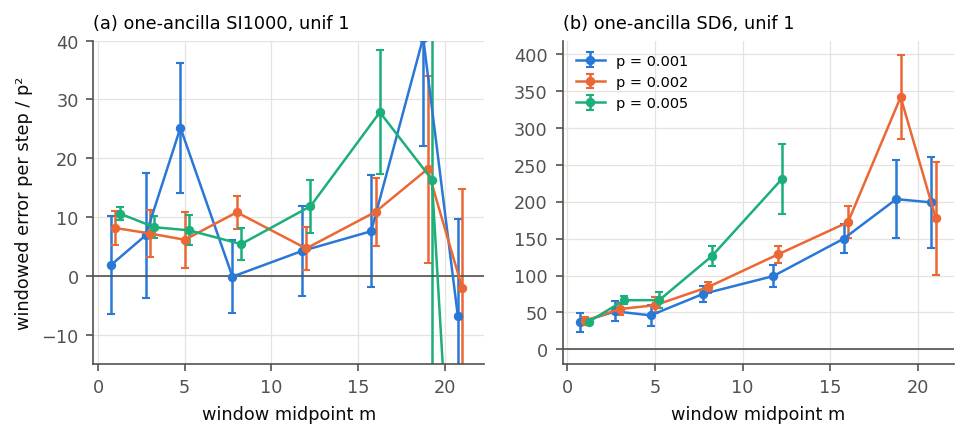
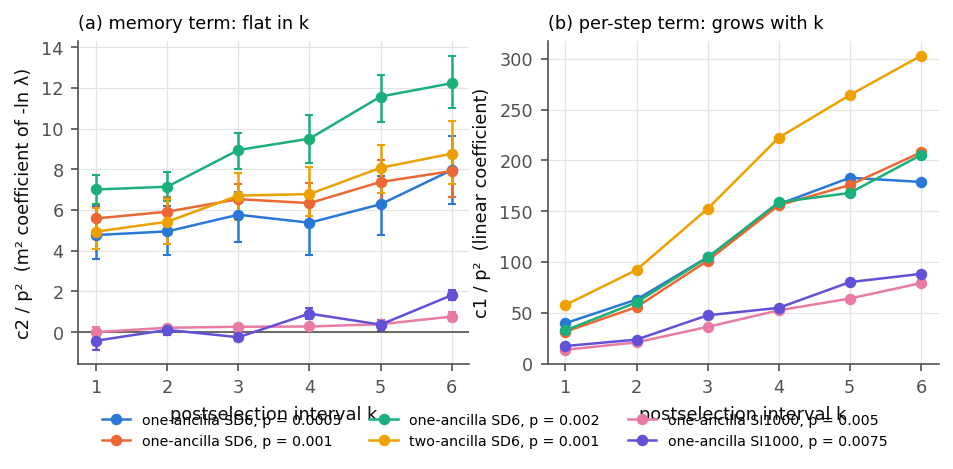
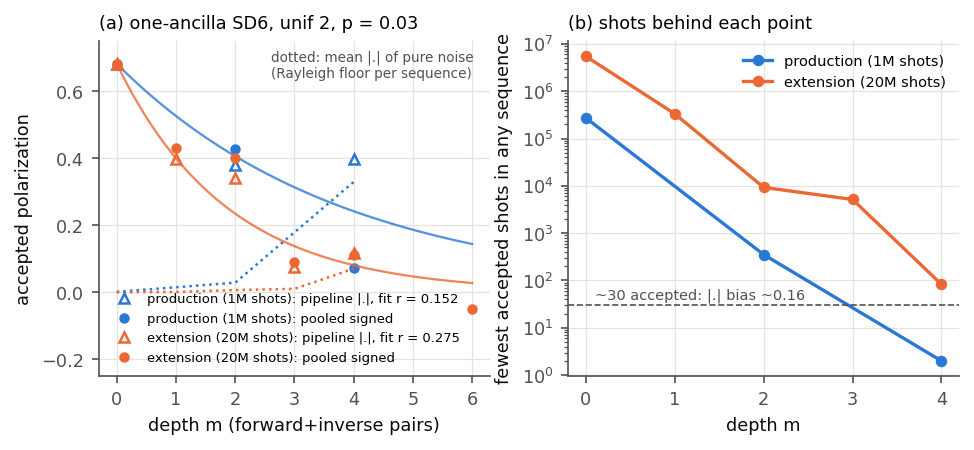
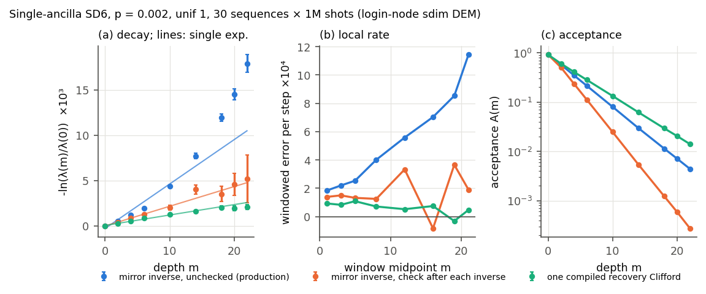
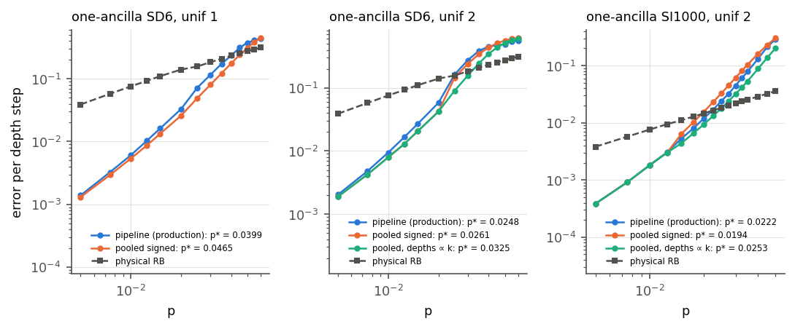

# Non-Markovian decay in LRB-D and how to get a logical gate fidelity out of it

Written 2026-10-30, revised 2026-10-31, for the `[[5,1,2]]_3` folded-qutrit LRB-D study. The data are the four sdim 1.4.0 production runs (SI1000 and SD6, one-ancilla and split-ancilla layouts), their high-p extensions, and eight compiled-recovery runs made on 2026-10-31 as an alternate method. Production stays as it is. **Every LRB and RB fit in this report includes depth m = 0.** Every script and figure referenced here is in this folder; Section 6 lists runtimes and how to reproduce.

## Summary

**Your unif1 fix works for SI1000 but not for SD6.**

- Under SI1000, one-ancilla unif1 LRB-D on the production depths (0 to 22) fits a single exponential within statistics at every p I can test (p ≤ 0.02). Reduced χ² is 0.2 to 2.5 and the m² coefficient is consistent with zero. Two-ancilla SI1000 behaves the same, apart from two p values where the curvature is marginally significant (χ²/dof up to 3.2).
- Under SD6 it does not. For one-ancilla SD6, reduced χ² for a single exponential is 6 to 66, the decay accelerates, and the windowed error per step rises 5.4× from the m = 0→2 window to the m = 20→22 window at p = 1e-3. At the deepest usable depth the m² term carries roughly 70 to 80% of -ln λ. Two-ancilla SD6 shows the same pattern with χ²/dof 1.5 to 21.

**The cause is the unchecked mirror inverse.** Every depth-m circuit runs C1..Cm with a check after each, then Cm^-1..C1^-1 with no checks, then one final check. So every policy, unif1 included, ends with an m-step block in the terminal-check regime. Pairs of data faults inside that block become undetectable logical errors at a rate that grows as m².

- At fixed p the m² coefficient is nearly the same for k = 1 to 4, while the linear coefficient grows 5× (Fig. 3). That rules out the forward checks and points at the part all policies share.
- SD6 shows the effect and SI1000 hides it because SD6 puts p, not p/10, on every one-qutrit gate and idle in the logical Cliffords.

**Three more properties of the data bend the curves.** None of them is physical memory.

- **Depth-0 boundary.** The depth-0 circuit is ideal preparation followed by one check round. That check sees a freshly prepared state, while every later check also inherits errors left over from the round before it. So the first step, m = 0→1, decays faster than the steps after it. The effect is small at low p and large at high p. Examples:
  - one-ancilla SI1000 extension, unif1, depths 0 to 6: χ²/dof 14 to 19;
  - compiled-recovery runs at high p: local rate after the first step about 1/3 of the first step's.

  Every fit here includes m = 0 and so carries this effect. A leading check round after preparation, at every depth including 0, removes most of it (Section 2.1).
- **Schedule staircase for k ≥ 2.** Depths that are not multiples of k carry an extra unchecked forward Clifford. In your worked example (one-ancilla SD6, k = 2, p = 0.03), the production fit gave 0.152 on depths {0,2,4} and the extension fit gave 0.275 on 0 to 4. The difference comes mostly from the odd depths in the extension fit. Fitting only even depths gives 0.139 (production) and 0.156 (extension), which agree within the bootstrap SE of 0.015.
- **Estimator floor at low acceptance.** The pipeline averages `|Σ ω^i P_i|` per sequence, and with a handful of accepted shots that number is biased up. In the production k = 2, p = 0.03 run, the m = 4 point rests on 273 accepted shots in total, as few as 2 in one sequence. The pipeline gives 0.398 there; the pooled signed value is 0.071. The rise of accepted fidelity with depth seen at high p comes from this floor and the staircase. Postselection on i.i.d. noise does not cause it.

**The compiled recovery Clifford fixes the SD6 shape at low p, but not the high-p thresholds.** Replacing the m mirror inverses with one compiled recovery Clifford gives m + 1 Cliffords and m + 1 check rounds. I implemented it as an opt-in mode (`--inverse-mode compiled`) and ran all four configurations (Section 3.6).

- **Low p.** At SD6 p = 0.002 it takes χ²/dof from 54.6 to 1.8, at 7.6e-5 per Clifford plus check round. That matches half the per-pair rate of checking inside the inverse (1.45e-4). It also keeps 3.2× more shots at m = 22.
- **High p (provisional, on hold).** Near threshold, the depth-0 boundary dominates the fit through m = 0 in both protocols. With depth m as the x-axis, the compiled pseudo-thresholds land between 18% below and 15% above the production ones; for one-ancilla SD6 p*(1) it is 0.040 against 0.040. Those numbers wait on the x-axis decision in Section 3.6.

**The quoted pseudo-threshold intervals cover statistics only.**

- For SD6 unif1 and for k ≥ 2, the threshold moves by 10 to 30% depending on the estimator and depth set. For example, one-ancilla SD6 p*(1) ranges from 0.040 to 0.047, while the quoted interval is about ±0.001 (Section 3.4).
- SI1000 k = 1 is robust across estimators (one-ancilla 0.0285 to 0.0293).
- If discarded shots count as random outputs, LRB-D loses to physical RB at every p in every configuration.

**Recommendation.** Rebuild the benchmark around standard RB structure:

- one compiled recovery Clifford;
- one leading check round after preparation;
- a check round after every Clifford (unif1);
- the pooled signed polarization fitted on all depths, m = 0 included, with the deeper depths chosen from the acceptance per step;
- report two numbers per p, the logical cycle error r_L per Clifford and the discard rate d_L per Clifford.

Quote the pseudo-threshold from r_L against physical RB per Clifford, and quote d_L next to it. The leading check round is the part not yet in `src/`. It needs a small generator option and one more round of runs, about 5 node-hours (Section 4).

---

## 1. Diagnosis

### 1.1 What the pipeline measures

Facts from `src/lrb`, which the rest of the report relies on:

- **Depth.** Depth m is 2m noisy Cliffords: C1..Cm, each followed by a check round, then the mirror inverses with no checks, then one final check. Encoded preparation and the terminal logical-X readout are ideal.
- **Policies.** Every forward round is executed for every policy. `unif k` only chooses which rounds' syndromes are postselected: rounds after C_k, C_2k, ... plus the final round (`postselect_uniform_interval`). Policies share the same shots.
- **Sequences.** The 30 sequences are nested. Depth m uses the first m Cliffords of one max-depth draw, and the same circuits serve every p (`circuit_generator.py`). Depth points are therefore correlated within a sequence. I bootstrap over whole sequences throughout.
- **Statistic.** The pipeline uses `|Σ_i ω^i P(i | accepted)|` per sequence, averaged with equal weight over sequences and fitted to b f^m with weights 1/std², std being the spread across sequences. It reports r = 2(1 - f)/3. The tables call r "per Clifford", but f is per forward+inverse pair. Physical RB uses the same convention, so the LRB/RB ratio is unaffected.
- **Signed polarization.** The ideal outcome is 0 for every sequence, so the unbiased statistic is the signed polarization λ = (3 P(0 | accepted) - 1)/2. Under this noise it equals `|.|` in expectation but has no upward bias at low counts. I pool it over sequences as a ratio of sums ("pooled" below). That is the form that stays exponential under a Markovian, twirled, lossy step map (prior study, Section 5.2).

Validation: my reimplementation of the production fit reproduces both numbers in the worked example (0.1521, 0.2754), and my crossing finder reproduces the official SD6 p*(1) values.

### 1.2 Five mechanisms, with the evidence for each

`diagnose.py` scans every configuration, p and policy (unif 1 to 6, const 0 to 3; `results/curvature_scan.csv`). It fits ln λ = c0 - c1 m - c2 m² with a 95% sequence-bootstrap interval on c2, and a single-exponential χ².

| # | Mechanism | Signature | Where it shows | Evidence |
|---|---|---|---|---|
| M1 | Unchecked mirror inverse: pairs of faults in the m-step inverse block become logical errors | accelerating decay, c2 > 0, nearly the same for k = 1 to 4 | SD6 at all p; weakly in SI1000 | SD6 one-ancilla unif1 χ²/dof 6.3, 28, 66, 28 at p = 5e-4, 1e-3, 2e-3, 5e-3; c2/p² = 5.6, 5.9, 6.3 for k = 1, 2, 4 at p = 1e-3, while c1/p² = 31, 56, 156 (Fig. 3) |
| M2 | Check schedule for k ≥ 2: depths with m mod k ≠ 0 have one more unchecked forward Clifford and one fewer postselected round | staircase; accepted λ at m = jk - 1 is close to λ at m = jk | k ≥ 2 on dense depths | SI1000 extension unif2 χ²/dof 100 to 260; worked example below |
| M3 | Depth-0 boundary: the depth-0 check sees a fresh state; later checks also inherit the previous round's leftover errors | first step decays fastest | high p, dense depths, both protocols | one-ancilla SI1000 extension unif1 χ²/dof 16, 19, 16, 14 at p = 0.015, 0.02, 0.025, 0.03; a leading check round brings SI1000 p = 0.02 to 0.86 (mirror) and 2.6 (compiled), Section 2.1 |
| M4 | Estimator floor: `|.|` of a few accepted shots is biased up by about sqrt(π/4N), and the pipeline keeps any depth where every sequence has one accepted shot | flattening or rising tail at the deepest depths | high p, all policies | production SD6 k = 2, p = 0.03, m = 4: pipeline 0.398 vs pooled 0.071 from 273 shots (Fig. 1) |
| M5 | Shot-to-shot drift on hardware: postselection keeps the quiet shots | accepted fidelity rises with depth | not in this simulation (i.i.d. faults) | prior study's quasi-static mixture, Section 5.5 |

One candidate does not contribute: mixing of fast and slow sequences. In the variant runs, equal-weight and acceptance-weighted averages give the same windows, and the curvature is present within single sequences.

**M1 in more detail.**

- Fig. 2b shows the SD6 windowed rate per step climbing linearly in m: 3.7e-5 in the first window and 2.0e-4 in the last at p = 1e-3, a factor of 5.4. A linear rise in the local rate is what an m² term in -ln λ gives.
- Fig. 2a shows SI1000 flat within errors.
- Fig. 3a shows c2 staying within errors for k = 1 to 4 and rising only by k = 5 and 6, where the forward intervals get long enough to hold pairs of their own. Meanwhile c1 grows 5× from k = 1 to 4.
- The only unchecked interval whose length grows with m in every policy is the inverse block. Checking inside the inverse, or removing the inverse block, sets c2 to zero (Section 2).

### 1.3 The worked example

One-ancilla SD6, k = 2, p = 0.03 (Fig. 1). Every row includes m = 0:

| fit | depths | r |
|---|---|---|
| production pipeline | 0, 2, 4 | 0.152 |
| extension pipeline | 0, 1, 2, 3, 4 | 0.275 |
| production pooled | 0, 2 (m = 4 has 273 shots) | 0.139 |
| extension pooled, even depths | 0, 2, 4 | 0.156 |
| extension pooled, all depths | 0 to 4 | 0.241 |

The split is mostly M2. With k = 2, depth 1 has only the final check, and depth 3 has the same 4-Clifford unchecked tail as depth 4 with one fewer postselected round, so the odd depths sit on a different curve. Restrict the fit to multiples of k and production and extension agree within sequence noise. The extension is a fresh draw of 30 sequences, and the bootstrap SE of the production rate is 0.015. M4 inflates the production m = 4 point, but the pipeline weights it lightly because its spread across sequences is large; it moves the production fit by about 0.01.

### 1.4 Accepted fidelity rising with depth

In the new data, every case of λ(m + Δ) > λ(m) that I looked at is M2 (the step from m = 2j - 1 to 2j for k = 2 adds a postselected round), M4 (a point resting on tens of shots), or both. With i.i.d. DEM faults there is no hidden per-shot noise strength for postselection to select on, so the prior study's drift mechanism cannot appear here. It remains the main risk on hardware (Section 3.5).

## 2. Mitigation options, ranked

The protocol variants come from `variant_sim.py`. It builds one-ancilla circuits with the production generator's own segments and noise and samples sdim's exact DEM, at 30 sequences, postselecting every round. The production-protocol variant reproduces the production run: at SD6 p = 0.002 it gives r = 3.26e-4 vs 3.19e-4, the same c2, and acceptance 0.914, 0.080, 0.0044 vs 0.914, 0.084, 0.0044 at m = 0, 10, 22. All fits include m = 0 (`results/variant_summary.csv`). "Per Clifford" halves the mirror rates so all variants share one unit: one logical Clifford plus one check round.

| variant | noise, p | depths | r per Clifford | χ²/dof, single exp. | c2 [95%] | acceptance at deepest m |
|---|---|---|---|---|---|---|
| mirror, unchecked (production) | SD6 0.002 | 0 to 22 | 1.63e-4 | 54.6 | 2.7e-5 [2.4e-5, 3.0e-5] | 4.4e-3 |
| mirror, check after each inverse | SD6 0.002 | 0 to 22 | 7.2e-5 | 0.69 | 1.5e-6 [-2.7e-6, 6.1e-6] | 2.7e-4 |
| compiled recovery | SD6 0.002 | 0 to 22 | 7.6e-5 | 1.82 | -2.6e-6 [-4.2e-6, -0.9e-6] | 1.4e-2 |
| mirror, unchecked | SD6 0.025 | 0 to 3 | 0.029 | 7.9 | 2.2e-2 [1.4e-2, 3.3e-2] | 7e-8 at m = 6 |
| mirror, check after each inverse | SD6 0.025 | 0 to 2 | 0.023 | 0.04 | n/a | 0 at m = 6 |
| compiled recovery | SD6 0.025 | 0 to 4 | 0.038 | 6.7 | -1.1e-2 [-1.6e-2, -0.7e-2] | 1.8e-7 at m = 6 |
| mirror, unchecked | SI1000 0.005 | 0 to 22 | 1.14e-4 | 1.5 | 7.3e-6 [-0.9e-6, 1.5e-5] | 2.0e-4 |
| compiled recovery | SI1000 0.005 | 0 to 22 | 1.41e-4 | 1.83 | -3.9e-6 [-9.3e-6, 1.4e-6] | 3.7e-4 |

Physical RB per Clifford at the same p: 7.9e-3 (SD6 0.002), 0.079 (SD6 0.025), 1.9e-3 (SI1000 0.005).

The compiled rows at SD6 0.025 and SI1000 0.005 show negative curvature, a decay that slows after the first step. That is M3, in the fit through m = 0: the compiled m = 0 circuit has no recovery gate and starts from a fresh state.

### 2.1 The depth-0 boundary with m = 0 in every fit

I tried four ways of closing the circuits, aimed at putting m = 0 on the same footing as the other depths (`variant_sim.py`, `results/variant_summary.csv`):

1. compiled recovery as in Section 2;
2. the compiled recovery plus a noisy identity "recovery" at m = 0;
3. a random Clifford G followed by its compiled undo at every depth, 0 included;
4. a leading check round after preparation at every depth, 0 included, applied to both protocols.

| closing | SD6 p = 0.002, depths 0 to 22 | SD6 p = 0.025, depths 0 to 4 | SI1000 p = 0.02, depths 0 to 4 |
|---|---|---|---|
| compiled | χ²/dof 2.3, r 7.8e-5 | 8.0, r 0.039 | 56, r 0.0057 |
| compiled + identity at m = 0 | 0.68, r 7.3e-5 | 11.3, r 0.035 | |
| compiled + random G and undo | 1.8, r 7.1e-5 | 1.9 (4 depths), r 0.037 | |
| compiled + leading check | | 5.3, r 0.043 | 2.6, r 0.0035 |
| mirror (per Clifford) | 54.6, r 1.6e-4 | 15.6, r 0.031 | 11.2, r 0.0035 |
| mirror + leading check (per Clifford) | | 7.1, r 0.026 | 0.86, r 0.0024 |

- At low p every closing gives a near-exponential decay through m = 0.
- At high p, a noisy identity at m = 0, or a random Clifford and its undo at every depth (rows 2 and 3), leaves the steep first step in place. So the missing recovery gate is not the whole story. A separate check (Section 3.6 note) finds that counting noisy Cliffords on the x-axis removes the gate-count part of the first step, and what remains is the depth-0 boundary.
- The leading check round gives the depth-0 check the same inherited errors as every other check. It makes SI1000 p = 0.02 exponential through m = 0 in both protocols.
- At SD6 p = 0.025 it halves χ²/dof but does not remove the curvature. There the compiled local rates keep falling past the first step (0.053, 0.030, 0.019), so a slower mixing of the hidden syndrome also contributes.

### 2.2 Ranked options

The ranking is by how much of the problem each option removes per unit of cost.

1. **Compiled recovery Clifford, unif1 (protocol).** This removes M1, the only real memory effect in the data.
   - Every interval between checks is one Clifford, the condition under which logical dynamics compose (Ziyad, Blume-Kohout and Rudinger 2025; Combes et al. 2017 require syndromes refreshed every round).
   - Each depth step becomes one logical Clifford followed by one check round. That is the logical gate a reader expects a "logical gate fidelity" to describe, and it is the same rate the checked-inverse variant measures per Clifford. Circuits get shorter (m + 1 Cliffords instead of 2m), so acceptance improves.
   - Done as an opt-in mode, with the default path verified byte-identical ([COMPILED_RECOVERY_PLAN.md](COMPILED_RECOVERY_PLAN.md)). All four configurations have been run (Section 3.6).
   - Cons: old and new numbers are not directly comparable. With m = 0 in the fit, the high-p rates and thresholds are set mostly by M3, so on its own it does not move the pseudo-thresholds.

2. **Leading check round after preparation (protocol).** This removes most of M3 while keeping m = 0 in every fit (Section 2.1). It costs one constant check round per circuit, a constant acceptance factor that does not change f.
   - Not yet in `src/`: a ~10-line generator option and tests, plus new runs.

3. **Choose the deeper depths from the acceptance (depth grid).** To estimate a per-step decay c from a lossy curve A(m) = A0 a^m, the shot-noise variance of ĉ scales roughly as c/(N A0 a^m m). That is smallest near m* = -1/ln a, not where λ has decayed by 1/e as in ordinary RB (Harper et al. 2019 give m ≈ 1/(2(1 - f)) for the lossless case). With the production protocol, unif1:

   | p | 5e-4 | 1e-3 | 2e-3 | 5e-3 | 1e-2 | 2e-2 | 3e-2 |
   |---|---|---|---|---|---|---|---|
   | m*, one-ancilla SI1000 | 27 | 13 | 7 | 2.7 | 1.3 | 0.7 | 0.45 |
   | m*, one-ancilla SD6 | 16 | 8 | 4 | 1.7 | 0.9 | 0.45 | 0.3 |

   Above p ≈ 0.01, depths beyond 2 cost shots without adding information, which is why the production fits near threshold run on m = 0 and one more depth. The dense 0 to 4 or 0 to 6 grids of the extensions are the right design.

4. **Pooled signed estimator with a shot floor (analysis).** This removes M4.
   - Replace the per-sequence `|.|` mean with the pooled (3 P(0) - 1)/2.
   - Use depths with at least about 1000 accepted shots in total; m = 0 always qualifies.
   - Weight by binomial standard errors, and take intervals from a sequence bootstrap.
   - Done as `src/lrb/pooled_lrb_fits.py`, a separate module from the production plotter. It always includes m = 0 and has no option to leave it out.
   - Cons: the shot floor removes deep, nearly empty points that the pipeline currently fits. At high p that changes which depths survive, and under M1 that moves the rate. That is the source of the 0.040 vs 0.047 spread for SD6 p*(1).

5. **Fit only depths that are multiples of k when k ≥ 2 (analysis).** This removes M2.
   - If the k-dependence is meant to describe a sparser checking protocol, also execute only the postselected rounds (protocol). Today every round is executed and only its syndrome is ignored, so a larger k pays the full check noise and discards information. p*(k) falling with k measures how much information you throw away, not what sparser checking would buy.

6. **Check after every inverse Clifford (protocol).** This removes M1 and measures the same per-Clifford rate as the compiled recovery. But it doubles the check rounds: acceptance at m = 22 falls 16× at SD6 p = 0.002 relative to production and 51× relative to compiled, and at SI1000 p = 0.005 the usable depths stop at 14. The compiled recovery dominates it.

7. **Model-based fits of the mirror data you already have (analysis).** Fitting ln λ = c0 - c1 m - c2 m² through all depths and reporting c1 bounds the SD6 per-step rate.
   - It is model-dependent and needs at least 4 usable depths. Use it to bound the SD6 numbers in the paper, not as the headline.
   - A multi-exponential (ESPRIT or matrix-pencil) fit, which Helsen et al. 2022 recommend for repeated irreps, does not apply. The m² term comes from an interval that grows with m, not from a fixed transfer matrix, so it has no eigenvalue to extract.

8. **Decoder-based acceptance: blip-forgiving detection or soft-output MLD (protocol plus decoder).** The prior study found these improve the acceptance-versus-error trade at the same circuit noise. They do not address M1 or M2. I have not rechecked them on the new circuits.

9. **Full correction (MLD) instead of detection.** This removes postselection bias under hardware drift (M5). But at distance 2 it gave a first-order logical error 3× worse than physical RB in the prior study, and that was against p_RB = 5p; the same-p SI1000 baseline is about 10× stricter. It is not a fidelity metric for this code.

## 3. The logical fidelity metric

### 3.1 What to report, and how it relates to your current number

The metric is the **logical cycle error per Clifford**, r_L = (d - 1)(1 - f)/d = 2(1 - f)/3. Here f is the decay per depth step of the accepted, pooled, signed polarization in the compiled-recovery unif1 protocol, and the logical gate fidelity is F_L = 1 - r_L.

- One step is one encoded Clifford followed by one check round. That is the logical channel Combes et al. 2017 define: gate plus recovery round, with the syndrome traced out. Here it is conditioned on passing the check.
- "Cycle" is borrowed from QEC memory experiments; r_L is a logical gate error, not a different kind of quantity.
- It is the conditional error rate Gottesman (2016) says to compare with the unencoded error rate in small experiments, "p_L/p_S" against p_U.

Your current logical gate fidelity, F = (1 + 2f)/3 from the mirror protocol, covers a different unit. One depth step there is a forward Clifford, its check round, and the matching inverse Clifford in the unchecked inverse block. That is two logical Cliffords and one check round, and under SD6 the per-step rate also depends on which depths are fitted.

On the same data (unif1, one-ancilla, all fits through m = 0; `results/compiled_vs_mirror_rates.csv`), the current per-pair rate over r_L is:

| p | SI1000 | SD6 |
|---|---|---|
| 1e-3 | 2.0 | 4.3 |
| 2e-3 | 2.0 | 4.0 |
| 5e-3 | 1.5 | 2.1 |

At low p, SI1000 gives two cycles per pair, as expected. SD6 gives four, because of the inverse block's extra errors. Physical RB shows the factor of 2 (1.8 to 1.9 at low p) in both models.

Report the **discard rate per Clifford**, d_L = 1 - a, next to r_L, where a is the per-step acceptance from a log-linear fit of A(m) on the same depths. This is the erasure-qubit convention. Levine et al. 2024 fit the postselection probability and the postselected survival separately, and quote an erasure rate of 4.38e-3 and a residual error of 1.01e-4 per Clifford, a 43:1 ratio. For LRB-D at one-ancilla SI1000 p = 1e-3, discards outnumber accepted errors per step about 9000:1. Readers need both numbers to judge the code.

For a single number that counts discards, use the unconditional rate r_uncond = 2(1 - a f)/3.

- It is the decay of J(m) = A(m) λ(m) = E[Re ω^residual · 1_accept], scoring a discarded shot as a random guess.
- J is linear in the process, with no ratio, and it is exponential whenever the step map is Markovian.
- Chen and Baldwin 2025 make the same point for leakage: the gate fidelity needs both the kept-fraction decay and the postselected decay. If leakage dominates, the postselected infidelity "would be zero while the actual infidelity is" the leakage rate. LRB-D is deep in that regime.

### 3.2 How to fit it robustly

1. Use all depths, m = 0 included. Choose the deeper depths around m* = -1/ln a, at least three in all; add one or two beyond m* only as a model check.
2. Use the pooled signed polarization, a floor of about 1000 accepted shots per depth, and binomial weights.
3. Fit λ = b f^m with b free and offset 0, as now, because the polarization of a depolarized qutrit is 0. b absorbs preparation and readout. The depth-0 boundary (M3) is part of what the fit sees.
4. Take intervals from a bootstrap over sequences, resampled whole across depths because the prefixes are nested.
5. Test the model and report the outcome, using the χ²/dof of the single exponential and the rate fitted on the shallower half of the depths against the deeper half.
   - A window ratio far from 1 with χ²/dof ≫ 1 means the per-step rate depends on the depth window, through M1 or M3. Then the number should be quoted with that diagnostic, not as a clean gate fidelity.
   - `src/lrb/pooled_lrb_fits.py` reports both diagnostics for every row.

Harper et al. (2019) note that weights for joint multi-depth fits "are not generally inferable from the data". With shot noise dominating at high p, their two-depth design (here m = 0 and a second depth near m*) is a reasonable minimum.

### 3.3 Acceptance and cost

Acceptance enters in three places:

- **As d_L next to r_L.** It is the cost of the protection.
- **As the shot budget.** Collecting N accepted shots at depth m takes N/(A0 a^m) attempts. At SD6 p = 0.03, a ≈ 0.04 per production step, so each extra depth costs 25× the shots.
- **As the strict comparison: r_uncond against physical RB.**
  - In every configuration and at every p from 1e-4 to 0.07, in both protocols, r_uncond is far above physical RB: 0.048 vs 7.6e-4 at SI1000 p = 1e-3, and 0.076 vs 8.0e-3 at SD6 p = 1e-3.
  - So postselected LRB-D on this code never beats an unencoded qutrit once discards count. Say so plainly.
  - Hardware papers that postselect report the discard fraction next to the fidelity: Harper and Flammia 2019 (discard bars), Self et al. 2024 (86.8% discards at logical quantum volume 2^8), Bluvstein et al. 2024 (fidelity against accepted fraction).

English, Williamson and Bartlett (2025) give the cleanest framing. Postselected error correction has two thresholds, a conditional logical threshold computed on the accepted set and an abort threshold, and it scales only below both. The current p* is the conditional one. For a distance-2 code no abort threshold exists in the scaling sense, so the honest statement is the pair (r_L, d_L) at each p.

### 3.4 How this relates to the pseudo-thresholds you quote

Today p* is where the mirror-protocol LRB rate per pair equals the mirror physical-RB rate per pair. `estimators.py` recomputes it under three estimators on the production plus extension data, with the same RB baseline and m = 0 in every fit (`results/pseudo_thresholds_by_estimator.csv`, Fig. 5).

- "Pipeline (mine)" is my reimplementation of the production statistic with a simple last-crossing rule, on all depths.
- "Depths ∝ k" fits only depths that are multiples of k; for k = 1 it equals pooled.
- Bootstrap 68% intervals for the pooled estimators are about ±1 to 5%; for example, one-ancilla SD6 p*(1) pooled is [0.0442, 0.0483].

| configuration | k | official | pipeline (mine) | pooled | depths ∝ k | spread |
|---|---|---|---|---|---|---|
| one-ancilla SD6 | 1 | 0.0399 | 0.0399 | 0.0465 | = pooled | 0.040 to 0.047 |
| one-ancilla SD6 | 2 | 0.0269 | 0.0248 | 0.0261 | 0.0325 | 0.025 to 0.033 |
| one-ancilla SD6 | 3 | 0.0181 | 0.0186 | 0.0179 | 0.0230 | 0.018 to 0.023 |
| one-ancilla SD6 | 4 | 0.0155 | 0.0158 | 0.0178 | 0.0184 | 0.016 to 0.018 |
| two-ancilla SD6 | 1 | 0.0360 | 0.0362 | 0.0401 | = pooled | 0.036 to 0.040 |
| two-ancilla SD6 | 2 | 0.0251 | 0.0229 | 0.0241 | 0.0280 | 0.023 to 0.028 |
| one-ancilla SI1000 | 1 | 0.0292 | 0.0293 | 0.0285 | = pooled | 0.029 to 0.029 |
| one-ancilla SI1000 | 2 | 0.0239 | 0.0222 | 0.0194 | 0.0253 | 0.019 to 0.025 |
| one-ancilla SI1000 | 3 | 0.0166 | 0.0173 | 0.0152 | 0.0195 | 0.015 to 0.020 |
| two-ancilla SI1000 | 1 | 0.0288 | 0.0289 | 0.0274 | = pooled | 0.027 to 0.029 |
| two-ancilla SI1000 | 2 | 0.0228 | 0.0208 | 0.0178 | 0.0241 | 0.018 to 0.024 |

The official column is `comparisons/pseudo-thresholds-current.csv` as of 2026-10-31. Its extension fits for k ≥ 2 use even depths only, which is why it differs from my all-depth pipeline column for k = 2.

- SI1000 k = 1 is robust across estimators, within 0.001.
- SD6 at every k, and SI1000 at k ≥ 2, carry a systematic of 10 to 30% that the quoted ±0.001 intervals do not show.

### 3.5 Where this sits in the literature

All sources below were fetched and checked; full citations are in Section 7.

- **No theory exists for postselected decays specifically.** Harper and Flammia (2019) say "there is at present no complete theory for fitting an RB decay curve with post-selection". Their supplement writes the postselected survival as Pr(S|m)/Pr(c|m) and warns that ignoring the denominator "might lead to inaccurate fits". I found no paper giving a fitting model for RB with mid-circuit detection between logical gates. The closest are leakage RB (Wood and Gambetta 2018; Wallman, Barnhill and Emerson 2016; Chen and Baldwin 2025) and erasure-conditioned RB (Levine et al. 2024). Both separate a kept-fraction decay from a conditional decay, which is the (d_L, r_L) pair recommended here.
- **On the source of the memory.** Ceasura et al. (2022) identify syndrome qubits as hidden memory in LRB but give no fitting prescription. Ziyad, Blume-Kohout and Rudinger (2025) prove that non-Markovianity emerges if and only if the state is not returned to the code space every round, which here means the unchecked inverse block. Their theorem is stated for d ≥ 3, so it does not cover this code, but the mechanism matches. In their numerics the logical error rate is zero in the first round, jumps, then relaxes to a constant: a first-round boundary of the same kind as M3.
- **On fitting.** Helsen et al. (2022) say single exponentials need a Markovian, multiplicity-free setting, and point to multi-exponential fits otherwise. Proctor et al. (2022) count every mirror layer, inverses included, and note that correlations between a layer and its inverse put the per-layer error between ε/2 and ε. Here the two halves differ more fundamentally, checked against unchecked, which is another reason to drop the mirror.
- **On hardware drift.** The prior study's quasi-static mixture (M5) is the one effect the compiled protocol does not remove. On hardware, run one unpostselected companion: correction-based, or r_uncond. If the postselected rate falls with depth while the companion's does not, the selection is picking quiet shots.

### 3.6 Compiled-recovery results (alternate method; production unchanged)

**Provisional, on hold (2026-10-31).** These compiled-recovery numbers use depth m as the x-axis. In compiled mode, depth 0 has no noisy Clifford while every later depth m has m + 1 (forward plus recovery), so a fit against m through m = 0 biases the rates, and most strongly over the short 0 to 4 high-p window. Indexing by the number of noisy Cliffords (0 at depth 0, m + 1 otherwise) puts compiled RB's depth-0 point back on its curve and mostly fixes unif1 LRB. The user is deciding which x-axis to use, with m = 0 kept in every fit. Do not quote the compiled numbers until then.

Eight runs were made with `--inverse-mode compiled`, run folders `Run-2026-10-31-00-*-compiled-recovery[-highp]`:

- **Production grid:** 15 p values, depths 0,1,2,3,4,6,10,14,18,22, 1M shots.
- **High-p grid:** depths 0 to 4, 20M shots. SD6 covers p = 0.025 to 0.07; SI1000 covers 0.015 to 0.05.

All eight validate (`validate_lrb_run.py --require-complete`). Fits use `src/lrb/pooled_lrb_fits.py`, with m = 0 in every LRB and RB fit, merged at p = 0.015 (SI1000) and 0.025 (SD6). Compiled rates are per Clifford plus check round against compiled physical RB per Clifford; mirror rates are per pair against mirror physical RB per pair (`compiled_vs_mirror.py`, `results/compiled_vs_mirror_thresholds.csv`).

| configuration | k | mirror, official | mirror, pooled | compiled, pipeline statistic | compiled, pooled [68%] |
|---|---|---|---|---|---|
| one-ancilla SI1000 | 1 | 0.0292 | 0.0285 | 0.0288 | 0.0254 [0.0252, 0.0255] |
| one-ancilla SI1000 | 2 | 0.0239 | 0.0253 | 0.0230 | 0.0230 [0.0228, 0.0232] |
| one-ancilla SI1000 | 3 | 0.0166 | 0.0195 | 0.0180 | 0.0180 [0.0179, 0.0182] |
| one-ancilla SI1000 | 4 | 0.0132 | 0.0155 | 0.0118 | 0.0118 [0.0117, 0.0120] |
| one-ancilla SD6 | 1 | 0.0399 | 0.0465 | 0.0403 | 0.0402 [0.0390, 0.0415] |
| one-ancilla SD6 | 2 | 0.0269 | 0.0325 | 0.0288 | 0.0309 [0.0302, 0.0314] |
| one-ancilla SD6 | 3 | 0.0181 | 0.0230 | 0.0187 | 0.0196 [0.0193, 0.0200] |
| one-ancilla SD6 | 4 | 0.0155 | 0.0184 | 0.0142 | 0.0144 [0.0142, 0.0146] |
| two-ancilla SI1000 | 1 | 0.0288 | 0.0274 | 0.0262 | 0.0237 [0.0235, 0.0239] |
| two-ancilla SI1000 | 2 | 0.0228 | 0.0241 | 0.0212 | 0.0211 [0.0208, 0.0213] |
| two-ancilla SI1000 | 3 | 0.0150 | 0.0179 | 0.0156 | 0.0157 [0.0154, 0.0158] |
| two-ancilla SI1000 | 4 | 0.0119 | 0.0138 | 0.0101 | 0.0101 [0.0100, 0.0102] |
| two-ancilla SD6 | 1 | 0.0360 | 0.0401 | 0.0344 | 0.0338 [0.0331, 0.0346] |
| two-ancilla SD6 | 2 | 0.0251 | 0.0280 | 0.0250 | 0.0273 [0.0270, 0.0276] |
| two-ancilla SD6 | 3 | 0.0145 | 0.0187 | none | 0.0166 [0.0164, 0.0169] |
| two-ancilla SD6 | 4 | 0.0125 | 0.0148 | none | 0.0122 [0.0121, 0.0124] |

**At low p** the compiled decays are single exponentials through m = 0: χ²/dof 0.2 to 3.4 for one-ancilla at every p ≤ 0.002. For SD6 the compiled LRB/RB ratio per Clifford is half the mirror per-pair ratio, 0.0047 against 0.0108 at p = 1e-3. For SI1000 the two ratios agree.

**At high p** M3 dominates, in LRB and in compiled RB alike, because the compiled m = 0 circuits have no recovery gate.

- The one-ancilla SI1000 compiled fits through m = 0 reach χ²/dof 1,200 to 1,650 at p = 0.015 to 0.025, with late/early window ratios near 0.3.
- So the fitted compiled per-Clifford rate rises to about the mirror per-pair rate (ratio 0.9 to 1.1 at p ≥ 0.02).
- The compiled thresholds therefore land between 18% below and 15% above the official mirror ones: lower for SI1000 k = 1 and for k = 4, higher for SD6 k = 2 and 3. These rows are compiled-protocol numbers with M3 included, not a statement that the code got worse.

A leading check round (Section 2.1) is the protocol change that should let the compiled numbers show their low-p behaviour near threshold too.

## 4. Recommendation and what it takes

**Recommended protocol.** Compiled recovery, a leading check round after preparation, and a check after every Clifford. Report (r_L, d_L) per logical Clifford, fitted with the pooled signed estimator on all depths including m = 0. Quote the pseudo-threshold as r_L = r_RB per Clifford, give d_L at that p, and state that r_uncond never crosses physical RB.

**For the paper as it stands** (production, mirror protocol):

- keep SI1000 unif1 as quoted;
- mark the SD6 rates and the k ≥ 2 thresholds with the estimator spread of Section 3.4;
- drop the claim that k = 1 alone makes the decay Markovian; it does so only together with a checked or compiled inverse;
- present the compiled-recovery runs, if at all, as an alternate method (Section 3.6).

Done (opt-in; the default path is byte-identical; see [COMPILED_RECOVERY_PLAN.md](COMPILED_RECOVERY_PLAN.md)):

1. `--inverse-mode compiled` in the generator and the generation script.
2. `src/lrb/pooled_lrb_fits.py` and `scripts/fit_lrb_pooled.py`: r_L, d_L and r_uncond with m = 0 always in the fit, plus diagnostics, bootstrap and production + high-p merging.
3. The eight compiled-recovery runs, completed and validated (Section 3.6).

Still to do, if you want the recommended protocol measured:

1. A `--leading-check` generator option: one postselected check round after preparation at every depth. About 10 lines in `src/lrb/circuit_generator.py`; that file is not checkpoint-fingerprinted. Plus a test that m = 0 then has two rounds and that default circuits stay byte-identical.
2. Eight more runs with compiled recovery plus leading check, same grids. The last round took 2¼ h of wall time in 12 thirty-minute debug jobs, at most 6 node-hours.

## 5. Caveats, and the prior study's claims rechecked

- The variant tests are one-ancilla only, at four (noise, p) points, with 1M to 2M shots per circuit. The leading check round was tested at two high-p points; its effect at SD6 high p is partial.
- Fits use 30 sequences per run. Sequence-to-sequence variation dominates the error at low p, so the bootstrap intervals are the relevant ones, not binomial ones.

| prior-study claim (August 2026 noise model) | status on sdim 1.4.0 data |
|---|---|
| Sparse-check LRB-D (const c, unif k ≥ 2) is strongly non-exponential | Confirmed. const1 χ²/dof exceeds 100 at every p ≤ 0.02 in every configuration, up to about 5000; unif4 one-ancilla SI1000 reaches 168 on production depths and 290 on the dense extension depths. |
| unif1 is about exponential | True for SI1000. False for SD6, through the unchecked inverse (M1). |
| Postselection plus drift makes accepted fidelity rise | Not testable with i.i.d. DEM noise. The rises seen here come from M2 and M4. |
| Checking inside the inverse half removes residual curvature | Confirmed (Section 2), at a 16× acceptance cost at m = 22. The compiled recovery does the same more cheaply. |
| Parallel ancilla readout is the biggest lever | Already in the sdim140 circuits: `_check_round_circuit` puts all ancilla readouts in one shared measurement moment. |
| BFD and soft-MLD beat LRB-D on acceptance; const0 + MLD gives 0.45× RB; full MLD is 3× worse than RB | Not rechecked. The RB baseline changed from p_RB = 5p to same-p, and under SI1000 that is about 10× stricter, so the 0.45× and 3× ratios will not survive as stated. |

## 6. Reproduction

All scripts run from this folder with `PYTHONNOUSERSITE=1 ../../.venv-sdim140/bin/python`. They read only from `LRB-experiment-data-slurm/` and `src/`, and write only to `results/` and `figures/`. Every fit includes m = 0.

| script | what it does | runtime here |
|---|---|---|
| `nmlib.py` | loaders for the per-sequence count arrays, estimators, the mirror of the production fit | library |
| `diagnose.py` | curvature scan over every run, p and policy → `results/curvature_scan.csv`, `results/curves.npz` | 6 min |
| `estimators.py` | estimator comparison and pseudo-thresholds → `results/estimator_table.csv`, `results/pseudo_thresholds_by_estimator.csv` | 10 min |
| `variant_sim.py`, `run_variants.sh` | login-node protocol-variant sampling, closings of Section 2.1 included → `results/variant_sim_*.npz` | 2 to 9 min per setting on 8 workers |
| `check_gate_conventions.py` | checks the token unitaries behind the recovery lookup against sdim (0 mismatches in 800) | seconds |
| `variant_summary.py` | variant fits → `results/variant_summary.csv` | 2 min |
| `compiled_vs_mirror.py` | Section 3.6 tables → `results/compiled_vs_mirror_{thresholds,rates}.csv` | 5 min |
| `figures.py` | Figs. 1 to 5 | 1 min |

## 7. References

Each entry was fetched from its arXiv page or journal and checked against Crossref.

- Bluvstein et al., "Logical quantum processor based on reconfigurable atom arrays", Nature 626, 58 (2024). arXiv:2312.03982
- Ceasura, Iyer, Wallman, Pashayan, "Non-Exponential Behaviour in Logical Randomized Benchmarking", arXiv:2212.05488 (2022)
- Chen, Baldwin, "Randomized Benchmarking with Leakage Errors", Phys. Rev. Research 7, 043065 (2025). arXiv:2502.00154
- Combes, Granade, Ferrie, Flammia, "Logical randomized benchmarking", arXiv:1702.03688 (2017)
- English, Williamson, Bartlett, "Thresholds for Postselected Quantum Error Correction from Statistical Mechanics", PRL 135, 120603 (2025). arXiv:2410.07598
- Gidney, Newman, Fowler, Broughton, "A Fault-Tolerant Honeycomb Memory", Quantum 5, 605 (2021). arXiv:2108.10457 (SI1000 and SD6 definitions)
- Gottesman, "Quantum fault tolerance in small experiments", arXiv:1610.03507 (2016)
- Harper, Flammia, "Fault-Tolerant Logical Gates in the IBM Quantum Experience", PRL 122, 080504 (2019). arXiv:1806.02359
- Harper, Hincks, Ferrie, Flammia, Wallman, "Statistical analysis of randomized benchmarking", PRA 99, 052350 (2019). arXiv:1901.00535
- Helsen, Roth, Onorati, Werner, Eisert, "A general framework for randomized benchmarking", PRX Quantum 3, 020357 (2022). arXiv:2010.07974
- Levine et al., "Demonstrating a long-coherence dual-rail erasure qubit using tunable transmons", PRX 14, 011051 (2024). arXiv:2307.08737
- Proctor et al., "Scalable randomized benchmarking of quantum computers using mirror circuits", PRL 129, 150502 (2022). arXiv:2112.09853
- Self, Benedetti, Amaro, "Protecting expressive circuits with a quantum error detection code", Nat. Phys. 20, 219 (2024). arXiv:2211.06703
- Wallman, "Randomized benchmarking with gate-dependent noise", Quantum 2, 47 (2018). arXiv:1703.09835
- Wallman, Barnhill, Emerson, "Robust characterization of leakage errors", NJP 18, 043021 (2016). arXiv:1412.4126
- Wood, Gambetta, "Quantification and characterization of leakage errors", PRA 97, 032306 (2018). arXiv:1704.03081
- Ziyad, Blume-Kohout, Rudinger, "Emergent Non-Markovianity in Logical Qubit Dynamics", arXiv:2512.08893 (2025)
- Prior study: [`../correction-decoders/qutrit/REPORT.md`](../correction-decoders/qutrit/REPORT.md)
