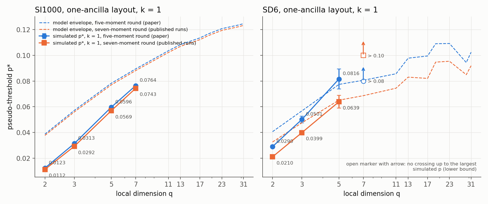
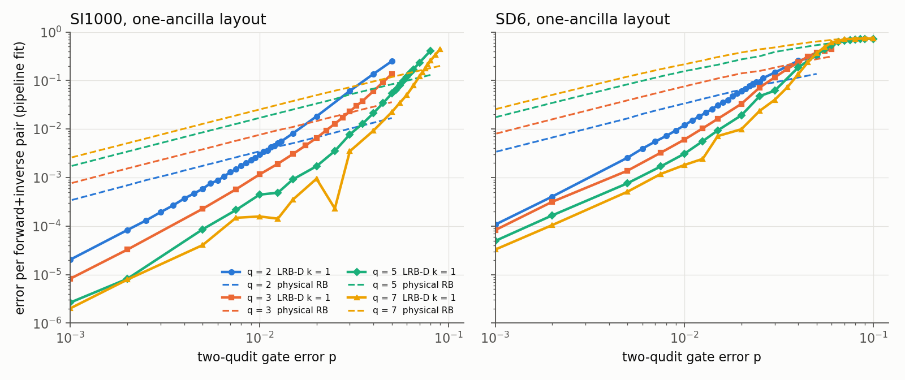
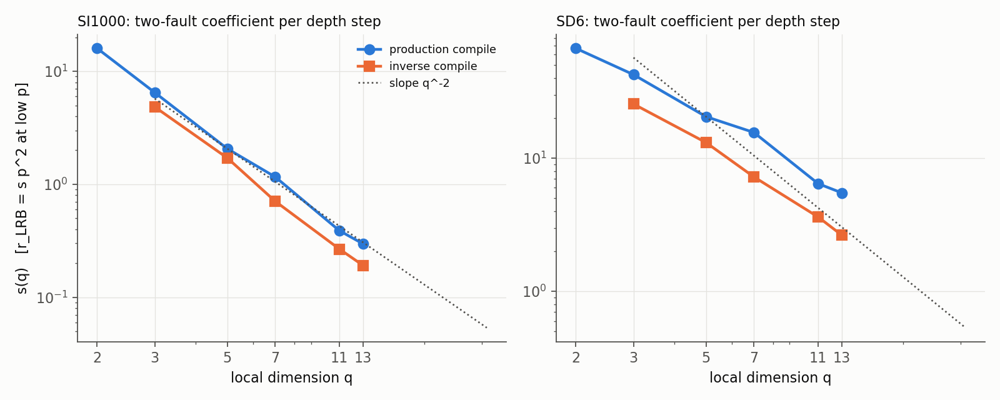
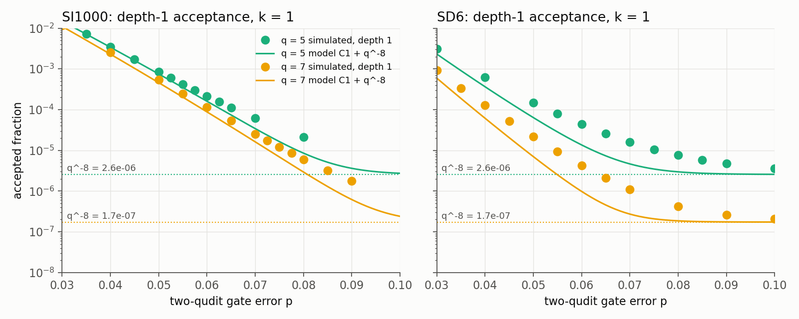
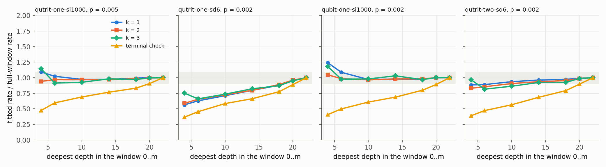

# LRB-D at large local dimension, and how far a single exponential holds

Written 2026-11-20 for the simulation paper "Logical Randomized Benchmarking on a Qutrit Surface Code" ([[5,1,2]]_q folded surface code, LRB-D = postselection on trivial syndromes).

Conventions throughout:

- Every LRB and RB fit includes depth m = 0.
- Rates and p* come from the pipeline estimator: per-sequence |Σ ω^i P_i|, offset-0 fit b f^m over all depths, the notebook's crossing rule, and fits per forward+inverse pair.
- Uncertainties are one standard error from a bootstrap over whole Clifford sequences.
- "One-ancilla layout" and "two-ancilla layout" are the user's layouts; the internal run names of the latter contain `layout_b`.
- The one-ancilla layout's check round is the five-moment round (the paper's, internal name `prod5b`) or the seven-moment round (the published runs). Both are reported.
- Nothing under the repository's `src/`, no run folder, no hand-off file and no paper draft was written. Everything is in this folder (`studies/qudit-scaling/`).

## Summary for the paper session

**Part 1: pseudo-thresholds as q grows.**

- p* rises with q, but more slowly at each step. It settles where postselection itself stops working, not where the code stops detecting.
- Over q ≤ 31 the k = 1 pseudo-threshold is capped near 0.08–0.11 under SD6 and 0.09–0.125 under SI1000 (five-moment round; the seven-moment round is 0.07–0.095 and 0.09–0.123).
- Beyond the simulated range the cap grows at most logarithmically in q, and only through the rare, atypically short compiled Cliffords. For a typical Clifford sequence it falls as ln q / q.

Simulated k = 1 values, one-ancilla layout, production compile. The five-moment round is the paper's check round; the seven-moment round is that of the published runs.

| q | SI1000, five-moment | SI1000, seven-moment | SD6, five-moment | SD6, seven-moment | per-step acceptance at p*, five-moment (SI1000 / SD6) |
|---|---|---|---|---|---|
| 2 | 0.0123 ± 0.0004 | 0.0112 ± 0.0002 | 0.0290 ± 0.0010 | 0.0210 ± 0.0008 | 0.44 / 0.14 |
| 3 | 0.0313 ± 0.0006 | 0.0292 ± 0.0006 | 0.0501 ± 0.0026 | 0.0399 ± 0.0015 | 0.10 / 0.013 |
| 5 | 0.0596 ± 0.0010 | 0.0569 ± 0.0009 | 0.0816 ± 0.0077 | 0.0639 ± 0.0049 | 5.6e-3 / 4.5e-4 |
| 7 | 0.0764 ± 0.0007 | 0.0743 ± 0.0007 | > 0.08 (no crossing) | no pipeline crossing ≤ 0.10 | 6.8e-4 / ≤ 1e-5 |

- q = 2, 3 are the published values; q = 5, 7 are new.
- The local exponent d ln p*/d ln q under SI1000 (five-moment) is 2.32 ± 0.09 for q = 2→3, 1.26 ± 0.05 for q = 3→5, and 0.74 ± 0.06 for q = 5→7. The seven-moment values are 2.36, 1.31 and 0.79.
- **q = 7 under SD6 has no quotable crossing.** In the five-moment round LRB-D stays 0.04 below RB at p = 0.08, the last point simulated. In the seven-moment round the depth-1 accepted shots are already fully random at p = 0.09–0.10: their polarization equals the estimator floor √(π/4N). The pipeline rate is then pinned near 0.73, below RB's 0.77. The infinite-shot crossing would sit at the random-acceptance onset, about 0.07–0.09.

Three mechanisms explain the shape (Section 1.3):

1. **The code detects better as q grows.** In every circuit examined (both rounds, q = 2…13), the fault combinations that give an undetected logical error span at least three independent detector directions. Each is therefore silent with probability at most (q−1)/q³ ≈ q⁻². The low-p logical error coefficient falls about as q⁻², even though the Clifford gets longer.
2. **The physical comparator gets worse.** A random qudit Clifford compiled into H, P, X, Z tokens has 2.5, 5.2, 10.4 and 14.6 tokens on average at q = 2, 3, 5, 7, rising to 50 at q = 31. The Pauli frame X^a Z^b alone costs about q tokens. Physical RB per Clifford grows in step with the length.
3. **Postselection has a ceiling.** A fully scrambled shot passes the 8 checks of a depth-1 circuit with probability q⁻⁸.
   - The simulations show it directly: the depth-1 acceptance stops falling at 7⁻⁸ and 5⁻⁸.
   - Once the fault-free probability drops below q⁻⁸, the accepted shots are random and the fitted LRB-D error goes to (q−1)/q.
   - A model built from this, the exact two-fault term and exact RB gives an envelope that the simulated p* approaches from below. Under SI1000 the simulated p* is 32%, 55%, 76% and 85% of it (five-moment; seven-moment 30/52/74/84%). Under SD6 it is 71%, 88% and 105 ± 10% at q = 2, 3, 5.
   - The five-moment envelope is 0.089, 0.108 and 0.125 under SI1000 and 0.081, 0.098 and about 0.10 under SD6 at q = 7, 13, 31.

So the q → ∞ answer has two halves:

- **Accepted shots.** At fixed p the postselected logical error vanishes as q⁻². In that conditional sense, detection gets arbitrarily good.
- **Crossing.** The crossing with physical RB moves into a regime where LRB-D accepts 6e-3 to 4e-4 (q = 5) or 7e-4 to below 1e-5 (q = 7) of the shots per depth step. There it meets the random-acceptance ceiling.
  - Beyond q ≈ 11 under SD6, the ceiling is set by the ≤ 1% of random sequences whose compiled Cliffords are atypically short. At that point both LRB-D and physical RB are within a few percent of fully depolarized, so a 30-sequence experiment has no crossing to measure. q = 7 under SD6 is already at this edge.
  - Under SI1000, about a quarter of the sequences still carry the crossing at q = 31.

k = 2 under SI1000 follows the same trend: 0.0087, 0.0258, 0.0484 ± 0.0009 and 0.0602 ± 0.0014 (five-moment); 0.0078, 0.0239, 0.0471 ± 0.0008 and 0.0570 ± 0.0012 (seven-moment) for q = 2, 3, 5, 7.

**Part 2: up to which interval is the accepted signal a single exponential?** The criterion is that the pipeline fit's error rate changes by at most 10% (beyond 2 SE) under two changes:

- the depth window 0..m, every window starting at m = 0;
- the depth grid (all depths vs depths that are multiples of k).

Results:

- **Terminal postselection never passes.** This covers the terminal check (const 0) and final-round-only postselection. The fitted rate changes by 50–1000% with the window, the m² law of the terminal-check study.
- **k ≥ 3 does not pass.** Depths that are not multiples of k end with an unchecked partial interval. The fitted rate then depends on the depth grid by 12–41% in eleven of twelve configurations.
- **k = 1 and k = 2 pass under SI1000** at every p up to p*, within 10% in the one-ancilla layout (qutrit and qubit). The exception is qutrit two-ancilla k = 1, which drifts by 11–15% from the depth-0 boundary in the dense high-p windows.
- **Under SD6, k ≤ 2 passes only near threshold.** The unchecked mirror inverse adds an m² term. At p ≤ 2e-3 it changes the fitted rate by up to +54% (qutrit one-ancilla k = 1) across windows.

Largest acceptable k (10% tolerance), one-ancilla layout with the paper's five-moment round:

- SI1000: 2, for qutrit and qubit.
- SD6: none over the whole range. The unchecked mirror inverse shifts the rate by 35–67% across windows below p*/2, and qutrit k = 1 still shifts by 17% near threshold. Qubit k = 1 reaches 1 at 12%.

Two-ancilla layout:

- SI1000: 4 for qubit; qutrit k = 1 misses by 1% and reaches 2 at 12%.
- SD6, near threshold: 2 for both codes.

The seven-moment round of the published runs gives the same picture: SI1000 k_max = 2, and SD6 0–1 near threshold. The fidelities these fits give are in Table 2.3.

**Text the paper session can adapt** (numbers for the paper's five-moment round, one-ancilla layout; uncertainties are one sequence-bootstrap standard error):

> *Larger local dimension.* The folded code and its fold-transversal gates are defined over Z_q for every prime q, so we repeated the k = 1 benchmark at q = 5 and 7. The pseudo-threshold rises with q, from 0.0123 ± 0.0004 (q = 2) and 0.0313 ± 0.0006 (q = 3) to 0.0596 ± 0.0010 and 0.0764 ± 0.0007 under SI1000, and from 0.0290 ± 0.0010 and 0.0501 ± 0.0026 to 0.0816 ± 0.0077 at q = 5 under SD6. At q = 7 under SD6 the two curves do not cross below p = 0.08. Two effects drive the rise. Every fault combination that the checks miss and that flips the logical spans at least three independent detector directions, so its probability falls as q⁻². Meanwhile a random qudit Clifford compiled into H, S and Pauli gates gets longer (5.2, 10.4 and 14.6 gates on average at q = 3, 5, 7), which raises the physical-RB error. The rise slows with every step in q, and the crossing moves to error rates where at most 0.6% of the shots survive each depth step (q = 5 and 7). There a third effect takes over: a fully scrambled shot passes the eight checks of a depth-1 circuit with probability q⁻⁸, so once faults are this frequent the accepted shots are random. A model built from these three ingredients caps the pseudo-threshold at about 0.09 to 0.125 (SI1000) and 0.08 to 0.11 (SD6) for q = 7 to 31. Larger local dimension therefore makes postselection more selective, but it does not make LRB-D useful at higher physical error rates.

> *Single-exponential range.* We call a decay single-exponential when the fitted error rate, with m = 0 in every fit, changes by at most 10% beyond two standard errors under two changes: dropping the deeper depths, and keeping only depths that are multiples of the postselection interval k. Under SI1000 the accepted signal passes for k = 1 and 2 at every p up to the pseudo-threshold, for both codes. That gives logical gate fidelities per Clifford pair of 0.999991, 0.999970 and 0.999810 (qutrit, k = 1) at p = 10⁻³, 2 × 10⁻³ and 5 × 10⁻³. For k ≥ 3, depths that are not multiples of k end with an unchecked partial interval, and the fitted rate depends on the depth grid by 12–41%. Under SD6 the unchecked mirror inverse adds an m² term that shifts the rate by 35–67% at low p, so a single exponential holds only near threshold. With postselection only at the end (the terminal check), the rate changes by 70% to a factor of four with the depth window, and no logical gate fidelity can be read from a decay fit.

---

## Part 1. Pseudo-thresholds versus q

### 1.1 What was simulated, and the checks

**The code at any prime q.**

- The stabilizers have coefficients ±1 over Z_q: S_Z1 = Z0 Z1⁻¹ Z3⁻¹, S_Z2 = Z1 Z2 Z4⁻¹, S_X1 = X0 X1 X2⁻¹, S_X2 = X3 X1⁻¹ X4⁻¹. The logicals are X̄ = X0X3 and Z̄ = Z0Z2.
- The code, the fold-transversal logical gates H̄ and S̄, and the one-ancilla check round are therefore the production ones at every prime q. Distance 2 holds at every q.
- The only q-specific inputs are the Clifford catalogue and the mod-q arithmetic.

**Catalogue (`qslib.py`).**

- Each catalogue element is a Pauli prefix X^a Z^b times one word per element of SL(2, Z_q).
- **Production compile:** the symplectic part is the lexicographically smallest shortest positive word in {H, S}, and the Pauli prefix is X…X Z…Z (a and b tokens). This rule reproduces the production q = 2 and q = 3 catalogues word for word and in order (`01_catalogue_checks.py`).
- **Inverse-token compile:** the same, but words may also use H⁻¹, S⁻¹, X⁻¹, Z⁻¹. It is used as a sensitivity check.
- At q = 2, 3, 5, 7 every catalogue has q³(q²−1) distinct Cliffords (checked on sdim's unitaries), and every inverse word inverts its word.

**Mean tokens per Clifford.** This number sets physical RB.

| q | 2 | 3 | 5 | 7 | 11 | 13 | 31 |
|---|---|---|---|---|---|---|---|
| production compile | 2.54 | 5.17 | 10.43 | 14.60 | 21.75 | 25.07 | 50.29 |
| inverse-token compile | 2.54 | 3.50 | 7.12 | 9.67 | 14.12 | 16.09 | 30.52 |

**Circuits and sampling.**

- Circuits come from the production generator (`src/lrb`). The runs used a frozen copy of it from the one-ancilla-prod5b worktree, which is byte-identical to the repository's `src/lrb`.
- They are the production one-ancilla LRB-D protocol: ideal |+>_L, C1..Cm each followed by a noisy check round, the mirror inverse with no checks, a final check, and ideal X̄ readout.
- Noise is SI1000 or SD6 with qudit DEP1/DEP2/flips. Sampling uses sdim 1.4.0's exact DEM, as production does.

**Checks.**

- *Byte identity.* For 6 sequences of each of the production q = 2 and q = 3 SI1000 runs, the words were decoded from the run's own files. This study's q-general profile then rebuilt the circuits byte for byte at three depths (`03_validate_against_production.py`).
- *Sampler agreement.* Sampling those circuits at p = 0.005 and 0.0125 with 1M shots reproduced the production tallies. Over 324 comparisons per q, the acceptance z-scores have mean −0.08/+0.12 and SD 1.03/0.95, and the logical-error z-scores have mean +0.02/−0.16 and SD 0.85/0.98.
- *Noiseless circuits.* At q = 2, 3, 5, 7, every encoded catalogue Clifford followed by its encoded inverse gives all-zero detectors and logical 0 in noiseless sdim (`02_noiseless_checks.py`).

**Runs for q = 5, 7** (cache in `cache/final-prod`, `cache/final-ext`; five-moment folders end in `-five`). Each configuration, for each round, has 30 random sequences per set, one-ancilla layout, production compile. The two rounds use the same Clifford sequences and the same RB data, paired as production pairs them.

| set | p | depths | shots per circuit |
|---|---|---|---|
| production grid | 1e-4 … 0.025 (12 values) | 0,2,4,6,10,14,18,20,22 | 1e6 |
| high-p extension | from 0.03 to past the crossing | 0, 1, 2 | 1e7 / 5e7 – 2e9 / 5e7 (depth 0 / 1 / 2) |

- In the extension, depth 1 carries the crossing and gets enough shots for 10³–10⁴ accepted per circuit. Depths 3–6, which production's extensions include, keep no shots at these p for q ≥ 5 and were dropped.
- The merge rule is production's: rows below p_split = 0.03 come from the production grid, rows at or above it from the extension, and the extension uses even depths only for k ≥ 2.
- **Five-moment checks.** The five-moment profile rebuilds 4 sequences of the production five-moment runs (q = 2 and 3) byte for byte. It is noiseless-deterministic at q = 5, 7 (`04_validate_five_moment.py`).
- **Physical RB** uses its own 30 sequences per set, the production construction and 10,000 DEM shots per circuit. Per circuit, the sampled polarization differs from the exact formula below by at most 0.01–0.025, consistent with 10,000-shot noise (`12_sample_rb.py`).
- **Crossing rule.** p* uses the notebook crossing chain with the scale-free rule (tol 0, no floor), as for the qubit campaigns. The error of the mean is the production sequence bootstrap: 1000 replicates, with LRB-prod, LRB-ext, RB-prod and RB-ext resampled independently (`13_final_thresholds.py --round five|seven`).

### 1.2 Results

**Table 1.2: one-ancilla layout, production compile.**

- q = 2, 3 are the published values from the canonical hand-off files (`pseudo-thresholds-{,qubit-}prod5b-current.csv` for the five-moment round, `pseudo-thresholds-{,qubit-}current.csv` for the seven-moment round).
- q = 5, 7 are from this study (`results/pstar_vs_q.csv`).
- Physical RB is per forward+inverse pair, at p*.

| round | q | SI1000 p*(k=1) | SI1000 p*(k=2) | SD6 p*(k=1) | SD6 p*(k=2) | RB at p*(k=1), SI1000 / SD6 |
|---|---|---|---|---|---|---|
| five | 2 | 0.0123 ± 0.0004 | 0.0087 ± 0.0002 | 0.0290 ± 0.0010 | 0.0203 ± 0.0007 | |
| five | 3 | 0.0313 ± 0.0006 | 0.0258 ± 0.0005 | 0.0501 ± 0.0026 | 0.033 ± 0.006 | |
| five | 5 | 0.0596 ± 0.0010 | 0.0484 ± 0.0009 | 0.0816 ± 0.0077 | 0.062 ± 0.016 (low precision) | 0.099 / 0.66 |
| five | 7 | 0.0764 ± 0.0007 | 0.0602 ± 0.0014 | > 0.08, no crossing | 0.056 ± 0.006 (low precision) | 0.175 / > 0.75 |
| seven | 2 | 0.0112 ± 0.0002 | 0.0078 ± 0.0002 | 0.0210 ± 0.0008 | 0.0151 ± 0.0005 | 0.004 / 0.068 |
| seven | 3 | 0.0292 ± 0.0006 | 0.0239 ± 0.0005 | 0.0399 ± 0.0015 | 0.0269 ± 0.0007 | 0.021 / 0.234 |
| seven | 5 | 0.0569 ± 0.0009 | 0.0471 ± 0.0008 | 0.0639 ± 0.0049 | 0.039 ± 0.010 (low precision) | 0.095 / 0.608 |
| seven | 7 | 0.0743 ± 0.0007 | 0.0570 ± 0.0012 | no pipeline crossing ≤ 0.10 | 0.044 ± 0.006 (low precision) | 0.170 / > 0.77 |

- **k ≥ 3 at q = 5, 7 is not determined.** On the 0, 1, 2 extension grid, k = 3 and k = 4 postselect the same rounds, so the crossing (0.0335 at q = 5 SI1000) cannot separate them. It would need depths ≥ 3 at p ≈ 0.03–0.05, where the acceptance per step is ≤ 1e-3.
- **SD6 k = 2 at q = 5, 7** rests on depth 2 with 1e-7–1e-8 acceptance, hence the large errors.
- **q = 7 SD6, k = 1:**
  - Five-moment: LRB-D is below RB at every simulated p ≤ 0.08; the gap shrinks from 0.15 at p = 0.065 to 0.04 at 0.08. The model puts the crossing at 0.081.
  - Seven-moment: LRB-D stays below RB up to p = 0.10, the last point simulated. At p = 0.09 and 0.10 the depth-1 accepted shots (about 370 per circuit, with 2e9 shots) carry polarization 0.045–0.048, equal to the estimator floor √(π/4N) = 0.046, so their true polarization is zero. The pipeline's fitted rate is then (q−1)/q · (1 − floor/λ₀) ≈ 0.73, below RB's 0.77. In the infinite-shot limit LRB-D would jump to 0.857 > RB at the random-acceptance onset, about p = 0.07–0.09.

### 1.3 Why: three mechanisms and their q-dependence

**(a) Silent fault pairs are suppressed at least as q⁻² (exact).**

- sdim's DEM writes every noise gate i as a mechanism that fires with probability π_i and adds a uniformly random element of a subgroup V_i of Z_q^(D+1) (D detectors, one logical).
- π_i is linear in p with a q-dependent factor: q²/(q²−1) for DEP1, q⁴/(q⁴−1) for DEP2 and q/(q−1) for flips.
- For a pair of mechanisms, the probability that the sum is undetected and flips the logical is exactly

    a_ij = (q − 1) q^(−w_ij) if e_L ∈ V_i + V_j, and 0 otherwise, with w_ij = rank(V_i + V_j).

- So every q-dependence of the low-p logical error sits in integer ranks.
- `qpairs.py` enumerates every element of every V_i and matches detector images with sparse products. `20_pair_expansion.py` runs it on the production circuits at depths 1–4 for q = 2, 3, 5, 7, 11, 13, both compiles, both noise models and both rounds (the five-moment round with the production compile), 10 sequences each.

What it finds:

- **The minimum rank of a silent logical pair is w = 3 in every contributing pair**, for both rounds (1.1 × 10⁷ pairs for the seven-moment round alone). No pair is suppressed only as 1/q.
- The reason is that every fault that changes a data qudit is visible in at least two independent detector directions, by distance 2 or by its own ancilla readout. A pair that reaches the logical therefore spans at least three directions.
- The same holds for any set of firing mechanisms: if no pair reaches e_L with rank ≤ 2, no larger set can reach it in a rank-2 span. So P(accepted ∧ logical error | faults) ≤ (q−1)/q³ for every bulk fault configuration.

**Table 1.3a: two-fault coefficient per depth step, s(q).** At low p, r_LRB = s p² for k = 1 (from S2(4) − S2(1), 10 sequences).

| q | 2 | 3 | 5 | 7 | 11 | 13 |
|---|---|---|---|---|---|---|
| SI1000, production compile | 16.0 | 6.5 | 2.07 | 1.16 | 0.39 | 0.30 |
| SI1000, inverse compile | n/a | 4.8 | 1.71 | 0.71 | 0.27 | 0.19 |
| SD6, production compile | 66.9 | 42.5 | 20.5 | 15.6 | 6.4 | 5.5 |
| SD6, inverse compile | n/a | 25.6 | 13.1 | 7.2 | 3.6 | 2.6 |
| SI1000, five-moment round | 13.9 | 5.7 | 1.86 | 1.05 | 0.35 | 0.27 |
| SD6, five-moment round | 47.8 | 33.0 | 16.9 | 13.2 | 5.5 | 4.8 |

Rows without a round label are the seven-moment round.

- Between q = 5 and 13, s(q) falls as q^(−2.0) under SI1000 and q^(−1.4) under SD6, while the mean Clifford length grows 2.4×.
- Under SD6 the pairs that involve a Clifford-gate fault (rank 4–5, more of them as the Clifford grows) are a larger share, hence the shallower slope. Asymptotically the rank-3 pairs dominate (`results/pair_classes_main.csv`).

**(b) Physical RB is exact and grows with the compiled length.**

- Every RB token gets DEP1 at s·p (s = 0.1 SI1000, 1 SD6). DEP1 commutes with Cliffords, and preparation and readout are ideal.
- The per-pair error is therefore r_RB = (q−1)/q · [1 − E_C λ^(2n(C))], with λ = 1 − s p q²/(q²−1) and n(C) the token count. To first order this is 2 n̄ s p q/(q+1).
- This formula matches the catalogue enumeration to machine precision (`23_model_pstar.py: rb_error`) and the DEM-sampled RB to within the 10,000-shot noise.
- n̄ ∝ q for either compile, because the Pauli frame alone costs about q (production) or q/2 (inverse compile) tokens.

At low p the ratio of the two errors is therefore

    r_LRB / r_RB = p / p_LO(q),   p_LO = 2 n̄ s q / ((q+1) s(q)).

Under SI1000 (production compile), p_LO = 0.021, 0.12, 0.84, 2.2, 10 and 16 for q = 2, 3, 5, 7, 11, 13. At any fixed low p, the logical advantage over the physical qudit grows roughly as q³.

This leading order describes the crossing only at q = 2. There the expected number of faults per step at p* is already about 1. For q ≥ 3 the crossing lies where many faults fire per step.

**(c) Random acceptance caps the crossing.**

- A shot whose detectors are fully scrambled passes the D_m = 4(m+1) checks of a depth-m circuit with probability q^(−D_m), and carries a uniformly random logical value.
- The probability that no fault is visible on its own is C_m(p) = Π_i [1 − π_i(p)(1 − z_i)], where z_i = q^(−rank det V_i). It is exact from the DEM. Write Λ_m = −ln C_m.
- The accepted fraction is then A_m ≈ C_m + q^(−D_m).

This is visible in the data (Fig. 4). At q = 7 SD6 the depth-1 acceptance stops falling at 2e-7 ≈ 7⁻⁸ = 1.7e-7; at q = 5 SD6 it stops at about 3e-6 ≈ 5⁻⁸ = 2.6e-6.

**The ceiling this sets.**

- Near threshold the pipeline fit rests on m = 0 and m = 1, so r_LRB = (q−1)/q (1 − λ₁/λ₀).
- Once Λ₁(p) > 8 ln q, the accepted depth-1 shots are mostly random, λ₁ → 0, and r_LRB → (q−1)/q. That is above r_RB at every p, so the crossing must occur below that point.
- Λ₁ ≈ N₁(q) p, where N₁ (`results/random_acceptance.csv`, seven-moment round) grows with the Clifford length:
  - SI1000: N₁ = 116, 124, 136, 146, 158, 163, 198 for q = 2, 3, 5, 7, 11, 13, 31. Check rounds dominate; the Clifford adds about 1.7 per token.
  - SD6: N₁ = 132, 165, 211, 264, 333, 349, 578. The Clifford adds about 9 per token.
- For a sequence of typical length, the crossing must therefore lie below p_rand ≈ 8 ln q / N₁(q). Because N₁ ∝ n̄ ∝ q at large q, this typical-sequence ceiling eventually falls as ln q / q.
  - Under SD6 it is already flat to falling for q ≥ 5 (linearized: 0.061, 0.059, 0.059, 0.048 at q = 5, 7, 13, 31).
  - Under SI1000 the check rounds dominate N₁, so it still rises up to q = 31.

**The model envelope (`23_model_pstar.py`).**

- Accepted polarization at depth m: λ_m = c_m (1 − q/(q−1) ε_m), with clean fraction c_m = C_m / (C_m + q^(−D_m)) and ε₁ − ε₀ = s(q) p².
- c_m is formed per random sequence and then averaged, as the pipeline averages per-sequence polarizations (96 random sequences per q).
- s(q) is from (a), extrapolated as a power law beyond q = 13. C_m is exact from the DEM. RB is exact.
- The model omits silent combinations of three or more faults, so it sits above the true p*. Those combinations are suppressed by extra powers of 1/q, so the model should become accurate as q grows. It does. Under SI1000 the simulated p* reaches 32%, 55%, 76% and 85% of it at q = 2, 3, 5, 7 for the five-moment round, and 30%, 52%, 74% and 84% for the seven-moment round. Under SD6 it reaches 71%, 88% and 105 ± 10% at q = 2, 3, 5 (five-moment), and 64%, 84% and 98% (seven-moment). q = 7 under SD6 is in Section 1.2.

**Table 1.3c: model envelope p*_model(q), k = 1, production compile unless marked** (± about 0.005 from sequence sampling at large q; SD6 scatter is larger). The last column is the share of random sequences whose depth-1 accepted shots are still mostly clean at the seven-moment SD6 crossing (`24_short_word_tail.py`).

| q | SI1000, five-moment | SI1000, seven-moment | SI1000, seven-moment, inverse compile | SD6, five-moment | SD6, seven-moment | SD6, seven-moment, inverse compile | SD6 seven-moment: sequences still clean at the crossing |
|---|---|---|---|---|---|---|---|
| 2 | 0.039 | 0.038 | n/a | 0.041 | 0.033 | n/a |  |
| 3 | 0.057 | 0.056 | 0.058 | 0.057 | 0.048 | 0.053 |  |
| 5 | 0.078 | 0.077 | 0.079 | 0.077 | 0.065 | 0.073 | 22% |
| 7 | 0.089 | 0.088 | 0.092 | 0.081 | 0.069 | 0.079 | 11% |
| 11 | 0.104 | 0.102 | 0.107 | 0.086 | 0.074 | 0.089 |  |
| 13 | 0.108 | 0.107 | 0.112 | 0.098 | 0.083 | 0.090 | 1% |
| 17 | 0.114 | 0.112 | 0.120 | 0.100 | 0.082 | 0.092 |  |
| 19 | 0.117 | 0.115 | 0.122 | 0.109 | 0.095 | 0.101 |  |
| 23 | 0.121 | 0.119 | 0.127 | 0.109 | 0.095 | 0.098 |  |
| 29 | 0.124 | 0.122 | 0.131 | 0.094 | 0.085 | 0.107 |  |
| 31 | 0.125 | 0.123 | 0.133 | 0.102 | 0.092 | 0.094 | 0 of 96 |

**Why the averaged envelope still creeps up.** At p well above the typical ceiling, both curves are carried by the short-word tail of the catalogue:

- **LRB-D:** only the few sequences whose compiled Clifford is short stay clean.
- **Physical RB:** E_C λ^(2n) is likewise dominated by short words. For the Pauli prefix alone, E[λ^(2(a+b))] ≈ 1/(2 q s p)², a 1/q² fraction.

Both signals scale as 1/q², so q² cancels in the crossing. What remains is the q⁻⁸ random-acceptance threshold against the fixed noise of the two check rounds. That gives a crossing that grows only like ln q (SI1000 production: 0.088 → 0.123 from q = 7 to 31, about 0.024 per e-fold of q).

Under SI1000 the crossing is still carried by 24% of the sequences at q = 31 (`results/short_word_tail.csv`). Under SD6 it is carried by 1% at q = 13 and by none of 96 sequences at q = 31.

### 1.4 The large-q limit

1. **At fixed p and a fixed circuit**, the postselected logical error vanishes as q⁻². This follows exactly from (a): every bulk silent logical configuration has probability ≤ (q−1)/q³. In the conditional sense, detection becomes perfect.
2. **The pseudo-threshold has no finite limit, and does not grow usefully.**
   - p*(q) approaches the random-acceptance envelope from below.
   - For the paper's five-moment round the envelope is 0.08–0.11 under SD6 and 0.09–0.125 under SI1000 for q = 7–31 (seven-moment round: 0.07–0.095 and 0.09–0.123). It grows at most like ln q beyond.
   - For a typical sequence the ceiling falls as ln q / q, because the compiled logical Clifford grows ∝ q.
   - The ensemble average creeps up only through the O(q⁻²) fraction of short compiled Cliffords. A 30-sequence experiment does not sample them for q ≳ 11 under SD6.

**Statement:** For realizable q (≤ 31), p* saturates at about 0.08–0.10 (SD6) and 0.09–0.12 (SI1000) for the five-moment round, and 0.07–0.09 and 0.09–0.12 for the seven-moment round. As q → ∞, the typical-sequence crossing goes to 0 as ln q / q, and the ensemble-average crossing grows no faster than ln q.

Uncertainty on these levels:

- ±0.005–0.01 from the model's sequence sampling (SD6 scatter is larger: heavy-tailed word lengths);
- a model systematic: the simulated p* sits 15–16% below the envelope at q = 7 under SI1000 (both rounds). Under SD6 at q = 5 it lies within errors of the envelope (−2% seven-moment, +5 ± 10% five-moment).

The inverse-token compile, with about 2/3 of the tokens, gives a 2–8% higher envelope under SI1000 and 3–20% under SD6. The compile changes the levels, not the shape.

3. **Fixed-length gates.** If every logical and physical Clifford were a single noisy gate, N₁ would not grow with q. The typical ceiling 8 ln q / N₁ would then grow logarithmically, until the noise model saturates (SI1000 measurement flips reach probability 1 at p = 0.2).
4. **The price.** The acceptance per depth step at p* is:
   - SI1000: 0.44, 0.10, 5.6e-3 and 6.8e-4 for q = 2, 3, 5, 7 (five-moment; seven-moment 0.51, 0.11, 6.3e-3, 7.7e-4);
   - SD6: 0.14, 0.013 and 4.5e-4 for q = 2, 3, 5 (five-moment; seven-moment 0.19, 0.016, 5.0e-4), and at most 1e-5 near the q = 7 crossing.

   LRB-D beats the physical qudit at large q only on a vanishing accepted fraction. Section 3.3 of `non-markovian-brainstorm/REPORT.md` notes that once discards count as random outputs, the unconditional comparison already fails at q = 3.

### 1.5 Caveats

- **The compile choice enters p* directly**, through n̄(q). The q = 2, 3 points are the production catalogues. The inverse-token compile (envelope 2–8% higher under SI1000, 3–20% under SD6, seven-moment round) was run only in the model and the two-fault expansion, not in a full q = 5, 7 simulation.
- **Grid and shots for q = 5, 7.** The high-p grid is 0, 1, 2 with 5e7–2e9 shots at depth 1. Production's q = 3 extension used 0–6 at 2e7. The fits use the same rule (all depths that keep shots in every sequence), and at these p depths ≥ 3 keep none.
- **Estimator floor.** At q = 7 SD6 the pipeline's per-sequence |Σ| floor (about √(π/4N)) is 0.03–0.05 at the highest p. There it decides whether LRB-D reaches RB at all (Section 1.2).
- **Layout.** One-ancilla layout only; the q-scaling was not repeated for the two-ancilla layout.

## Part 2. The single-exponential range

### 2.1 Criterion

Data: the checkpointed per-sequence tallies of twelve configurations:

- the one-ancilla layout (with the paper's five-moment round, and with the seven-moment round of the published runs) and the two-ancilla layout;
- qutrit and qubit codes;
- SI1000 and SD6;
- each with its production run and its high-p extension or near-threshold refinement, merged at production's p_split.

Policies: unif k = 1…6, const1 (final round only, all rounds executed) and const0 (terminal check: no rounds, direct five-qudit X readout).

For each (configuration, policy, p), `30_single_exponential.py` redoes the pipeline fit exactly. It uses even depths only for k ≥ 2 on extensions, as the production merge does. It then computes:

- **D (window drift)** = r(all depths) / r(depths 0..m₃) − 1, where 0..m₃ is the shortest window from m = 0 with three usable depths.
- **G (grid dependence, k ≥ 2)** = r(all fitted depths) / r(fitted depths that are multiples of k) − 1. m = 0 is in both fits. G is a model check, not an estimator to report.
- **Standard errors** of r, D and G from 200 sequence-bootstrap replicates.
- **For context:** the SEM-weighted χ²/dof, and the excess relative residual.

**Criterion.** A single exponential is an acceptable description at (configuration, k, p) when |D| − 2 SE(D) ≤ τ and |G| − 2 SE(G) ≤ τ, with τ = 0.10. In words: the fitted logical error rate changes by at most 10% when the depth window or the depth grid changes, beyond statistical noise.

- **Range.** Only p with a resolved rate (r > 2 SE) count. The policy must pass at every such p ≤ p*(k) ("all p"), or at every such p with p*(k)/2 ≤ p ≤ p*(k) ("near threshold").
- **Choice of τ.** A 10% rate systematic moves p* by about 10%, three times its quoted SE. Results for τ = 0.05, 0.12, 0.15 and 0.20 are in `results/single_exp_kmax.csv`.
- **Why χ² is not the criterion.** χ²/dof grows with the shot count for any fixed deviation. At the extensions' 2e7 shots, a 6% depth-0 curvature already gives χ²/dof ≈ 10.

### 2.2 Results

Table 2.2 gives, for k = 1, 2, the near-threshold maximum of |D| − 2 SE(D) (p*(k)/2 ≤ p ≤ p*(k)) and the low-p maximum (p < p*(k)/2). For k = 3, 4 it gives the near-threshold maxima of the window and grid tests (window / grid). The terminal-check column is the near-threshold window maximum. n/a means not applicable.

The one-ancilla layout appears twice. The five-moment round is the paper's check round since 2026-11-19; the seven-moment round is that of the published runs. Both rest on production data: the five-moment runs are paired with the published ones on the same Clifford sequences.

| configuration | k = 1 | k = 2 | k = 3 | k = 4 | terminal check | k_max (all p ≤ p*) | k_max (p ≥ p*/2) |
|---|---|---|---|---|---|---|---|
| qutrit, one-ancilla (five-moment round), SI1000 | 0.06 ; low 0.07 | 0.04 ; low -0.00 | **0.18** / **0.22** | **0.12** / **0.29** | **1.01** | 2 | 2 |
| qutrit, one-ancilla (five-moment round), SD6 | **0.17** ; low **0.67** | 0.04 ; low **0.62** | 0.05 / 0.08 | **0.37** / **0.41** | **3.24** | 0 | 0 |
| qubit, one-ancilla (five-moment round), SI1000 | 0.01 ; low 0.04 | 0.02 ; low 0.00 | 0.05 / **0.15** | **0.14** / **0.15** | **0.73** | 2 | 2 |
| qubit, one-ancilla (five-moment round), SD6 | 0.05 ; low **0.37** | **0.18** ; low **0.35** | **0.12** / **0.25** | **0.47** / **0.30** | **2.64** | 0 | 0 (1 at 12%) |
| qutrit, two-ancilla, SI1000 | **0.11** ; low -0.02 | -0.01 ; low -0.01 | **0.13** / **0.16** | **0.11** / **0.27** | **0.54** | 0 (2 at 12%) | 0 (2 at 12%) |
| qutrit, two-ancilla, SD6 | 0.05 ; low **0.18** | 0.00 ; low **0.26** | **0.14** / **0.14** | **0.20** / **0.34** | **3.93** | 0 | 2 |
| qubit, two-ancilla, SI1000 | 0.07 ; low 0.07 | -0.04 ; low -0.07 | 0.07 / 0.09 | 0.03 / 0.07 | **1.10** | 4 | 4 |
| qubit, two-ancilla, SD6 | -0.00 ; low 0.02 | 0.08 ; low 0.09 | -0.04 / **0.15** | **0.18** / **0.14** | **1.14** | 2 | 2 |
| qutrit, one-ancilla (seven-moment round), SI1000 | 0.09 ; low -0.03 | 0.02 ; low 0.02 | **0.17** / **0.19** | **0.13** / **0.24** | **1.02** | 2 | 2 |
| qutrit, one-ancilla (seven-moment round), SD6 | **0.11** ; low **0.54** | 0.02 ; low **0.48** | 0.03 / **0.13** | **0.23** / **0.27** | **3.34** | 0 | 0 (2 at 12%) |
| qubit, one-ancilla (seven-moment round), SI1000 | 0.04 ; low 0.05 | 0.02 ; low -0.01 | 0.06 / **0.12** | **0.11** / **0.12** | **0.72** | 2 | 2 |
| qubit, one-ancilla (seven-moment round), SD6 | 0.05 ; low **0.19** | **0.14** ; low **0.19** | 0.07 / **0.21** | **0.37** / **0.35** | **2.50** | 0 | 1 |

Bold entries exceed τ = 0.10. Final-round-only postselection (const1) fails like the terminal check, with window drifts of 1–10.

What fails, and why:

- **Terminal postselection.** The accepted infidelity grows as m², so the rate depends on the window by 50–1000% at every p. This agrees with `terminal-check-fidelity/REPORT.md`: no decay constant exists, and a fidelity from terminal-check data needs the Fourier-mode fit, not this pipeline.
- **k ≥ 3: the staircase.** Depths that are not multiples of k end with up to k−1 unchecked forward Cliffords. Even on production's all-even grid, k = 3 and 4 mix two families of points.
  - The rate on all depths differs from the rate on multiples of k by 12–41%, except in the qubit two-ancilla SI1000 configuration (7–9%).
  - The median SEM-weighted χ²/dof near threshold is 9–180.
  - This is a property of the depth grid, not of the noise. A grid of multiples of k would give a single exponential per block of k Cliffords, but that block rate is not the pipeline's per-pair number.
- **SD6 at low p: the mirror inverse.** The inverse block of m Cliffords has no checks, so fault pairs inside it add an m² term (mechanism M1 of `non-markovian-brainstorm/REPORT.md`). Under SD6 this changes the fitted rate by 18–54% across windows below p*/2 in three of the four configurations (all but the qubit two-ancilla layout), at k = 1 and k = 2 alike. Near threshold only the shallow depths keep shots, and the effect drops to 0–14%.
- **The depth-0 boundary at high p.** The first check sees a fresh state, so the m = 0→1 step decays faster (M3). On the dense 2e7-shot extension windows this gives D = −3% to −17% for k = 1 under SI1000. Only in the qutrit two-ancilla layout does it exceed 10% beyond 2 SE (11%).

**Answer per configuration (τ = 10%):**

- **SI1000:** k ≤ 2 in the one-ancilla layout, for qutrit and qubit and for both rounds. k ≤ 4 in the qubit two-ancilla layout. In the qutrit two-ancilla layout, k = 1 is at 11% and k = 2 at 1%.
- **SD6, near threshold:**
  - k ≤ 2 in both two-ancilla configurations;
  - k = 1 for the qubit one-ancilla layout (seven-moment, p ≥ 0.007; five-moment at 12%);
  - none at 10% for the qutrit one-ancilla layout (k = 1 at 11% seven-moment, 17% five-moment).
- **SD6 below p*/2:** no k qualifies in the one-ancilla layout. The mirror-inverse m² term shifts the rate by 19–67% there, and more with the five-moment round, whose lower check-round noise leaves the unchecked inverse block a larger share.
- **Everywhere:** no configuration supports terminal postselection, and none supports k ≥ 3 apart from the qubit two-ancilla SI1000 case.

### 2.3 Logical gate fidelities where the single exponential holds

F = 1 − r per forward+inverse pair (two logical Cliffords and one check round; the unit of the paper's tables), pipeline fit, ± sequence-bootstrap SE. Per single Clifford the error is about r/2 under SI1000. Under SD6 the m² term makes the per-Clifford conversion window-dependent at low p (Section 2.2). 

| configuration | k | p*(k) | F at p = 1e-3 | F at p = 2e-3 | F at p = 5e-3 |
|---|---|---|---|---|---|
| qutrit, one-ancilla (five-moment round), SI1000 | 1 | 0.0313 | 0.999991 ± 0.000001 | 0.999970 ± 0.000002 | 0.999810 ± 0.000008 |
| qutrit, one-ancilla (five-moment round), SI1000 | 2 | 0.0258 | 0.999987 ± 0.000001 | 0.999948 ± 0.000002 | 0.999687 ± 0.000008 |
| qutrit, one-ancilla (five-moment round), SD6 | 1 | 0.0501 | 0.999928 ± 0.000002 † | 0.999749 ± 0.000014 † | 0.998874 ± 0.000049 † |
| qutrit, one-ancilla (five-moment round), SD6 | 2 | 0.0326 | 0.999913 ± 0.000003 † | 0.999684 ± 0.000017 † | 0.998379 ± 0.000083 † |
| qubit, one-ancilla (five-moment round), SI1000 | 1 | 0.0123 | 0.999982 ± 0.000001 | 0.999930 ± 0.000002 | 0.999505 ± 0.000012 |
| qubit, one-ancilla (five-moment round), SI1000 | 2 | 0.0087 | 0.999970 ± 0.000001 | 0.999877 ± 0.000002 | 0.999132 ± 0.000013 |
| qubit, one-ancilla (five-moment round), SD6 | 1 | 0.0290 | 0.999921 ± 0.000003 † | 0.999710 ± 0.000012 † | 0.998121 ± 0.000086 † |
| qubit, one-ancilla (five-moment round), SD6 | 2 | 0.0203 | 0.999896 ± 0.000003 † | 0.999600 ± 0.000013 † | 0.997245 ± 0.000103 † |
| qutrit, two-ancilla, SI1000 | 1 | 0.0191 | 0.999984 ± 0.000001 | 0.999937 ± 0.000003 | 0.999515 ± 0.000017 |
| qutrit, two-ancilla, SI1000 | 2 | 0.0139 | 0.999969 ± 0.000001 | 0.999875 ± 0.000004 | 0.999146 ± 0.000017 |
| qutrit, two-ancilla, SD6 | 1 | 0.0206 | 0.999841 ± 0.000004 † | 0.999399 ± 0.000017 | 0.996050 ± 0.000328 |
| qutrit, two-ancilla, SD6 | 2 | 0.0147 | 0.999769 ± 0.000005 † | 0.999095 ± 0.000025 † | 0.993969 ± 0.000204 |
| qubit, two-ancilla, SI1000 | 1 | 0.0051 | 0.999950 ± 0.000002 | 0.999783 ± 0.000003 | 0.998386 ± 0.000034 |
| qubit, two-ancilla, SI1000 | 2 | 0.0031 | 0.999905 ± 0.000002 | 0.999595 ± 0.000004 | not quoted, p > p* |
| qubit, two-ancilla, SD6 | 1 | 0.0085 | 0.999707 ± 0.000006 | 0.998837 ± 0.000022 | 0.991846 ± 0.000187 |
| qubit, two-ancilla, SD6 | 2 | 0.0058 | 0.999538 ± 0.000008 | 0.998108 ± 0.000033 | 0.986342 ± 0.000370 |
| qutrit, one-ancilla (seven-moment round), SI1000 | 1 | 0.0292 | 0.999992 ± 0.000001 | 0.999967 ± 0.000002 | 0.999773 ± 0.000013 |
| qutrit, one-ancilla (seven-moment round), SI1000 | 2 | 0.0239 | 0.999987 ± 0.000001 | 0.999944 ± 0.000002 | 0.999613 ± 0.000010 |
| qutrit, one-ancilla (seven-moment round), SD6 | 1 | 0.0399 | 0.999917 ± 0.000004 † | 0.999684 ± 0.000012 † | 0.998616 ± 0.000063 † |
| qutrit, one-ancilla (seven-moment round), SD6 | 2 | 0.0269 | 0.999897 ± 0.000003 † | 0.999584 ± 0.000014 † | 0.997963 ± 0.000087 † |
| qubit, one-ancilla (seven-moment round), SI1000 | 1 | 0.0112 | 0.999980 ± 0.000001 | 0.999917 ± 0.000002 | 0.999414 ± 0.000010 |
| qubit, one-ancilla (seven-moment round), SI1000 | 2 | 0.0078 | 0.999965 ± 0.000001 | 0.999855 ± 0.000002 | 0.998999 ± 0.000015 |
| qubit, one-ancilla (seven-moment round), SD6 | 1 | 0.0210 | 0.999893 ± 0.000004 | 0.999595 ± 0.000014 † | 0.997438 ± 0.000088 † |
| qubit, one-ancilla (seven-moment round), SD6 | 2 | 0.0151 | 0.999852 ± 0.000004 | 0.999422 ± 0.000016 † | 0.995961 ± 0.000098 † |

† the fit fails the criterion at this p (window drift beyond 10% + 2 SE). These values exist, but their size depends on which depths are fitted.

Full table, with D, G and χ² for every p: `results/single_exp_fidelities.csv` and `results/single_exp_rows.csv.gz`.

## 3. Reproduction

Run from this folder with `PYTHONNOUSERSITE=1 NUMBA_NUM_THREADS=1 ../../.venv-sdim140/bin/python <script>`. Sampling scripts resume (they skip p files that exist). SLURM jobs use `slurm_sample.sh <jobs file>` (debug or regular QOS, one node, 250 worker processes).

| script | what it does | runtime |
|---|---|---|
| `qslib.py` | general-q catalogue (production and inverse-token compiles), q-general code definition, random words at large q | library |
| `qsim.py` | LRB-D and RB circuits from the production generator, DEM sampling, per-k postselection (`unif_slots` = production rule) | library |
| `qpairs.py` | exact two-fault coefficients from the DEM (a_ij = (q−1) q^−w) | library |
| `qfit.py` | production plotter's fit and crossing chain on this study's data | library |
| `01_catalogue_checks.py` | catalogue = production at q = 2, 3; group size and inverses at q = 2..7 → `results/catalogue_summary.csv` | 1 min |
| `02_noiseless_checks.py` | noiseless determinism of encoded Cliffords at q = 2..7 | 1 min |
| `03_validate_against_production.py` | byte identity with production circuits, sampler z-scores → `results/validation_production.csv` | 25 min |
| `10_sample_lrb.py` | LRB-D sampling (all k from the same shots) | see jobs files |
| `11_scan_thresholds.py` | crossings of exploratory scans (`scan`, `locate` tags; exact RB) | 1 min |
| `12_sample_rb.py` | physical RB, DEM-sampled and exact | minutes |
| `04_validate_five_moment.py` | five-moment profile = production five-moment circuits at q = 2, 3; noiseless checks at q = 5, 7 | 10 min |
| `13_final_thresholds.py` | p*(k) with 1000-replicate sequence bootstrap (`--round five|seven`) → `results/final_q*_*_production[_five]_{rates,thresholds}.csv` | 5–15 min |
| `14_collect_pstar.py` | p*(q) table and growth exponents → `results/pstar_vs_q.csv`, `results/pstar_growth_exponents.csv` | seconds |
| `20_pair_expansion.py`, `21_pair_summary.py` | two-fault expansion q = 2..13 → `results/pair_expansion_main.csv.gz`, `pair_summary_main.csv`, `pair_classes_main.csv` | 40 min on 8 workers |
| `22_random_acceptance.py` | exact clean-shot probabilities, N₁(q), p_rand(q), q ≤ 31 → `results/random_acceptance.csv` | 15 min |
| `23_model_pstar.py` | model envelope p*_model(q) (per-sequence clean fractions, 96 sequences) → `results/model_pstar[_five].csv`, `results/model_curves[_five].csv.gz` | 30 min |
| `24_short_word_tail.py` | share of sequences still clean at the model crossing → `results/short_word_tail.csv` | 10 min |
| `run_five_analysis.sh` | the two-fault expansion and the model for the five-moment round (`QSCAL_ROUND=five`) → `results/pair_expansion_five.csv.gz`, `results/model_pstar_five.csv` | 50 min |
| `30_single_exponential.py`, `single_exp_configs.py` | Part 2 diagnostics on the production data → `results/single_exp_rows.csv.gz` | 20 min on 12 workers |
| `31_single_exp_verdict.py` | criterion, k_max, fidelities → `results/single_exp_{verdicts,kmax,fidelities}.csv` (reads `single_exp_rows.csv.gz` and `single_exp_rows_five.csv.gz`) | seconds |
| `32_part2_tables.py` | Tables 2.2 and 2.3 → `results/part2_table_{diagnostics,fidelity}.md` | seconds |
| `40_figures.py` | figures 1–5 | seconds |

Jobs files and SLURM jobs:

- `jobs_locate.txt`: locator, 5e6 shots, depths 0–6.
- `jobs_final_prod.txt`: production grid. Debug job 61635333.
- `jobs_final_ext_si1000.txt`: debug job 61635334.
- `jobs_final_ext_sd6_q5.txt`, `jobs_final_ext_sd6_q7.txt`: regular QOS jobs 61635916, 61635922.
- `jobs_final_ext_sd6_q7_hi.txt`: debug job 61638530 (p = 0.09, 0.1); its resume was cancelled before p = 0.12.
- Five-moment round: `jobs_five_prod.txt` (debug 61639293), `jobs_five_ext_si1000.txt` (debug 61639294), `jobs_five_ext_sd6_q5.txt` and `jobs_five_ext_sd6_q7.txt` (regular 61639295, 61639296).
- RB for the five-moment sets is linked from the seven-moment sets (`run_rb_five.sh`): the same RB data, as production pairs them.

Total compute is about 6 node-hours. The run logs and the `cache/` of sampled counts are not kept in the repository.
