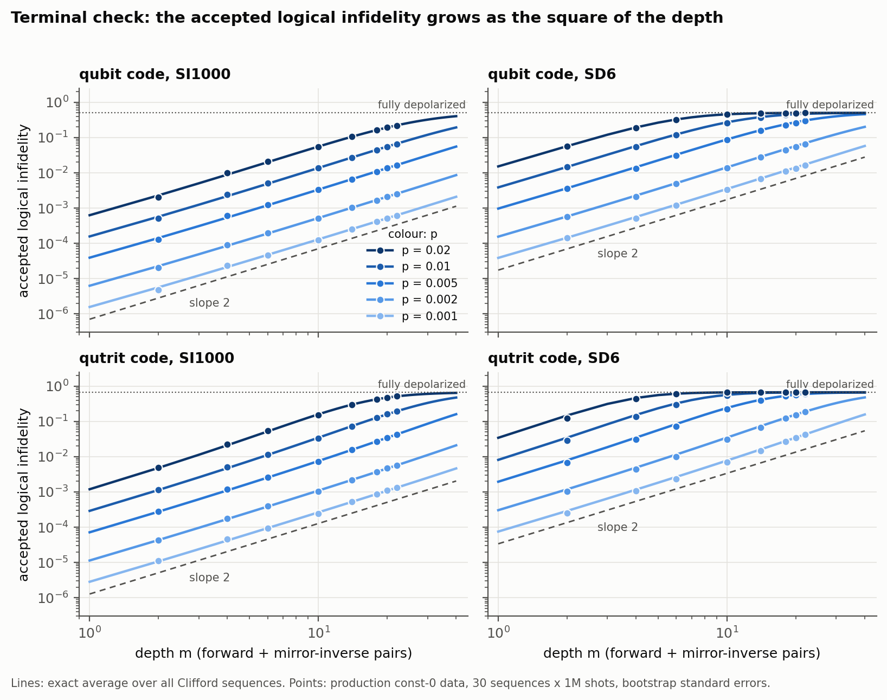
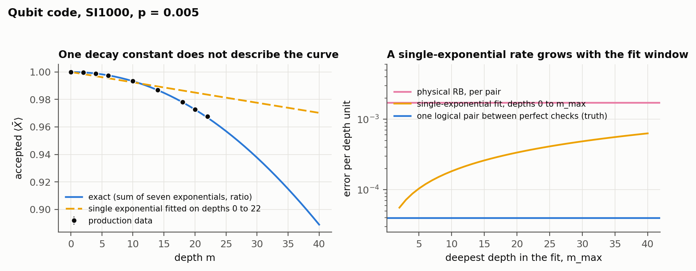
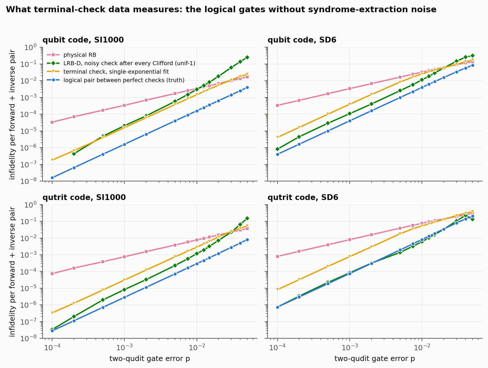
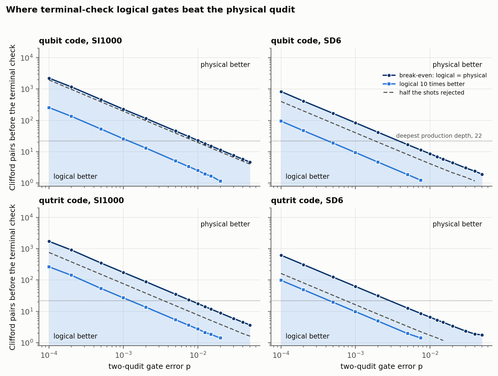
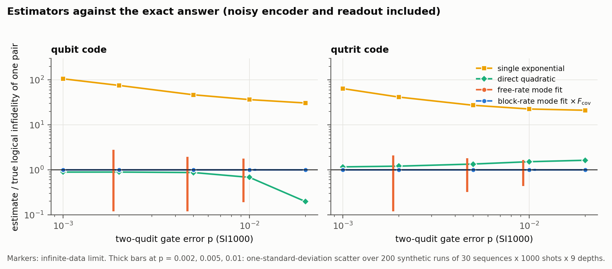
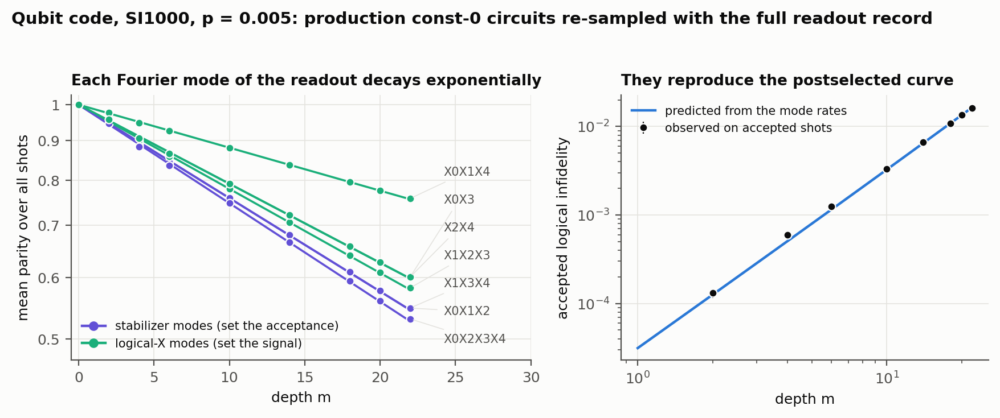
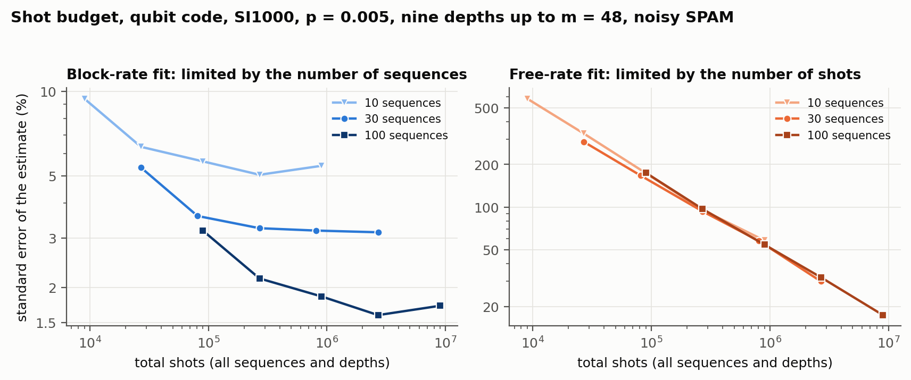
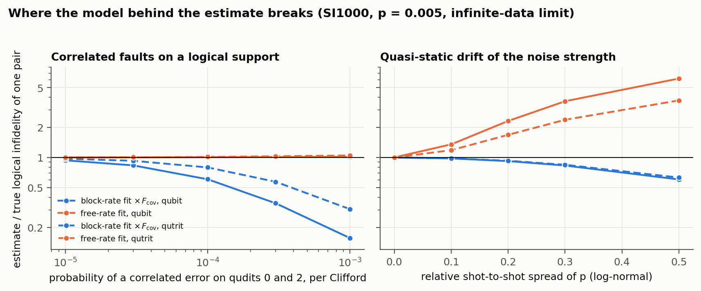

# A logical gate fidelity from terminal-check LRB-D

Written 2026-11-09 for the folded [[5,1,2]] code, qubit and qutrit, under SI1000 and SD6 in sdim 1.4.0. Everything referenced here is in this folder. Section 9 lists the scripts and runtimes. Every fit includes depth m = 0. Uncertainties are one standard error from a bootstrap over the random Clifford sequences. Nothing is committed, and no run folder or file under `src/` was touched.

## The answer

**Yes, terminal-check data gives a logical gate fidelity, but not through a decay fit of the postselected curve.**

The accepted ⟨X̄⟩ has no decay constant. Without intermediate checks the accepted logical infidelity grows as the square of the depth, ε(m) ≈ α m + β m² with β four to eleven times α, because a logical error needs two faults and nothing removes the first one before the second arrives (Fig. 1). A single-exponential fit returns a rate that depends on the depth window. On the production depths it overstates the logical infidelity of one Clifford pair by a factor of 6 to 11 with the ideal SPAM of the simulations (Table A, Fig. 2), and by 4 to over 100 once the encoder and readout are noisy (Table B).

What does work is to stop postselecting before fitting. Keep all five X-basis readouts of every shot, reduce them to the two stabilizer values and the logical value, and Fourier-transform that eight-outcome histogram (27 outcomes for the qutrit). Each Fourier mode is the plain, unpostselected expectation value of one X-type operator, and each decays as an ordinary exponential with SPAM in its amplitude (Fig. 3). The postselected curve is a known ratio of sums of these modes. The mode rates alone give two SPAM-free numbers:

- **ε_L**, the logical infidelity of one depth unit (a Clifford and its mirror inverse) between a perfect preparation and a perfect check. Per single Clifford it is ε_L/4.
- **d_L**, the fraction of shots that one depth unit rejects.

I validated two fits of the mode rates against exact ground truth.

| fit | what it assumes | bias in simulation | statistical error |
|---|---|---|---|
| block rates, times F_cov (recommended) | errors on different data qudits are independent and stationary | below 1% for p ≤ 0.01, both codes, both noise models, mirror or compiled closing, any depth grid, with noisy encoder and readout | 2 to 5% with 30 sequences and 2.4e5 to 2.7e5 shots; set by the number of sequences, not shots |
| free rates (cross-check) | exponential mode decays only | below 2.5% | 93% at 2.7e5 shots, 30% at 2.7e6, 17% at 9e6 (qubit, p = 0.005) |

F_cov is a factor of 1.26 (qubit) or 1.12 (qutrit) under SI1000 that accounts for Cliffords of unequal length (Section 4.2). It comes from simulating the compiled Clifford set and barely moves with p or the noise model.

Applied to the production const-0 circuits, re-sampled with the full record, the block fit gives 3.95(17)e-5 for the qubit code under SI1000 at p = 0.005. The exact value is 3.96e-5. The production fit model gives 3.8e-4 on the same circuits (Table E).

**What the number means, and what it does not.**

- It is the infidelity of the logical gates with an ideal check after them, averaged over the logical Clifford group. The terminal check reads the data qudits directly and uses no ancilla, so it has no syndrome-extraction circuit. Its only noise is readout error, which is SPAM and drops out of the rates. ε_L is therefore the complete circuit-level figure for the gates in this protocol. It is a different quantity from the unif-1 rate, which also contains the noisy ancilla checks. For p between 0.001 and 0.01 under SI1000 it sits 3 to 19 times below the unif-1 rate of the same code and 21 to 267 times below physical RB. Under SD6 it is within a factor of 3 of unif-1 and 8 to 106 times below physical RB (Table A, Fig. 7).
- Without intermediate checks that advantage is spent as the circuit grows. N unchecked Cliffords have logical infidelity close to (ε_L/4) N², so the gain over the physical qudit falls as one over the depth. One pair beats the physical pair at every p simulated, up to 0.05. The exact break-even depth is 46 pairs for the qubit code at SI1000 p = 0.005, and it scales as 1/p. The logical circuit wins while (pairs before the check) × p is below 0.23 (qubit, SI1000), 0.084 (qubit, SD6), 0.18 (qutrit, SI1000) or 0.063 (qutrit, SD6). Section 3.1 and Fig. 8 give the full map.
- The block fit assumes independent, stationary errors. It cannot see a correlated error between the pair q2-q3 and one of q0, q1, q4, which is a logical fault at first order. Three of the five Garnet couplers in the terminal-check embedding join such qudits, so their idle crosstalk is the main hardware risk (Section 6). It also under-reports by 8% if the noise strength wanders by 20% from shot to shot. In both cases the free fit is unbiased or errs high, so the two fits bracket the truth.

**For the IQM run.** About 100 random sequences, 8 or 9 depths from 0 to the depth where the acceptance has fallen to roughly 1/e of its depth-0 value, 300 shots per circuit. That is 2.7e5 shots and gives the block estimate of ε_L to about 2% statistically. Store all five readouts of every shot, not pass/fail. The free fit, which is the only part of the analysis that sees correlated logical faults, needs about 3e6 shots for a 30% standard error at p = 0.005. I would plan for that budget if the device allows it.

**Open questions for you** (Section 8): qubit or qutrit operation on Garnet, how SWAP_{2,3} is realized, idle crosstalk on three couplers, readout symmetrization, and whether the hardware sequences keep the mirror inverse.

---

## 1. The protocol, verified from code and files

`01_protocol_and_engine_check.py` recovers every sequence's Clifford words from the run's own LRB files, rebuilds each const-0 circuit from them, and compares it with `experiments/LRB_const0`. For all four one-ancilla production runs, 540 of 540 compared files are byte-identical to the rebuild (30 sequences, 9 depths, 2 values of p). The facts below follow from that match and from a scan of all files.

1. **const-0 is its own circuit family with no check rounds.** `generate_lrb_const0_clifford_sequence` ([circuit_generator.py:1249](../../src/lrb/circuit_generator.py)) builds it separately from the uniform-interval circuits. No gate ever acts on the four ancilla wires, and nothing is measured or reset before the terminal readout. Each circuit has exactly five measurements. The ancilla wires only receive idle noise, which no detector sees.
2. **The uniform-interval circuits are different.** `generate_lrb_clifford_sequence` (same file, line 1144) puts a noisy check round after every forward Clifford for every k. Those are not what Garnet can run. const-0 is, apart from SPAM.
3. **Depth.** Depth m is the m forward Cliffords followed by their token-wise mirror inverses, 2m noisy Cliffords. const-0 uses the same words as the LRB circuits of that sequence. Depth 0 has no noise at all, so its acceptance and ⟨X̄⟩ are exactly 1.
4. **Ideal parts.** The seven-gate encoder of |+⟩_L and the terminal readout (H_INV and M on the five data qudits, [code_definitions.py:507](../../src/lrb/code_definitions.py)) carry no noise. On hardware both are noisy. I added noisy versions in my own builder (`tclib.build_circuit`, generator's SI1000/SD6 rules on data resets, encoder, basis change and measurement) for the validation in Sections 4 to 6.
5. **Noisy parts.** Every primitive gate of the 2m logical Cliffords, scheduled per Clifford. SI1000 puts p on the q2-q3 gate of S̄ and H̄ and p/10 on one-qudit gates and idles. SD6 puts p on all of them.
6. **The check.** The two X-type stabilizers and X̄ are evaluated classically from the five X-basis readouts. A shot is kept if both stabilizer values are 0. The Z-type stabilizers are not checked, and X-type errors present at the end do not matter.
7. **What the stored tallies keep.** `progress/
/const_check_data/0.npy` holds accepted shots by logical value and `0_rejected.npy` the rejected count. Which stabilizer fired is not stored. The analysis below needs it, so `06_production_resample.py` re-samples the production circuits with sdim's sampler and keeps the full record, writing only to this folder.

The exact engine used for everything else rests on one more check. sdim's DEM of a const-0 circuit has two detectors and one observable, and each noise gate adds a uniformly random element of a subgroup of Z_d³. The outcome distribution is then a product in Fourier space and needs no sampling (`tclib.CircuitChars`). Against the production tallies its z-scores have means between -0.06 and 0.04 and standard deviations between 0.92 and 1.03 over about 720 circuits per run, for the acceptance and for the accepted error count.

## 2. Why the decay is not exponential, exactly

### 2.1 Seven modes for the qubit, thirteen for the qutrit

Each shot gives o = (s1, s2, l), the two stabilizer values and the logical value. Its Fourier modes are

    χ_k(m) = mean over all shots of ω^(k·o),   k in Z_d³, ω = exp(2πi/d).

Mode k is the expectation value of the X-type operator S1^k1 S2^k2 X̄^k3 at the end of the circuit, taken over all shots with no postselection. For the qubit these are seven operators.

| family | operator | error blocks it touches |
|---|---|---|
| stabilizer (S) | X0X1X2 | 0, 1, pair 2-3 |
| stabilizer (S) | X1X3X4 | 1, 4, pair 2-3 |
| stabilizer (S) | X0X2X3X4 | 0, 4, pair 2-3 |
| logical (L) | X0X3 | 0, pair 2-3 |
| logical (L) | X1X2X3 | 1, pair 2-3 |
| logical (L) | X0X1X4 | 0, 1, 4 |
| logical (L) | X2X4 | 4, pair 2-3 |

The qutrit has 26 non-trivial modes in 13 conjugate pairs.

The acceptance and the accepted polarization are exact combinations of the modes:

    A(m)      = [1 + Σ_{k in S} χ_k(m)] / d²
    ⟨X̄⟩_acc(m) = Σ_{k in L} χ_k(m) / [1 + Σ_{k in S} χ_k(m)]

For a fixed sequence under Pauli noise, each χ_k is a product of one factor per noisy Clifford. Averaged over random sequences it is a single exponential to the accuracy that matters here, χ_k(m) = B_k exp(-γ_k m). That is standard RB applied to one Pauli expectation value, and nothing in it is conditioned on a syndrome. The postselected curve is a ratio of sums of exponentials with different rates. That is the multi-exponential, "non-Markovian" shape, and it needs no memory in the noise.

### 2.2 The blocks, and why the infidelity is quadratic

The logical gates act on data qudits 0, 1 and 4 with one-qudit gates only, and couple qudits 2 and 3 to each other. So an error stays on qudit 0, on qudit 1, on qudit 4, or inside the pair 2-3 for the whole circuit. With noise that is independent between these four blocks, every mode rate is a sum of block rates, γ_k = Σ g_b over the blocks the operator touches. The qubit has 6 block rates for 7 modes, the qutrit 7 for 13.

Two consequences, both checked in `02b_exact_checks.py`.

- **First-order cancellation.** The rates of the logical modes and of the stabilizer modes have the same sum. This is the statement that no single fault is an accepted logical error. The accepted infidelity of one pair scales as p² down to p = 1e-6.
- **Quadratic growth.** Expanding the ratio gives ε(m) = α m + β m² + O(m³). An accepted logical error is a logical-Z representative, Z0Z2, Z3Z4, Z0Z1Z4 or Z1Z2Z3, so it needs errors in two blocks. Each block's error probability grows linearly in m, so their coincidence grows as m². β is that coincidence at the mean rates. α is the extra coincidence inside one depth unit, present because a long Clifford puts more errors on every block at once.

The curve leaves the m² law when the acceptance approaches 1/d² and the infidelity approaches (d-1)/d (Fig. 1). The mode model stays exact there.

### 2.3 The quantity to report

Dropping the amplitudes B_k removes SPAM, as in RB. The rates then define, for n depth units between a perfect preparation and a perfect check,

    Λ(n)   = Σ_{k in L} exp(-γ_k n) / [1 + Σ_{k in S} exp(-γ_k n)]
    ε_L(n) = (d-1)/d · [1 - Λ(n)]
    d_L    = 1 - [1 + Σ_{k in S} exp(-γ_k)] / d²

I report ε_L = ε_L(1) and d_L. The prefactor is the same one the pipeline uses to turn f into an error rate, so ε_L compares directly with the physical RB rate per pair.

The exact reference is computed independently of any fit. `tcsteps.StepModel` tabulates the exact factor of every Clifford in every frame (6 frames by 24 Cliffords for the qubit, 24 by 216 for the qutrit) and averages one mirror pair, or one Clifford, between ideal preparation and ideal check over the whole catalog. One mirror pair has 4.0 times the infidelity of one Clifford (3.98 to 4.08 across the four configurations), which is the N² law at N = 1 and 2.

## 3. The terminal-check decay across p, noise model and code

`02_characterize.py`, exact, no sampling. Table A lists four values of p. The CSV has all fourteen.

### Table A. What the terminal check measures (exact)

| code | noise | p | logical pair, truth | coincidence part | F_cov | discard per pair | physical RB per pair | RB / logical | break-even depth | unif-1 per pair (noisy checks) | single-exp fit of const-0 |
|---|---|---|---|---|---|---|---|---|---|---|---|
| qutrit | SI1000 | 0.001 | 2.8e-6 | 2.5e-6 | 1.12 | 1.0% | 7.6e-4 | 267 | 301 | 8.3e-6 | 3.1e-5 |
| qutrit | SI1000 | 0.002 | 1.1e-5 | 1.0e-5 | 1.12 | 1.9% | 1.5e-3 | 135 | 152 | 3.3e-5 | 1.2e-4 |
| qutrit | SI1000 | 0.005 | 7.2e-5 | 6.4e-5 | 1.12 | 4.7% | 3.8e-3 | 53 | 60 | 2.3e-4 | 7.4e-4 |
| qutrit | SI1000 | 0.01 | 2.9e-4 | 2.6e-4 | 1.12 | 9.2% | 7.6e-3 | 26 | 29 | 1.2e-3 | 2.8e-3 |
| qutrit | SD6 | 0.001 | 7.5e-5 | 6.8e-5 | 1.11 | 4.4% | 8.0e-3 | 106 | 118 | 8.3e-5 | 7.8e-4 |
| qutrit | SD6 | 0.002 | 3.0e-4 | 2.7e-4 | 1.11 | 8.6% | 1.6e-2 | 52 | 58 | 3.2e-4 | 3.0e-3 |
| qutrit | SD6 | 0.005 | 2.0e-3 | 1.8e-3 | 1.10 | 19.9% | 3.9e-2 | 20 | 22 | 1.4e-3 | 1.8e-2 |
| qutrit | SD6 | 0.01 | 8.1e-3 | 7.5e-3 | 1.09 | 34.9% | 7.6e-2 | 9 | 10 | 6.1e-3 | 5.3e-2 |
| qubit | SI1000 | 0.001 | 1.6e-6 | 1.3e-6 | 1.26 | 0.4% | 3.4e-4 | 214 | 270 | 2.0e-5 | 1.6e-5 |
| qubit | SI1000 | 0.002 | 6.3e-6 | 5.0e-6 | 1.26 | 0.8% | 6.9e-4 | 109 | 138 | 8.0e-5 | 6.2e-5 |
| qubit | SI1000 | 0.005 | 4.0e-5 | 3.1e-5 | 1.26 | 2.1% | 1.7e-3 | 43 | 54 | 5.8e-4 | 3.8e-4 |
| qubit | SI1000 | 0.01 | 1.6e-4 | 1.3e-4 | 1.26 | 4.1% | 3.4e-3 | 21 | 27 | 3.0e-3 | 1.4e-3 |
| qubit | SD6 | 0.001 | 4.0e-5 | 3.3e-5 | 1.21 | 2.0% | 3.4e-3 | 84 | 102 | 1.1e-4 | 3.9e-4 |
| qubit | SD6 | 0.002 | 1.6e-4 | 1.3e-4 | 1.21 | 4.0% | 6.7e-3 | 42 | 51 | 4.0e-4 | 1.5e-3 |
| qubit | SD6 | 0.005 | 1.0e-3 | 8.3e-4 | 1.21 | 9.5% | 1.7e-2 | 17 | 20 | 2.6e-3 | 8.4e-3 |
| qubit | SD6 | 0.01 | 4.0e-3 | 3.3e-3 | 1.20 | 17.6% | 3.3e-2 | 8 | 10 | 1.1e-2 | 2.6e-2 |

"Logical pair, truth" is ε_L. "Coincidence part" is what the block fit converges to. "Physical RB" and "unif-1" are the official per-pair rates in each run's `unif-1-lrb-vs-rb-table-mixed-fits.csv`. "Break-even depth" is r_RB divided by the coincidence part, a low-order estimate. The exact crossing is about 17% lower for the qubit and 45% lower for the qutrit, and is in Section 3.1. The last column is the production fit model b f^m applied to exact const-0 data on depths 0 to 22.

What sets the shape:

- **Scaling with p.** ε_L is 1.58 p² for the qubit and 2.83 p² for the qutrit under SI1000, and 40 p² and 75 p² under SD6. The factor of 25 between the noise models is the square of the factor of 5 in faults per Clifford. The qutrit is 1.8 to 1.9 times worse than the qubit. Its Cliffords are twice as long (5.17 tokens against 2.54), which alone would give a factor of 4, so something offsets half of it. I did not separate the contributions.
- **How far from one exponential.** A single-exponential fit through m = 0 on the production depths has χ²/dof of 2,000 or more for p ≥ 0.001 at 3e7 shots per depth, and returns 6 to 11 times ε_L. The ratio depends on the deepest depth in the fit, as Fig. 2 shows, since a fit over depths up to M returns roughly β times an average depth.
- **The single-exponential rate can mislead in either direction.** For the qubit under SI1000 it lands near the unif-1 rate by accident. It says nothing about the gates.
- **Acceptance.** One pair rejects d_L of the shots, 2.1% for the qubit at SI1000 p = 0.005, and the acceptance decays close to exponentially until it nears 1/d². At depth 22 and p = 0.005 under SI1000 the qubit terminal check keeps 65.5% of the shots with accepted ⟨X̄⟩ = 0.967. The unif-1 protocol keeps 0.04% with 0.941.

### 3.1 When and where the logical gates beat the physical qudit

`09_logical_vs_physical.py`, exact. The logical side is the accepted infidelity of m Clifford pairs followed by the terminal check, with ideal SPAM. The physical side is (d-1)/d · (1 - f^m), with f from the run's official physical RB rate per pair. Both are averages over the Clifford group, both are free of SPAM, and both carry the same circuit-level noise model. Their ratio, the gain, compares the gates alone.

### Table H. Logical against physical, exact

| code | noise | p | physical, one Clifford | logical, one Clifford then check | gain | gain at 1 / 5 / 10 / 22 pairs | 10 times better up to (pairs) | break-even depth (pairs) | accepted at break-even | half the shots rejected at (pairs) |
|---|---|---|---|---|---|---|---|---|---|---|
| qubit | SI1000 | 0.001 | 1.7e-4 | 4.0e-7 | 427 | 215 / 51 / 26 / 11.8 | 26 | 227 | 46% | 196 |
| qubit | SI1000 | 0.002 | 3.5e-4 | 1.6e-6 | 218 | 110 / 26 / 13.1 / 5.9 | 13 | 116 | 45% | 98 |
| qubit | SI1000 | 0.005 | 8.6e-4 | 9.9e-6 | 86 | 44 / 10 / 5.0 / 2.2 | 5 | 46 | 46% | 39 |
| qubit | SI1000 | 0.01 | 1.7e-3 | 4.0e-5 | 43 | 22 / 5 / 2.4 / 1.0 | 3 | 23 | 46% | 20 |
| qubit | SD6 | 0.001 | 1.7e-3 | 1.0e-5 | 169 | 87 / 19 / 9.4 / 4.0 | 9 | 84 | 33% | 40 |
| qubit | SD6 | 0.002 | 3.3e-3 | 4.0e-5 | 84 | 43 / 9 / 4.4 / 1.8 | 5 | 42 | 33% | 20 |
| qubit | SD6 | 0.005 | 8.3e-3 | 2.5e-4 | 33 | 17 / 3 / 1.6 / 0.9 | 2 | 17 | 33% | 8 |
| qubit | SD6 | 0.01 | 1.6e-2 | 1.0e-3 | 16 | 8 / 2 / 0.9 / 0.8 | none | 9 | 33% | 4 |
| qutrit | SI1000 | 0.001 | 3.8e-4 | 7.1e-7 | 535 | 267 / 58 / 29 / 12.5 | 27 | 174 | 24% | 76 |
| qutrit | SI1000 | 0.002 | 7.7e-4 | 2.8e-6 | 271 | 135 / 29 / 13.9 / 5.8 | 14 | 88 | 24% | 38 |
| qutrit | SI1000 | 0.005 | 1.9e-3 | 1.8e-5 | 107 | 53 / 11 / 4.9 / 1.8 | 5 | 35 | 24% | 15 |
| qutrit | SI1000 | 0.01 | 3.8e-3 | 7.2e-5 | 53 | 26 / 5 / 2.1 / 0.8 | 3 | 18 | 24% | 8 |
| qutrit | SD6 | 0.001 | 4.0e-3 | 1.9e-5 | 213 | 106 / 21 / 9.7 / 3.6 | 10 | 62 | 15% | 16 |
| qutrit | SD6 | 0.002 | 7.9e-3 | 7.5e-5 | 105 | 52 / 10 / 4.1 / 1.4 | 5 | 31 | 15% | 8 |
| qutrit | SD6 | 0.005 | 1.9e-2 | 4.8e-4 | 41 | 20 / 3 / 1.3 / 0.8 | 2 | 13 | 15% | 3 |
| qutrit | SD6 | 0.01 | 3.8e-2 | 2.0e-3 | 19 | 9 / 1 / 0.8 / 0.9 | none | 7 | 15% | 2 |

"Physical, one Clifford" is half the official RB rate per pair. "Logical, one Clifford then check" is the exact average over the whole Clifford catalog and all frames of one Clifford between a perfect preparation and a perfect check. All fourteen values of p are in `results/logical_vs_physical.csv`.

What the table says:

- **One gate.** A single logical Clifford followed by the check beats the physical Clifford at every p simulated. The gain is 0.43/p for the qubit and 0.53/p for the qutrit under SI1000, and 0.17/p and 0.21/p under SD6. One pair still wins at p = 0.05, by a factor of 4 under SI1000 and 1.5 under SD6.
- **Depth.** The gain falls roughly as one over the number of Cliffords before the check, because the logical infidelity is quadratic in that number and the physical one is linear.
- **Break-even.** The break-even depth times p is constant for p ≤ 0.01: 0.23 pairs (qubit, SI1000), 0.084 (qubit, SD6), 0.18 (qutrit, SI1000), 0.063 (qutrit, SD6). A tenfold gain holds up to 0.026/p pairs under SI1000 and 0.010/p under SD6, for both codes.
- **Cost.** The fraction of shots accepted at break-even does not depend on p. It is 46% and 33% for the qubit under SI1000 and SD6, and 24% and 15% for the qutrit.
- **The production depths.** At depth 22 the terminal-check circuit beats the physical qudit for p below about 0.010 (qubit, SI1000), 0.008 (qutrit, SI1000), 0.004 (qubit, SD6) and 0.003 (qutrit, SD6).

## 4. Estimators, validated against the exact answer

All estimators are in `tcfit.py`. The hardware-facing entry point is `tcfit.analyze`, with `tcfit.record_to_outcome` to turn five readouts into an outcome index. `08_analyze_example.py` runs it end to end.

### 4.1 The four candidates

1. **Single exponential** b f^m on the accepted polarization. This is the production model, kept as the reference for what not to do.
2. **Direct quadratic.** Fit ε_acc(m) = c0 + c1 m + c2 m² on the accepted shots, using depths where the acceptance is at least half its depth-0 value. c2 estimates β. SPAM enters c0 and c1.
3. **Mode fit, free rates.** Joint multinomial maximum likelihood for χ_k(m) = B_k exp(-γ_k m), one rate and one amplitude per mode. Then ε_L and d_L from the rates.
4. **Mode fit, block rates.** The same fit with γ_k restricted to sums of block rates, amplitudes still free. This forces α = 0, so it returns the coincidence part. Multiply by F_cov to get ε_L.

### 4.2 What F_cov is

The block fit sees coincidences at the mean error rates. The average over single Cliffords is larger, because a Clifford with more gates has more errors on both qudits of a logical support at once. The ratio is F_cov = 1 + α/β. It is a property of how the Clifford set is compiled. In simulation it is 1.26 to 1.27 for the qubit under SI1000 for every p up to 0.02, 1.20 to 1.21 under SD6, and 1.12 and 1.09 to 1.11 for the qutrit. The crude rule E[ℓ²]/E[ℓ]² over the number of tokens ℓ per Clifford gives 1.19 and 1.12. For hardware I would compute it by running `tcref.reference` on the compiled gate set with a noise model close to the device. The spread between SI1000 and SD6, 4%, is a fair uncertainty to carry.

### 4.3 Bias with infinite data

`03_estimator_bias.py` hands each estimator the exact sequence-averaged distribution, with the noisy encoder and readout included, for p from 0.001 to 0.01.

### Table B. Estimate over truth, exact data, noisy SPAM

| code | noise | closing | depth grid | single exp | direct c2 | free fit | block fit × F_cov |
|---|---|---|---|---|---|---|---|
| qubit | SI1000 | mirror | designed | 37 to 106 | 0.68 to 0.89 | 1.001 to 1.002 | 1.000 |
| qubit | SI1000 | mirror | production | 32 to 37 | 0.73 to 0.91 | 1.001 to 1.005 | 1.000 |
| qubit | SI1000 | compiled | designed | 73 to 136 | 0.70 to 0.89 | 1.004 to 1.008 | 1.000 to 1.001 |
| qubit | SD6 | mirror | designed | 5 to 21 | 0.86 to 0.91 | 0.993 to 1.001 | 1.000 to 1.001 |
| qubit | SD6 | mirror | production | 9 to 13 | 0.84 to 0.91 | 0.994 to 0.998 | 0.999 to 1.003 |
| qubit | SD6 | compiled | designed | 10 to 42 | 0.86 to 0.92 | 1.005 to 1.019 | 1.000 to 1.006 |
| qutrit | SI1000 | mirror | designed | 23 to 64 | 1.17 to 1.52 | 1.001 to 1.003 | 1.000 |
| qutrit | SI1000 | mirror | production | 25 to 33 | 1.02 to 1.50 | 1.001 to 1.002 | 1.000 |
| qutrit | SI1000 | compiled | designed | 46 to 126 | 1.16 to 1.55 | 1.009 to 1.021 | 0.999 to 1.000 |
| qutrit | SD6 | mirror | designed | 4 to 11 | 1.10 to 1.17 | 1.000 to 1.002 | 0.999 |
| qutrit | SD6 | mirror | production | 8 to 13 | 1.12 to 1.12 | 1.000 to 1.002 | 0.998 to 0.999 |
| qutrit | SD6 | compiled | designed | 7 to 21 | 1.11 to 1.30 | 1.010 to 1.018 | 0.998 to 1.000 |

"Designed" is the grid of Section 5, which reaches deeper than the production depths at small p. That is why the single-exponential column is larger there. For the compiled closing the depth coordinate is the number of noisy Cliffords, 0 at depth 0 and m + 1 otherwise, and the unit is one Clifford.

The two mode fits recover the truth with the noisy encoder and readout in the data. The block column is exact by construction of F_cov at the reference grid, so its content is that the answer does not move with the depth grid, the closing or SPAM. The direct quadratic is off by up to 50% because the polynomial stops being valid once the acceptance drops, and I do not recommend it.

### 4.4 On the production circuits

`06_production_resample.py` samples the production const-0 .chp files with sdim, 1M shots per circuit, keeping (s1, s2, l).

### Table E. Production const-0 circuits, full record, 30 sequences × 1M shots

| code | noise | p | truth (all sequences) | block fit × F_cov | free fit | single-exponential fit | discard per pair, fit / truth |
|---|---|---|---|---|---|---|---|
| qutrit | SI1000 | 0.001 | 2.83e-6 | 2.83e-6 ± 9e-8 | 2.88e-6 ± 2e-7 | 3.11e-5 ± 1e-6 | 0.97% ± 0.02% / 0.96% |
| qutrit | SI1000 | 0.005 | 7.16e-5 | 7.17e-5 ± 2e-6 | 7.25e-5 ± 4e-6 | 7.54e-4 ± 3e-5 | 4.72% ± 0.07% / 4.71% |
| qutrit | SD6 | 0.001 | 7.52e-5 | 7.14e-5 ± 2e-6 | 6.98e-5 ± 3e-6 | 7.10e-4 ± 3e-5 | 4.33% ± 0.05% / 4.44% |
| qutrit | SD6 | 0.005 | 1.95e-3 | 1.78e-3 ± 7e-5 | 1.80e-3 ± 1e-4 | 1.63e-2 ± 8e-4 | 19.13% ± 0.34% / 19.89% |
| qubit | SI1000 | 0.001 | 1.58e-6 | 1.58e-6 ± 6e-8 | 1.50e-6 ± 1e-7 | 1.54e-5 ± 8e-7 | 0.42% ± 0.01% / 0.42% |
| qubit | SI1000 | 0.005 | 3.96e-5 | 3.95e-5 ± 2e-6 | 3.90e-5 ± 2e-6 | 3.78e-4 ± 2e-5 | 2.08% ± 0.05% / 2.07% |
| qubit | SD6 | 0.001 | 4.00e-5 | 3.80e-5 ± 2e-6 | 3.91e-5 ± 2e-6 | 3.78e-4 ± 2e-5 | 1.97% ± 0.04% / 2.02% |
| qubit | SD6 | 0.005 | 9.98e-4 | 9.55e-4 ± 5e-5 | 9.47e-4 ± 7e-5 | 8.08e-3 ± 5e-4 | 9.31% ± 0.22% / 9.49% |

The SD6 rows sit about two standard errors low, in ε_L and in the discard rate alike. I checked that this is the draw of sequences and not the estimator. With no shot noise, the 30 production SD6 sequences of the qutrit run give a coincidence part 1.6 standard deviations below the mean of random 30-sequence sets, and those of the qubit run 1.1 below. With 2.7e8 shots the free fit is tight too, and the two fits agree.

## 5. Finite shots, and what an IQM run needs

`04_finite_shots.py` generates 200 synthetic experiments per row, with random sequences, the noisy encoder and readout, and multinomial shots, and compares each estimate with the exact reference.

### 5.1 Depth grid

`tcref.design_depths` takes the discard per depth unit and returns depths 0, 1 and about seven more, spaced as (j/7)^1.5, up to m_max ≈ 1/d_L, where the acceptance has fallen to roughly 1/e of its depth-0 value.

| code | p (SI1000) | mirror grid | acceptance at m = 0 and at m_max, noisy SPAM |
|---|---|---|---|
| qubit | 0.002 | 0, 1, 6, 18, 33, 51, 72, 94, 119 | 0.93, 0.43 |
| qubit | 0.005 | 0, 1, 3, 7, 13, 21, 29, 38, 48 | 0.84, 0.41 |
| qubit | 0.01 | 0, 1, 4, 7, 11, 15, 20, 25 | 0.71, 0.37 |
| qutrit | 0.002 | 0, 1, 3, 8, 15, 22, 31, 41, 52 | 0.93, 0.38 |
| qutrit | 0.005 | 0, 1, 3, 6, 9, 13, 17, 21 | 0.84, 0.34 |
| qutrit | 0.01 | 0, 1, 2, 3, 5, 7, 9, 11 | 0.70, 0.29 |

On hardware d_L is not known in advance. A pilot of a few sequences at three depths fixes it. The choice is forgiving. Half the reach costs a factor 1.4 in standard error, and the production depths 0 to 22 work too (Table D).

### 5.2 Standard error

### Table C. SI1000, mirror closing, nested sequences, designed grid, noisy SPAM

| code | p | sequences | shots per circuit | total shots | block fit, mean / reference | block fit SE | bootstrap SE | free fit, mean / truth | free fit SE |
|---|---|---|---|---|---|---|---|---|---|
| qubit | 0.002 | 30 | 100 | 2.7e4 | 1.000 | 4.0% | | 1.80 | 640% |
| qubit | 0.002 | 30 | 1000 | 2.7e5 | 0.999 | 2.1% | 2.3% | 1.08 | 170% |
| qubit | 0.002 | 100 | 1000 | 9.0e5 | 1.000 | 1.2% | | 1.04 | 95% |
| qubit | 0.002 | 100 | 10000 | 9.0e6 | 1.000 | 1.1% | | 1.02 | 30% |
| qubit | 0.005 | 10 | 1000 | 9.0e4 | 0.996 | 5.6% | | 1.13 | 173% |
| qubit | 0.005 | 30 | 100 | 2.7e4 | 1.007 | 5.4% | | 1.09 | 288% |
| qubit | 0.005 | 30 | 1000 | 2.7e5 | 0.998 | 3.3% | 3.2% | 1.01 | 93% |
| qubit | 0.005 | 30 | 10000 | 2.7e6 | 1.001 | 3.1% | | 0.96 | 30% |
| qubit | 0.005 | 100 | 100 | 9.0e4 | 1.001 | 3.2% | | 1.17 | 174% |
| qubit | 0.005 | 100 | 1000 | 9.0e5 | 0.998 | 1.9% | | 0.96 | 54% |
| qubit | 0.005 | 100 | 10000 | 9.0e6 | 1.000 | 1.7% | | 1.00 | 17% |
| qubit | 0.01 | 30 | 100 | 2.4e4 | 1.001 | 8.0% | | 1.06 | 252% |
| qubit | 0.01 | 30 | 1000 | 2.4e5 | 1.001 | 4.7% | 4.6% | 0.99 | 80% |
| qubit | 0.01 | 100 | 1000 | 8.0e5 | 1.001 | 2.6% | | 0.98 | 44% |
| qubit | 0.01 | 100 | 10000 | 8.0e6 | 1.000 | 2.3% | | 1.00 | 14% |
| qutrit | 0.005 | 30 | 100 | 2.4e4 | 0.998 | 5.5% | | 1.28 | 257% |
| qutrit | 0.005 | 30 | 1000 | 2.4e5 | 1.003 | 3.4% | 3.3% | 1.07 | 74% |
| qutrit | 0.005 | 100 | 1000 | 8.0e5 | 1.000 | 1.7% | | 1.01 | 41% |
| qutrit | 0.005 | 100 | 10000 | 8.0e6 | 1.000 | 1.8% | | 0.99 | 13% |
| qutrit | 0.01 | 30 | 1000 | 2.4e5 | 1.002 | 4.7% | 4.6% | 1.05 | 61% |
| qutrit | 0.01 | 100 | 1000 | 8.0e5 | 0.999 | 2.7% | | 0.97 | 35% |

The full grid of 90 rows is in `results/tables.md`.

Three things follow.

- **The block fit is limited by sequences.** Its error stops improving beyond a few hundred shots per circuit and falls as one over the square root of the number of sequences. Sequences differ in how many gates they contain, and that scatter is the floor. Thirty sequences give 3.3% at p = 0.005, a hundred give 1.9%.
- **The sequence bootstrap is calibrated.** It returns 3.2% where the true scatter is 3.3%, and 4.6% against 4.7%.
- **The free fit is limited by shots.** Its error falls as one over the square root of the total, whatever the number of sequences. It has to resolve the small α inside the first-order cancellation, against a floor of accepted errors that SPAM alone produces (2.3e-3 at depth 0 under SI1000 at p = 0.005).

### Table D. Design variants, 30 sequences × 1000 shots, p = 0.005 SI1000 unless noted

| code | variant | depths (max) | total shots | block fit, mean / reference | block fit SE | free fit SE |
|---|---|---|---|---|---|---|
| qubit | baseline: mirror, nested prefixes, designed grid | 9 (48) | 2.7e5 | 0.998 | 3.3% | 93% |
| qubit | independent sequences at every depth | 9 (48) | 2.7e5 | 1.001 | 1.9% | 101% |
| qubit | compiled recovery Clifford | 9 (96) | 2.7e5 | 1.003 | 2.7% | 212% |
| qubit | production depths 0, 2, ..., 22 | 9 (22) | 2.7e5 | 0.998 | 4.4% | 105% |
| qubit | designed grid, half the reach | 8 (24) | 2.4e5 | 1.001 | 4.8% | 104% |
| qubit | designed grid, twice the reach | 9 (96) | 2.7e5 | 1.005 | 2.7% | 114% |
| qubit | readout flip 20 p instead of 5 p | 9 (48) | 2.7e5 | 1.000 | 3.6% | 254% |
| qubit | SD6, p = 0.002 | 8 (25) | 2.4e5 | 1.002 | 3.7% | 33% |
| qutrit | baseline | 8 (21) | 2.4e5 | 1.003 | 3.4% | 74% |
| qutrit | independent sequences at every depth | 8 (21) | 2.4e5 | 0.998 | 2.2% | 76% |
| qutrit | compiled recovery Clifford | 9 (42) | 2.7e5 | 1.001 | 2.5% | 172% |
| qutrit | production depths 0, 2, ..., 22 | 9 (22) | 2.7e5 | 1.002 | 3.3% | 74% |
| qutrit | readout flip 20 p instead of 5 p | 8 (21) | 2.4e5 | 0.998 | 4.0% | 200% |
| qutrit | SD6, p = 0.002 | 8 (12) | 2.4e5 | 1.009 | 4.9% | 49% |

Drawing a fresh sequence for every depth, instead of nested prefixes, cuts the block fit's error by a factor of 1.5 to 1.7 for the same shots. A readout four times worse leaves the block fit unbiased and costs little. The compiled closing works as well as the mirror one and uses half the gates per depth.

### 5.3 Recommended run

1. 100 random sequences, drawn independently for every depth if the control software allows, otherwise nested.
2. Depths 0, 1 and six or seven more out to m_max ≈ 1/d_L from a pilot.
3. 300 shots per circuit, 2.7e5 shots in all. `08_analyze_example.py` simulates exactly this for the qubit at SI1000 p = 0.005 and returns ε_L = 3.92(7)e-5 against the exact 3.96e-5.
4. Keep every shot's five readouts.
5. Run physical RB with the same closing and depth grid for the baseline.
6. If the shot budget allows 3e6 or more, quote the free fit next to the block fit. Below that the free fit is too noisy to quote, and the paper should then say that correlated logical faults are not bounded by the data.

This assumes Garnet behaves roughly like SI1000 at p of 0.005 to 0.01. I did not use calibration data. If the device is noisier, d_L is larger, the grid is shallower, and the relative errors change little.

## 6. Where it breaks

`05_robustness.py`, SI1000 at p = 0.005, estimates from exact data.

### Table F. A correlated two-qudit error on data qudits 0 and 2 after every Clifford

| code | probability per Clifford | truth / truth without it | block fit × F_cov / truth | free fit / truth | detected at 2σ, 30 sequences × 1000 shots | detected, 30 sequences × 10000 shots |
|---|---|---|---|---|---|---|
| qubit | 1e-5 | 1.07 | 0.94 | 1.00 | 0% | 2% |
| qubit | 3e-5 | 1.21 | 0.83 | 1.01 | 5% | 18% |
| qubit | 1e-4 | 1.69 | 0.61 | 1.01 | 8% | 72% |
| qubit | 3e-4 | 3.06 | 0.35 | 1.01 | 57% | 100% |
| qubit | 1e-3 | 7.87 | 0.16 | 1.02 | 100% | 100% |
| qutrit | 1e-4 | 1.27 | 0.80 | 1.02 | 8% | 17% |
| qutrit | 3e-4 | 1.82 | 0.57 | 1.03 | 17% | 93% |
| qutrit | 1e-3 | 3.72 | 0.30 | 1.05 | 92% | 100% |

Qudits 0 and 2 carry the weight-2 logical Z, so such an error is an accepted logical error at first order. The block model has no parameter for it and misses it. The free fit stays unbiased. Detection uses the free fit's α against its scatter under the null. With 30 sequences × 1000 shots (2.7e5 shots for the qubit) a correlated rate of 3e-4 per Clifford, eight times ε_L, is found about half the time. So at that budget the data bound first-order logical faults only loosely.

Which pairs are dangerous? `05b_correlated_pairs.py` injects the correlated error on each pair of data qudits in turn and differentiates the exact ε_L.

| pair of data qudits | rise of ε_L per unit correlated-error probability per Clifford, qubit | qutrit |
|---|---|---|
| 0-2, 0-3, 2-4, 3-4 | 0.27 | 0.19 |
| 1-2, 1-3 | 0.089 | 0.075 |
| 0-1, 0-4, 1-4, 2-3 | 0 | 0 |

The rule is the block structure of Section 2.2. A correlated error is harmless inside one block, which covers the q2-q3 gate itself, and between blocks 0, 1 and 4. It is a first-order logical fault between the pair 2-3 and any of the other three qudits. In the Garnet embedding of the connectivity note, a 4-cycle q0-q1-q2-q3 with q4 on q2, three of the five couplers are of that kind (q3-q0, q2-q4, q1-q2). The logical gates never drive those couplers, so what matters is their idle crosstalk while the Cliffords run. I have no number for it. If it is not far below ε_L/4 per Clifford, about 1e-5 at p = 0.005, the block fit under-reports and only the free fit shows it.

### Table G. Quasi-static drift, p log-normal between shots with mean 0.005

| code | relative spread | truth / truth without drift | block fit × F_cov / truth | free fit / truth | observed / predicted accepted infidelity at mid depth |
|---|---|---|---|---|---|
| qubit | 0.1 | 1.01 | 0.98 | 1.36 | 1.011 |
| qubit | 0.2 | 1.04 | 0.92 | 2.32 | 1.033 |
| qubit | 0.3 | 1.09 | 0.83 | 3.66 | 1.066 |
| qubit | 0.5 | 1.27 | 0.60 | 6.17 | 1.152 |
| qutrit | 0.2 | 1.04 | 0.93 | 1.69 | 1.028 |
| qutrit | 0.5 | 1.26 | 0.63 | 3.73 | 1.136 |

When the noise strength is common to all qudits within a shot and varies between shots, errors on different qudits are correlated across shots and coincide more often than their mean rates predict. The block fit under-reports, by 8% at a 20% spread. The free fit fails the other way and badly, because mode decays that bend in the log break the first-order cancellation it relies on. The diagnostic that `tcfit.analyze` prints, observed against predicted accepted infidelity per depth, moves by only 3% at a 20% spread, so moderate drift will not announce itself at 3e5 shots.

In both failure modes the block fit is at or below the truth and the free fit is at or above it. I would state the block value as the estimate and, when the shots allow, the free value as the upper side.

Not tested: coherent errors, leakage, and readout with asymmetric assignment errors. The exact engine is a Pauli-noise engine. Mirror circuits can echo coherent errors between a Clifford and its inverse. A five-qubit state-vector simulation would settle it for the qubit code and is the first follow-up I would do before the run.

## 7. How the paper could say it

These are drafts for the paper session, to use only with your OK.

**Method.** "With terminal postselection the accepted ⟨X̄⟩ is not a single exponential in m, and we do not fit one. Every shot returns the two X-stabilizer values and the logical value, (s1, s2, l). The Fourier components of their distribution, χ_k(m) = ⟨ω^(k·(s1,s2,l))⟩, are the expectation values of the X-type operators generated by the two X stabilizers and X̄, taken over all shots. Each decays exponentially, χ_k(m) = B_k exp(-γ_k m), with state-preparation and measurement errors in B_k. The accepted fraction and the accepted ⟨X̄⟩ are ratios of sums of these components, which is why the postselected trace bends. We fit all components jointly, with the rates written as sums over the four groups of data qudits that the logical gates do not couple."

**Definition.** "From the rates we obtain the logical infidelity of one forward-and-inverse Clifford pair between an ideal preparation and an ideal check, ε_L = (d-1)/d · [1 - Σ_{k in L} exp(-γ_k) / (1 + Σ_{k in S} exp(-γ_k))], and the fraction of shots that one pair rejects, d_L."

**Simulation result.** "For the qubit code under SI1000 at p = 5×10⁻³, ε_L = 4.0×10⁻⁵ per pair with d_L = 2.1%, against 1.7×10⁻³ for the physical Clifford pair and 5.8×10⁻⁴ for LRB-D with a noisy check after every Clifford."

**Scaling.** "Without intermediate checks the accepted infidelity grows quadratically in m, so the gain over the physical qudit falls as 1/m. It is lost after 46 pairs for the qubit code under SI1000 at p = 5×10⁻³, where 46% of the shots are still accepted, and the break-even depth scales as 1/p."

**Hardware result, with its bound.** "On Garnet, ε_L = … ± … (one standard error from a bootstrap over sequences) and d_L = … . The estimate treats errors on different data qudits as independent. A fit without that assumption gives … ± … ."

**What the paper should not say.** A fidelity per Clifford from F(m) = A f^m for terminal postselection. The sentence in `results - circuit-level noise.tex` that "the data do not resolve individual modes" also no longer holds once the full readout is kept. The terminal record resolves d³ - 1 of them.

**Units.** ε_L is per pair, like every rate in the paper. One Clifford followed by a check has ε_L/4, not ε_L/2, and I would say so where the number first appears.

## 8. Assumptions that are yours to decide

1. **Qubit or qutrit.** The brief expects the qubit code on Garnet. The draft's method section describes a "20-qutrit IQM Garnet" with transmons run as three-level systems. I analysed both. The method is the same, with 7 modes or 13.
2. **SWAP_{2,3}.** The simulation charges it one two-qudit error p. As three CZs it costs more and d_L rises. As a relabelling it costs nothing. The estimator does not care, but the grid and the comparison with simulation do.
3. **Closing.** I kept the mirror inverse as the default because the paper's simulations use it. The compiled recovery Clifford halves the gates per depth, performs the same in Tables B and D, and avoids mirror echoes of coherent errors. Its depth coordinate must be the number of noisy Cliffords.
4. **Readout.** The simulated readout error is a symmetric flip. Real assignment errors are not symmetric and add small offsets to the modes. Randomizing a known Pauli before the readout and undoing it in software would symmetrize them. Untested here.
5. **F_cov on hardware.** It needs the compiled gate set and rough relative error weights. Tell me the compilation and I can compute it.
6. **Shot budget.** Whether 3e6 shots are available decides if the free fit can be quoted.
7. **Stationarity.** Interleave circuits in random order so slow drift averages over depths.
8. **Idle crosstalk on q3-q0, q2-q4 and q1-q2.** A correlated error there is a first-order logical fault that the block fit misses (Section 6). An independent crosstalk measurement on those couplers, or the 3e6-shot budget for the free fit, would bound it. Do you have calibration data for them?

## 9. Reproduction

Run from this folder with `PYTHONNOUSERSITE=1 ../../.venv-sdim140/bin/python <script>`. Scripts read `src/` and the run folders under `LRB-experiment-data-slurm/` at the repository root, and write only to `results/` and `figures/`. Circuits are built in memory, so the `working-folder*.txt` pointers are never touched.

| file | what it does | runtime here |
|---|---|---|
| `tclib.py` | circuit builder from the generator's own segments, exact Fourier modes of a circuit from sdim's DEM | library |
| `tcexact.py` | cached tables of exact distributions for families of circuits | library |
| `tcsteps.py` | exact per-Clifford factors, frame transfer matrix, ground truths, synthetic experiments | library; first use builds tables in about 1 min |
| `tcfit.py` | the estimators, the sequence bootstrap, `analyze` and `record_to_outcome` | library |
| `tcref.py` | exact reference values, F_cov, depth-grid design | library |
| `01_protocol_and_engine_check.py` | Section 1. Needs `TMPDIR` set to a scratch folder | 4 min |
| `02_characterize.py` | Table A, curves for Figs. 1, 2, 7 | 2 min |
| `02b_exact_checks.py` | checks of Section 2, all pass (`results/02b_exact_checks.log`) | 2 min |
| `03_estimator_bias.py` | Table B | 2 min |
| `04_finite_shots.py` | Tables C, D | 15 min on 16 cores |
| `05_robustness.py` | Tables F, G | 3 min |
| `05b_correlated_pairs.py` | which qudit pairs make a correlated error a first-order logical fault | 1 min |
| `06_production_resample.py` | Table E; samples production circuits read-only | 2 min on 16 cores, then cached |
| `07_tables.py` | prints every table to `results/tables.md` | seconds |
| `08_analyze_example.py` | the recommended analysis on a synthetic run | seconds |
| `09_logical_vs_physical.py` | Table H and Fig. 8, the exact logical-against-physical map | under 2 min |
| `figures.py` | Figs. 1 to 7 | 1 min |

The figures are matplotlib PNGs for this report. Any that goes into the paper has to be redrawn in TikZ in the figures session.

Follow-ups I did not do: a state-vector test of coherent errors, an opt-in pipeline mode that stores the syndrome-resolved const-0 tallies and generates const-0 circuits with noisy encoder and readout in new Run folders, and any change to the paper.
